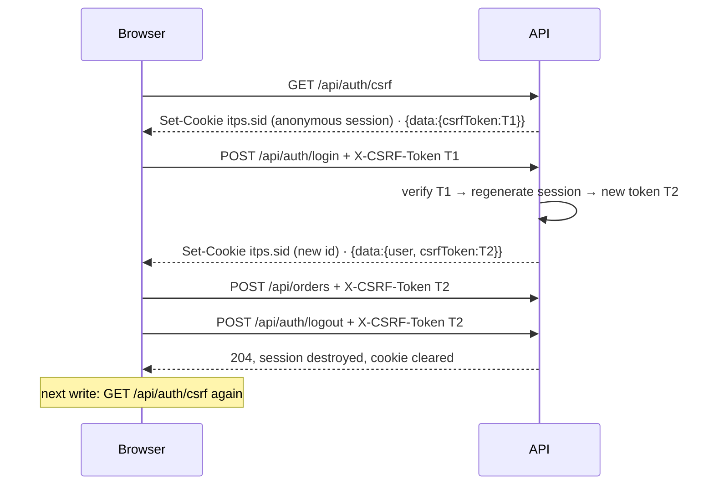

# API Contracts — IT Peripheral Store

Status: Draft v6 (M1-011). Base path `/api`. JSON only. Schemas live in `packages/shared/src/schemas` and are the source of truth; tables below summarise them.

## 1. Conventions

| Topic | Rule |
|---|---|
| Content type | `application/json; charset=utf-8`. Bodies > 100 kb rejected (`413`). |
| Auth | Session cookie `itps.sid` (HttpOnly, Secure in non-local, SameSite=Lax). See [SECURITY_MODEL.md](SECURITY_MODEL.md). |
| CSRF | All state-changing requests (`POST/PUT/PATCH/DELETE`), **including login and register**, require header `X-CSRF-Token` matching the token stored in the current session. Lifecycle in §3.1 and SECURITY_MODEL §3.1. |
| Success envelope | `{ "data": <object|array>, "meta"?: {...} }` |
| Error envelope | `{ "error": { "code": "STRING_CODE", "message": "human text", "details"?: [...], "outcome"?: "ORDER_FOUND" \| "CONFIRMED_NOT_COMMITTED" \| "UNKNOWN", "requestId": "uuid" } }`. `outcome` appears only on `POST /api/orders` and `POST /api/orders/reconcile` and states what is known **about the idempotency key**, not just about this request (§3.3) |
| Money | Integer satang (`priceSatang`, `totalSatang`) within the bounds of DATABASE_DESIGN §1.1. Clients format for display. |
| IDs | 24-hex ObjectId strings; invalid → `400 INVALID_ID` |
| Unknown fields | **Rejected everywhere**: every body, query and params schema, and every nested object, is `.strict()`. Unknown key → `400 VALIDATION_ERROR` with `details[].path` (e.g. `items.0.unitPriceSatang`); no write happens. Nothing is stripped. Server-set fields (`role`, `userId`, prices, totals, `status`, `createdBy`, `deletedAt`, `currency`) count as unknown wherever the client is not allowed to set them. |
| Versioning | Unversioned in v1; breaking changes require `/api/v2` |

### 1.1 Pagination, filtering, sorting

Query: `page` (int ≥ 1, default 1), `limit` (1–50, default 12 public / 20 admin), `sort` from an allowlist.

```json
{ "data": [ ... ], "meta": { "page": 1, "limit": 12, "total": 34, "totalPages": 3 } }
```

Offset pagination is acceptable at this scale (≤ thousands of docs). All filter values are parsed by Zod into primitives before reaching a query, so `?price[$gt]=0` style operator injection is impossible.

### 1.2 Error codes

| HTTP | Code | When |
|---|---|---|
| 400 | `VALIDATION_ERROR` | Zod failure; `details` = `[{path, message}]` |
| 400 | `INVALID_ID` | Bad ObjectId |
| 401 | `UNAUTHENTICATED` | No / expired session |
| 401 | `INVALID_CREDENTIALS` | Wrong email or password (same message for both) |
| 403 | `FORBIDDEN` | Role not allowed or not owner |
| 403 | `CSRF_INVALID` | Missing/wrong CSRF token |
| 404 | `NOT_FOUND` | Resource missing **or** not visible to caller (avoid ID probing) |
| 409 | `EMAIL_TAKEN`, `SKU_TAKEN`, `SLUG_TAKEN` | Unique conflicts |
| 409 | `OUT_OF_STOCK` | `details` = `[{productId, requested, available}]` |
| 409 | `PRODUCT_UNAVAILABLE` | Inactive / deleted product in cart |
| 409 | `INVALID_STATUS_TRANSITION` | Order status rule violated, or a concurrent change won; `details.currentStatus` |
| 409 | `STOCK_CONFLICT` | `expectedRevision` stale, or a `stockAdjust` would go below 0 or above the admin cap 1,000,000; `details.currentStock`, `details.currentRevision` |
| 409 | `CATEGORY_UNAVAILABLE` | Product assigned to an inactive or missing category |
| 409 | `CATEGORY_HAS_ACTIVE_PRODUCTS` | Category delete while active products remain |
| 409 | `PRODUCT_CONFLICT` | Product changed concurrently and the transition couldn't be re-applied within 3 tries; reload and retry |
| 409 | `INVENTORY_LIMIT` | Cancellation would push a product's stock past the int32 hard limit; nothing changed (order keeps its status); `details: [{productId, currentStock, quantity}]`. Recover by lowering stock, then retry (DATABASE_DESIGN §7.4) |
| 422 | `IDEMPOTENCY_KEY_REUSED` | Same idempotency key with a different payload within the replay window |
| 409 | `IDEMPOTENCY_KEY_CLOSED` | The key can't create an order: its order's replay window has ended, or the key was closed by a failed checkout or by reconcile. `outcome: ORDER_FOUND` with `details: { orderNumber, createdAt }`, or `outcome: CONFIRMED_NOT_COMMITTED`. No new order |
| 422 | `ORDER_LIMIT_EXCEEDED` | Order total > 1,000,000,000 satang (BR-15) |
| 423 | `ACCOUNT_LOCKED` | Too many failed logins |
| 429 | `RATE_LIMITED` | Rate limit hit; `Retry-After` header |
| 500 | `INTERNAL_ERROR` | Unexpected; no internals leaked |
| 503 | `CHECKOUT_RETRY` | `outcome: UNKNOWN`. The key's outcome could not be established. It means neither "nothing was ordered" nor "an order exists". `Retry-After` header. Retry the same request with the **same** key, or call `POST /api/orders/reconcile`; never start a new key while the outcome is unknown |

## 2. Endpoint index

| Method | Path | Auth | Purpose | Req |
|---|---|---|---|---|
| GET | `/api/health` | – | Liveness + DB ping (no details) | E |
| GET | `/api/auth/csrf` | – | Create anonymous session if none; return its CSRF token | E |
| POST | `/api/auth/register` | – | Create customer | E01 |
| POST | `/api/auth/login` | – | Start session | B06 |
| POST | `/api/auth/logout` | session | End session | B06 |
| GET | `/api/auth/me` | session | Current user | B05 |
| PATCH | `/api/users/me` | customer/admin | Update own name/phone/addresses | E |
| PATCH | `/api/users/me/password` | customer/admin | Change password | E |
| GET | `/api/categories` | – | Active categories | B04 |
| GET | `/api/products` | – | List/search/filter active products | B03, B04 |
| GET | `/api/products/featured` | – | Featured products for landing | A07 |
| GET | `/api/products/:slug` | – | Product detail | B03 |
| POST | `/api/cart/quote` | – | Price a cart (server prices, stock check) — no persistence | B08 |
| POST | `/api/orders` | customer/admin | Checkout | B08, B09 |
| POST | `/api/orders/reconcile` | customer/admin, **own keys only** | Definitive outcome for one of the caller's idempotency keys; closes the key | B08 |
| GET | `/api/orders` | customer/admin | Caller's own orders only | E02 |
| GET | `/api/orders/:orderNumber` | customer/admin, **owner only** | Own order detail (admins use the admin route for others) | E02 |
| POST | `/api/orders/:orderNumber/cancel` | customer/admin, **owner only**, if `pending` | Cancel own order | E |
| GET | `/api/admin/products` | admin | All products incl. inactive | B07 |
| POST | `/api/admin/products` | admin | Create | B07 |
| GET | `/api/admin/products/:id` | admin | Read | B07 |
| PATCH | `/api/admin/products/:id` | admin | Update | B07 |
| DELETE | `/api/admin/products/:id` | admin | Delete = deactivate (always soft) | B07 |
| GET/POST | `/api/admin/categories` | admin | List / create | E03 |
| PATCH | `/api/admin/categories/:id` | admin | Update name/slug/description/sortOrder (**not** `isActive`) | E03 |
| DELETE | `/api/admin/categories/:id` | admin | Deactivate: the only deactivation path; blocked while active products remain | E03 |
| POST | `/api/admin/categories/:id/reactivate` | admin | Reactivate a category | E03 |
| GET | `/api/admin/orders` | admin | All orders, filter by status | E04 |
| GET | `/api/admin/orders/:orderNumber` | admin | Detail | E04 |
| PATCH | `/api/admin/orders/:orderNumber/status` | admin | Change status | E04 |
| GET | `/api/admin/audit-logs` | admin | Admin action log | E08 |

## 3. Contracts

### 3.1 Auth and CSRF lifecycle (R04)



**GET `/api/auth/csrf`** → `200 { data: { csrfToken } }`. If the request has no valid session, the API creates an anonymous session holding only `{ csrfToken }` (32 random bytes, base64url). Otherwise it returns the existing session's token. The token never changes within one session ID.

**POST `/api/auth/register`**: CSRF required; rate limited (5/hour/IP)

```json
// request
{ "email": "a@example.com", "password": "correct horse battery 9", "name": "A Customer" }
// 201
{ "data": { "user": { "id": "…", "email": "a@example.com", "name": "A Customer", "role": "customer" },
            "csrfToken": "<new token>" } }
```

Rules: email lowercased, ≤ 254; password 10–128 chars, rejected if it is on a small common-password list. `role` is rejected as unknown (strict schema). On success the session is **regenerated** (new ID, new CSRF token, returned in the body; the old token stops working). `409 EMAIL_TAKEN` on duplicate.

**POST `/api/auth/login`**: CSRF required; rate limited (10/15 min per IP+email)

```json
// request
{ "email": "a@example.com", "password": "…" }
// 200
{ "data": { "user": { "id": "…", "email": "a@example.com", "name": "A Customer", "role": "customer" },
            "csrfToken": "<new token>" } }
```

`401 INVALID_CREDENTIALS` (generic message), `423 ACCOUNT_LOCKED` after 5 consecutive failures (15 min lock). The session is regenerated as in register.

**POST `/api/auth/logout`**: CSRF required → `204`. Destroys the server session and clears the cookie. Any later write first needs `GET /api/auth/csrf`.

**GET `/api/auth/me`** → `200 { data: User }` or `401`.

Client rule: keep the CSRF token in memory only, never in `localStorage`. On `403 CSRF_INVALID`, call `GET /api/auth/csrf` once and retry the request once.

### 3.2 Catalog

**GET `/api/products`** (strict query; unknown parameters → `400`)

| Query | Type | Notes |
|---|---|---|
| `q` | string 1–100 | Text search (name, brand, tags, description) |
| `category` | slug | Resolved to a category id (active categories only); unknown slug → empty result |
| `minPrice`, `maxPrice` | int satang 0–10,000,000 | Range |
| `inStock` | `true` | Only `stock > 0` |
| `sort` | `newest` \| `price_asc` \| `price_desc` \| `name_asc` \| `relevance` | `relevance` only with `q` |
| `page`, `limit` | int | See §1.1 |

```json
{
  "data": [
    { "id": "…", "slug": "tkl-mechanical-keyboard-red-switch", "name": "TKL Mechanical Keyboard (Red Switch)",
      "brand": "GenericBrand", "category": { "id": "…", "slug": "keyboards", "name": "Keyboards" },
      "priceSatang": 189000, "currency": "THB", "inStock": true,
      "image": { "url": "/images/products/kb-mech-tkl-01.webp", "alt": "TKL mechanical keyboard" } }
  ],
  "meta": { "page": 1, "limit": 12, "total": 34, "totalPages": 3 }
}
```

`category` is filled in from the categories collection (small and cacheable). List items expose `inStock` (bool), not the exact stock. Inactive products return `404` on the detail route for everyone (admins use `/api/admin/products/:id`).

**GET `/api/products/:slug`** → the full product: adds `description`, `images[]`, `specs[]`, `stock`, `category {id, slug, name}`.

**GET `/api/categories`** → `[{ id, name, slug, description, productCount }]`, where `productCount` = `activeProductCount`.

### 3.3 Cart and checkout

The cart lives in the browser. Prices shown in cart and checkout always come from the server.

**Line normalization (F05, BR-04)** is shared by quote and checkout. First, lines with the same `productId` are summed. Then each merged quantity must be an integer 1–10, and there can be at most 20 distinct products; violations → `400 VALIDATION_ERROR` (`details[].path = "items"`, message names the product). The response always contains merged lines. Example: `[{p1, 6}, {p1, 6}]` → `400` (merged 12); `[{p1, 4}, {p1, 4}]` → one line `{p1, 8}`.

**POST `/api/cart/quote`** (CSRF required, since it is a POST; no persistence)

```json
// request
{ "items": [ { "productId": "6740…720", "quantity": 2 } ] }
// 200
{ "data": {
  "items": [ { "productId": "6740…720", "name": "TKL Mechanical Keyboard (Red Switch)", "unitPriceSatang": 189000,
               "quantity": 2, "lineTotalSatang": 378000, "available": true } ],
  "subtotalSatang": 378000, "shippingFeeSatang": 0, "totalSatang": 378000, "currency": "THB" } }
```

**POST `/api/orders`**: session + CSRF required; rate limited (20/hour/user)

```json
// request
{
  "items": [ { "productId": "6740…720", "quantity": 2 } ],
  "shippingAddress": { "recipient": "A Customer", "line1": "99 Example Rd.", "district": "Pathum Wan",
                       "province": "Bangkok", "postalCode": "10330", "phone": "0800000000" },
  "note": "Please call before delivery",
  "idempotencyKey": "3b0f6c1e-9a4d-4f2b-8c7e-5d1a2b3c4d5e"
}
// 201 (new) or 200 (replay)
{ "data": { "orderNumber": "ORD-20261114-7K2M9Q", "status": "pending", "items": [ … ],
            "subtotalSatang": 378000, "shippingFeeSatang": 0, "totalSatang": 378000, "currency": "THB",
            "createdAt": "2026-11-14T06:10:00Z" } }
```

Schema (strict at every level): `items` normalized as above; `shippingAddress` (strict Address); `note` ≤ 500; `idempotencyKey` **required**, a UUID in canonical form (any version; random v4 recommended). The server treats it as opaque and never reads a timestamp from it (M1-011 F3). Price, total, status and userId fields are rejected.

**Idempotency (F02, BR-14, DATABASE_DESIGN §7.2, M1-011)**

Every checkout response tells the client what is known about the **key**:

| Outcome | Responses that carry it | Client meaning |
|---|---|---|
| `ORDER_FOUND` | `201`, `200` replay, `409 IDEMPOTENCY_KEY_CLOSED` with `orderNumber` | An order exists for this key. Show it. The key is resolved |
| `CONFIRMED_NOT_COMMITTED` | Business errors (`409 OUT_OF_STOCK`, `409 PRODUCT_UNAVAILABLE`, `422 ORDER_LIMIT_EXCEEDED`), `409 IDEMPOTENCY_KEY_CLOSED` without an order | No order exists, and this key can never create one (the server wrote a tombstone first). The key is resolved |
| `UNKNOWN` | `503 CHECKOUT_RETRY`; also any network failure or timeout seen by the client | Not resolved. Retry with the same key and payload, or reconcile |

`400`, `401`, `403` and `429` are returned before any database work. They change nothing, and the key keeps whatever outcome it had before.

| Situation (server time t) | Result |
|---|---|
| Key with no record | Normal checkout → `201`. No age check of any kind |
| Same key, same normalized payload, t < `replayUntil` | Original order → `200` (header `Idempotent-Replay: true`); no stock change |
| Same key, different payload, t < `replayUntil` | `422 IDEMPOTENCY_KEY_REUSED`; no order, no stock change |
| Same key, t ≥ `replayUntil` | `409 IDEMPOTENCY_KEY_CLOSED`, `ORDER_FOUND`, `orderNumber`; **no new order** |
| Key closed by a failed checkout or by reconcile | `409 IDEMPOTENCY_KEY_CLOSED`, `CONFIRMED_NOT_COMMITTED`; **no new order** |
| Concurrent requests with the same key | One commits; the others replay its order (`200`) once it is majority-visible, else `503` (`UNKNOWN`) |
| Business error (stock, availability, limit) | The server first closes the key (fence), then returns the error with `CONFIRMED_NOT_COMMITTED`. If a concurrent same-key request committed first, it returns that order instead. If the fence can't be confirmed → `503`, `UNKNOWN` |
| Commit outcome unknown | The server re-reads the key record (majority) for up to 3 s. Found → `201`/`200`; tombstone → `409 IDEMPOTENCY_KEY_CLOSED`, `CONFIRMED_NOT_COMMITTED`; still absent → `503 CHECKOUT_RETRY`, `UNKNOWN`. Absence is **never** reported as "no order" |
| Retry budget exhausted (conflicts) | `503 CHECKOUT_RETRY`, `UNKNOWN` |

Windows: `replayUntil` = server time recorded inside the creating transaction, before its commit, + 24 h. Key records are kept 30 days; the order keeps its key permanently, so a key never creates a second order even after its record is gone.

Clients (M1-011):
1. **Starting a checkout = explicit authorization.** A key is created only when the user presses "Place order", and only if this user has no unresolved pending checkout. Generate a random UUID. Before sending, store `{ key, request, firstSentAt, outcome: 'UNKNOWN' }` in `localStorage` under `pendingCheckout:v1:<userId>`.
2. **Resolved** (`ORDER_FOUND` or `CONFIRMED_NOT_COMMITTED`, from any response): delete the entry, then show the order, or the error and the cart. The key is never sent again. Any further order needs a new click and a new key.
3. **Unknown** (`503`, a network failure or a timeout): keep the entry. Show "Checking your order…", and retry automatically with the **same** key and **identical** request, with backoff (5 s, 15 s, 60 s, then every 5 min while the page is open). Automatic retries stop 24 h after `firstSentAt`. "Place order" is disabled and no new key is offered while the outcome is unknown.
4. **Reconcile** (`POST /api/orders/reconcile`): on app start with an entry older than 24 h, when automatic retries have stopped, or when the user chooses "Stop and check". `ORDER_FOUND` → show the order and delete the entry. `CONFIRMED_NOT_COMMITTED` → show "No order was placed. Review your cart and place the order again", delete the entry, and only a new click creates a new key. `503 UNKNOWN` → keep the entry and offer "Check again".
5. **Sessions.** The entry is keyed by `userId` and is used only while that user is signed in. If the session expires (`401`), keep the entry and ask the user to sign in. After the **same** user signs in, step 4 runs before checkout is enabled. A different user on the same browser never sees or sends it. Signing out keeps an unresolved entry, because it is the only handle on that order, and the sign-out dialog warns about it. Resolved entries are deleted at once. The entry holds the cart and shipping address but no credentials.


The server-side algorithm, including duplicate-key and uncertain-commit recovery outside the aborted transaction, is in DATABASE_DESIGN §7.2.

Clients generate a new key only for a checkout the user explicitly starts, after any previous key is resolved, and reuse it on network retries and double clicks.

Other errors: `409 OUT_OF_STOCK`, `409 PRODUCT_UNAVAILABLE`, `422 ORDER_LIMIT_EXCEEDED` (each with `outcome: CONFIRMED_NOT_COMMITTED`, because the key was fenced first), `409 IDEMPOTENCY_KEY_CLOSED`, `422 IDEMPOTENCY_KEY_REUSED`, `503 CHECKOUT_RETRY`.

**POST `/api/orders/reconcile`**: session + CSRF required; rate limited (60/hour/user); body strict `{ "idempotencyKey": "<uuid>" }`. It returns the **definitive** outcome for one of the caller's own keys and **closes** the key, so the key can't create an order afterwards (DATABASE_DESIGN §7.2 *Fence*). Use it only to stop and decide; to complete a purchase, retry `POST /api/orders` with the same key instead.

| Result | Response |
|---|---|
| An order exists for `(session user, key)` | `200 { "data": { "outcome": "ORDER_FOUND", "order": OrderSummary } }` |
| No order, and the key is now closed (tombstone majority-acknowledged, or already closed) | `200 { "data": { "outcome": "CONFIRMED_NOT_COMMITTED" } }` |
| Couldn't be established (fence not acknowledged, record not yet majority-visible, timeout) | `503 CHECKOUT_RETRY`, `outcome: UNKNOWN`, `Retry-After`. Calling again is safe |
| No session | `401`; nothing written |
| Missing or invalid CSRF token | `403`; nothing written |

The call is idempotent: once definitive, repeating it returns the same outcome. **Ownership:** the key is always looked up and closed under `session.userId`; there is no user parameter, and admins get no wider access. Another account's key is simply a different `(userId, key)` pair, so the caller gets `CONFIRMED_NOT_COMMITTED` for their **own** namespace and learns nothing about the other account. The other account's record and order are untouched.

**GET `/api/orders`** → the caller's own orders, newest first, paginated; summary fields only. There is **no** `idempotencyKey` filter (an unknown query parameter → `400`). An empty read can't prove that a checkout didn't commit, so outcome checks go through reconcile.
**GET `/api/orders/:orderNumber`** → the caller's own order; `404` for any order the caller doesn't own, **including for admins** (F04).
**POST `/api/orders/:orderNumber/cancel`** (empty strict body) → owner only, only while `pending`. It is a conditional transition (DATABASE_DESIGN §7.4) that restores stock exactly once. It is not blocked by the admin stock cap; only the int32 hard limit can block it (`409 INVENTORY_LIMIT`, nothing changed). `200 { data: Order }`; already cancelled or no longer pending → `409 INVALID_STATUS_TRANSITION { currentStatus }`; not owner → `404`.

### 3.4 Admin

All `/api/admin/*` routes: `requireAuth` → `requireRole('admin')` → CSRF (writes) → strict validation. Every write creates an `auditLogs` entry.

**POST `/api/admin/products`**

```json
{
  "sku": "KB-MECH-TKL-01", "slug": "tkl-mechanical-keyboard-red-switch",
  "name": "TKL Mechanical Keyboard (Red Switch)", "brand": "GenericBrand",
  "description": "87-key tenkeyless mechanical keyboard…", "categoryId": "6740…710",
  "priceSatang": 189000, "compareAtPriceSatang": 219000, "stock": 25,
  "images": [ { "url": "/images/products/kb-mech-tkl-01.webp", "alt": "TKL mechanical keyboard" } ],
  "specs": [ { "key": "Switch", "value": "Linear Red" } ], "tags": ["mechanical"],
  "isActive": true, "isFeatured": false
}
```

→ `201 { data: Product }` (includes `stock` and `inventoryRevision: "0"`). Creation is insert-if-absent by SKU (DATABASE_DESIGN §7.5 `createProduct`). An active product requires an active category, and an inactive one requires an existing category (any state). Nothing is written on any error. `stock` is accepted **only on create** (initial stock, 0–1,000,000). `slug` is generated from the name if omitted. `currency`, `createdBy`, `deletedAt` are server-set and rejected if sent. Errors: `409 SKU_TAKEN | SLUG_TAKEN | CATEGORY_UNAVAILABLE`.

Admin product reads (`GET /api/admin/products`, `/:id`) and every admin product response include `stock` and `inventoryRevision`. `inventoryRevision` is a **decimal string** (it is a 64-bit integer, DATABASE_DESIGN §1.1), e.g. `"7"`; clients echo it back unchanged.

**PATCH `/api/admin/products/:id`**: partial update of the create fields **except `stock`**, plus at most one stock operation (F01, N02, DATABASE_DESIGN §7.1). Every stock change increments `inventoryRevision`:

| Body | Meaning | Conflict |
|---|---|---|
| `{ "stockAdjust": 10 }` | Atomic `+10` (negative to write off); never conflicts with checkout | `409 STOCK_CONFLICT` if the result would be < 0, or > 1,000,000 for an increase |
| `{ "stockSet": 40, "expectedRevision": "7" }` | Absolute count (0–1,000,000), only if no stock mutation happened since the admin read revision 7 | `409 STOCK_CONFLICT { currentStock, currentRevision }` if the revision changed, even when the stock number matches |
| `{ "stock": 40 }` | Not allowed | `400 VALIDATION_ERROR` |

Sending both `stockAdjust` and `stockSet`, or `stockSet` without `expectedRevision` → `400`. `categoryId` and `isActive` may be changed in the same request. The server applies one atomic transition computed from the stored before-state and the resulting after-state (DATABASE_DESIGN §7.5, G03); errors `409 CATEGORY_UNAVAILABLE` (target category inactive or missing) or `409 PRODUCT_CONFLICT`. `isActive: false` alone behaves like DELETE. `expectedRevision` must match `/^\d{1,19}$/`.

**DELETE `/api/admin/products/:id`** (F06, R01): always a soft delete, whether or not the product has orders.

| Case | Response | Resulting state |
|---|---|---|
| Active product | `200 { data: { id, isActive: false, deletedAt } }` | Deactivated; hidden from catalog and checkout; orders unchanged |
| Already inactive | `200`, same body (original `deletedAt`) | Unchanged (idempotent) |
| Unknown id | `404 NOT_FOUND` | — |

**DELETE `/api/admin/categories/:id`**: deactivate if `activeProductCount = 0` → `200 { data: { id, isActive: false, deletedAt } }`. Active products remain → `409 CATEGORY_HAS_ACTIVE_PRODUCTS`. Already inactive → `200`. Unknown → `404`.

**POST `/api/admin/categories`** (strict): `name`, `slug`, `description`, `sortOrder`. New categories are active.

**PATCH `/api/admin/categories/:id`** (strict): `name`, `slug`, `description`, `sortOrder` only. `isActive`, `parentId`, `activeProductCount` and `deletedAt` are rejected with `400 VALIDATION_ERROR`, so deactivation can only happen through DELETE (N06).

**POST `/api/admin/categories/:id/reactivate`** (empty strict body) → `200 { data: Category }`; already active → `200`, unchanged; unknown → `404`. Products in the category stay inactive until each is reactivated (DATABASE_DESIGN §7.5).

**GET `/api/admin/orders`**: query `status`, `q` (orderNumber or customer email), `from`, `to`, paging.

**GET `/api/admin/orders/:orderNumber`** → any order (`404` if it doesn't exist).

**PATCH `/api/admin/orders/:orderNumber/status`**

```json
{ "status": "confirmed", "note": "Stock checked" }
```

Allowed transitions (BR-07): `pending→confirmed|cancelled`, `confirmed→shipped|cancelled`, `shipped→delivered`. They are applied as a conditional write (DATABASE_DESIGN §7.4). Not allowed from the current status, or lost to a concurrent change → `409 INVALID_STATUS_TRANSITION { currentStatus }`. Cancellation restores stock exactly once, or fails atomically with `409 INVENTORY_LIMIT`.

## 4. Authorization matrix (enforced in API, F04)

| Route | Guest | Customer | Admin |
|---|:-:|:-:|:-:|
| `/auth/csrf`, `/auth/register`, `/auth/login`, catalog, `/cart/quote` | ✓ | ✓ | ✓ |
| `/auth/me`, `/auth/logout`, `/users/me*` | 401 | ✓ self | ✓ self |
| `GET /orders`, `POST /orders`, `POST /orders/reconcile` | 401 | ✓ own | ✓ own |
| `GET /orders/:n`, `POST /orders/:n/cancel` | 401 | owner ✓ · other 404 | owner ✓ · other **404** |
| `/admin/orders`, `/admin/orders/:n` | 401 | 403 | ✓ all |
| other `/admin/*` | 401 | 403 | ✓ |

On `/api/orders/*`, ownership is part of the repository filter (`{ orderNumber, userId: session.userId }`) for every role, rather than a fetch followed by a comparison, so a missed check cannot leak data. All-order access exists only on `/api/admin/orders/*`.
