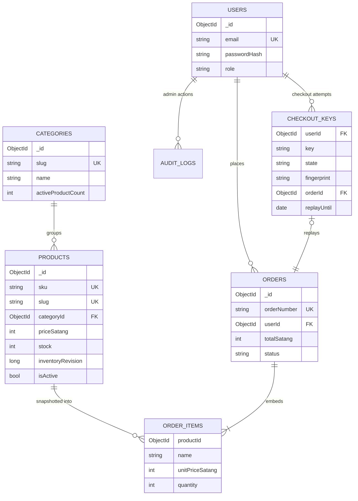

# Database Design — IT Peripheral Store (MongoDB)

Status: Draft v8 (M1-015). Satisfies REQ-B02, B03, B09, B12. Concurrency policies: [ADR-002](../decisions/ADR-002-DATA_CONSISTENCY.md). Business rules referenced as BR-xx are in [SYSTEM_REQUIREMENTS.md](../requirements/SYSTEM_REQUIREMENTS.md#6-business-rules--orders-and-inventory).

## 1. Conventions

| Topic | Rule |
|---|---|
| Database | `itps_<env>` e.g. `itps_dev`, `itps_test`, `itps_prod` |
| Collection names | lower camelCase plural |
| IDs | `_id: ObjectId` |
| Money | Integer **satang** (THB×100), BSON `int` (int32). Field suffix `Satang`. Never `Double`/`Decimal128`/`long` in v1. Bounds in §1.1. |
| Timestamps | `createdAt`, `updatedAt` (`Date`, UTC) via Mongoose `timestamps: true` |
| Strings | Trimmed; length limits enforced by Zod and by `$jsonSchema` |
| Validation | Three layers: strict Zod at the API boundary (primary, unknown keys rejected), Mongoose schemas with `strict: 'throw'` (unknown paths throw instead of being dropped), MongoDB `$jsonSchema` validator `validationLevel: strict` (safety net). |
| Deletes | Products and categories are **never hard-deleted by the application**; delete = `isActive:false` + `deletedAt` (ADR-002 D5, BR-10) |

### 1.1 Numeric types, bounds and arithmetic (R03)

The Node.js driver serializes a JS `number` that is an integer within int32 range as BSON `int`, and any other number as `double`. Every money and stock bound below keeps stored values, including sums, within int32 (max 2,147,483,647). Their validators therefore require `bsonType: "int"`, so a stray double, fraction or overflow fails loudly. The one exception is `inventoryRevision`, a counter that is stored as BSON `long` via Mongoose `BigInt` and validated as `bsonType: "long"`.

| Field | Mongoose type | Bounds | Notes |
|---|---|---|---|
| `products.priceSatang`, `compareAtPriceSatang` | `Number` + `validate: Number.isInteger` | 1 – 10,000,000 (฿100,000) | |
| `products.stock` | `Number` + integer validator | Admin-set: 0 – 1,000,000 (`MAX_ADMIN_STOCK`). Stored: 0 – 2,147,483,647 | Admin operations (create, `stockAdjust` up, `stockSet`) may not raise stock above 1,000,000. Cancellation restores are exempt (§7.4), so stored stock can exceed the admin cap by up to the units in open orders |
| `products.inventoryRevision` | Mongoose `BigInt` → BSON **`long`** (int64) | 0 – 9,223,372,036,854,775,807 | +1 on every stock mutation (§7.1, G04). Always written as `long` (`$inc` with `Long(1)`, insert with `0n`), so it never shares the int32 limit with stock. Lifecycle: starts at 0 on insert, only ever increases, and is never reset or reused for the product's lifetime (the seed never touches it, §8). At 1,000 mutations per second it would take about 292 million years to exhaust. An `$inc` overflow raises a server error, which aborts the transaction like any other failed write (§7.4). Serialized in the API as a **decimal string** (e.g. `"7"`), because JSON numbers can't hold every int64 value exactly |
| `items[].unitPriceSatang` | same | 1 – 10,000,000 | |
| `items[].quantity` | same | 1 – 10 (after merge) | |
| `items[].lineTotalSatang` | same | ≤ 100,000,000 | = unit × qty |
| `subtotalSatang`, `totalSatang` | same | ≤ **1,000,000,000** (BR-15) | checked after each addition; over cap → `422 ORDER_LIMIT_EXCEEDED` |
| `shippingFeeSatang` | same | 0 – 100,000 | |
| Config `SHIPPING_FEE_SATANG`, `FREE_SHIPPING_THRESHOLD_SATANG` | parsed by Zod at startup | 0 – 100,000 and 0 – 1,000,000,000 | invalid config stops startup |
| `categories.activeProductCount` | same | 0 – 1,000,000 | |

Arithmetic rules: compute only in `packages/shared/money.ts` helpers (`mulSatang`, `addSatang`) that assert `Number.isSafeInteger(result)` and the relevant cap, and throw otherwise. No division, percentages or floats in v1. API JSON carries plain integers. Zod: `z.number().int().min(a).max(b)`. Do not use `mongoose.Schema.Types.Int32` or `Long` plugins; plain `Number` plus the validators above is sufficient and matches the driver's int32 serialization.

## 2. Entity relationships



Supporting collections (not part of the four core ones): `checkoutKeys` (durable checkout key registry, F02, M1-013), `systemState` (restore validation gate, DEPLOYMENT_DESIGN §7), `sessions` (managed by `connect-mongo`, TTL) and `auditLogs` (admin actions, REQ-E08).

## 3. Embedding vs referencing

| Relationship | Decision | Reason |
|---|---|---|
| Order → items | **Embed** (`items[]`) | Always read with the order, bounded size (≤ 20, BR-04), must be immutable snapshot (BR-03) |
| Order → shipping address | **Embed** | Snapshot at order time; user may change address later |
| Order → user | **Reference** `userId` + embed `customer.email/name` snapshot | Users change; order lists for admin need name without `$lookup` |
| Product → category | **Reference** `categoryId` only (no copied slug) | Category rename needs no propagation. `?category=<slug>` resolves the slug to an id with one indexed lookup, then filters by `categoryId`. Consistency with category deactivation is coordinated via `categories.activeProductCount` (§7, ADR-002 D9). |
| Product → images | **Embed** `images[]` (URL + alt) | Small, owned by product |
| Product → specs | **Embed** `specs[]` key/value | Varies by peripheral type; avoids per-type collections |
| User → orders | **Not embedded**; query `orders` by `userId` | Unbounded growth |
| User → addresses | Embed up to 5 `addresses[]` | Small, owned by user (engineering, optional for v1) |

## 4. Collections

### 4.1 `users`

**Purpose:** customer and admin accounts, login identity.

| Field | Type | Req | Validation |
|---|---|:-:|---|
| `_id` | ObjectId | ✓ | |
| `email` | string | ✓ | lowercase, trimmed, RFC-ish email, ≤ 254; **unique** |
| `passwordHash` | string | ✓ | Argon2id (or bcrypt cost ≥ 12) encoded hash. Never plaintext; `select: false` |
| `name` | string | ✓ | 1–100 chars |
| `role` | string | ✓ | enum `customer` \| `admin`; default `customer`; **not settable via public API** |
| `phone` | string | | ≤ 20, digits/+/-/space |
| `addresses` | array<Address> | | max 5 |
| `isActive` | bool | ✓ | default `true`. `false` = **disabled** (M1-015): the account can't log in, check out or reconcile. Set only by the `user:disable` maintenance command (§7.7); V1 has no re-enable or delete operation |
| `disabledAt` | Date | | set with `isActive: false` |
| `accountFence` | long | ✓ | default `Long(0)`. Incremented in every checkout, reconcile and disable transaction, so they all write this document and serialize (§7.2, §7.7) |
| `failedLoginCount` | int | ✓ | default 0 |
| `lockedUntil` | Date | | set after repeated failures |
| `lastLoginAt` | Date | | |
| `createdAt`/`updatedAt` | Date | ✓ | |

`Address` = `{ recipient: string(1–100), line1: string(1–200), line2?: string(≤200), district: string, province: string, postalCode: string(/^\d{5}$/), phone: string }`

Indexes:

| Index | Purpose |
|---|---|
| `{ email: 1 }` unique, collation `{locale:'en', strength:2}` | Login lookup; case-insensitive uniqueness |
| `{ role: 1, createdAt: -1 }` | Admin user list (future) |

```json
{
  "_id": { "$oid": "6740a1f2c1a2b3c4d5e6f701" },
  "email": "customer@example.com",
  "passwordHash": "$argon2id$v=19$m=19456,t=2,p=1$<salt>$<hash>",
  "name": "Example Customer",
  "role": "customer",
  "addresses": [
    { "recipient": "Example Customer", "line1": "99 Example Rd.", "district": "Pathum Wan",
      "province": "Bangkok", "postalCode": "10330", "phone": "0800000000" }
  ],
  "isActive": true,
  "accountFence": { "$numberLong": "0" },
  "failedLoginCount": 0,
  "createdAt": { "$date": "2026-11-14T06:00:00Z" },
  "updatedAt": { "$date": "2026-11-14T06:00:00Z" }
}
```

### 4.2 `categories`

**Purpose:** product grouping for navigation and filtering (REQ-B04).

| Field | Type | Req | Validation |
|---|---|:-:|---|
| `name` | string | ✓ | 1–60, unique (case-insensitive) |
| `slug` | string | ✓ | `/^[a-z0-9]+(-[a-z0-9]+)*$/`, ≤ 60, **unique** |
| `description` | string | | ≤ 500 |
| `sortOrder` | int | ✓ | default 0 |
| `isActive` | bool | ✓ | default true |
| `deletedAt` | Date | | set on deactivation |
| `activeProductCount` | int | ✓ | default 0; number of products with `isActive:true` in this category; maintained transactionally (§7.5) |

Categories are **flat** in v1 (no `parentId`), so hierarchy cycles cannot occur; nesting is REQ-F07.

Indexes: `{ slug: 1 }` unique · `{ name: 1 }` unique (collation strength 2) · `{ isActive: 1, sortOrder: 1 }`.

Seed categories (≥ 6): `keyboards`, `mice`, `headsets`, `monitors`, `webcams`, `storage`, `networking`, `accessories`.

```json
{ "_id": { "$oid": "6740a1f2c1a2b3c4d5e6f710" }, "name": "Keyboards", "slug": "keyboards",
  "description": "Mechanical and membrane keyboards", "sortOrder": 1, "isActive": true, "activeProductCount": 6,
  "createdAt": { "$date": "2026-11-14T06:00:00Z" }, "updatedAt": { "$date": "2026-11-14T06:00:00Z" } }
```

### 4.3 `products`

**Purpose:** catalog items (REQ-B02/B03). Minimum 30 seeded documents.

| Field | Type | Req | Validation |
|---|---|:-:|---|
| `sku` | string | ✓ | `/^[A-Z0-9-]{3,32}$/`, **unique** |
| `slug` | string | ✓ | kebab-case ≤ 120, **unique** |
| `name` | string | ✓ | 2–150 |
| `brand` | string | ✓ | 1–60 |
| `description` | string | ✓ | 10–5000, plain text (rendered escaped) |
| `categoryId` | ObjectId → categories | ✓ | must reference an active category, enforced by the conditional category write in §7.5 |
| `priceSatang` | int | ✓ | 1 – 10,000,000 (≤ ฿100,000), §1.1 |
| `compareAtPriceSatang` | int | | > `priceSatang` if set |
| `currency` | string | ✓ | const `THB` |
| `stock` | int | ✓ | ≥ 0; admin cap 1,000,000, stored max int32 (§1.1); changed only by the operations in §7.1 |
| `inventoryRevision` | long | ✓ | 0 on insert; incremented by **every** stock mutation; never reset; required by absolute stock corrections (§7.1) |
| `images` | array<{url, alt}> | ✓ | 1–8; `url` https or `/images/` path ≤ 500; `alt` ≤ 150 |
| `specs` | array<{key, value}> | | ≤ 30; key ≤ 50, value ≤ 200 |
| `tags` | array<string> | | ≤ 10, each ≤ 30 |
| `isActive` | bool | ✓ | default true; `false` = deleted (soft) |
| `deletedAt` | Date | | set when deactivated by DELETE; cleared on reactivation |
| `isFeatured` | bool | ✓ | default false (landing "featured" section) |
| `createdBy`/`updatedBy` | ObjectId → users | | admin who changed it |

Indexes:

| Index | Purpose |
|---|---|
| `{ sku: 1 }` unique | Admin lookup, seed idempotency |
| `{ slug: 1 }` unique | Product page |
| `{ isActive: 1, categoryId: 1, priceSatang: 1 }` | Category filter + price sort/range |
| `{ isActive: 1, createdAt: -1 }` | "Newest" listing |
| `{ isActive: 1, isFeatured: 1 }` | Landing page featured products |
| Text `{ name: 10, brand: 5, tags: 3, description: 1 }`, `default_language: 'none'` | `?q=` search (REQ-B04). `none` avoids English stemming mangling model numbers. |

Atlas Search is a future option (REQ-F06); the native text index is sufficient for v1 and works locally.

```json
{
  "_id": { "$oid": "6740a1f2c1a2b3c4d5e6f720" },
  "sku": "KB-MECH-TKL-01",
  "slug": "tkl-mechanical-keyboard-red-switch",
  "name": "TKL Mechanical Keyboard (Red Switch)",
  "brand": "GenericBrand",
  "description": "87-key tenkeyless mechanical keyboard with linear red switches and USB-C.",
  "categoryId": { "$oid": "6740a1f2c1a2b3c4d5e6f710" },
  "priceSatang": 189000,
  "currency": "THB",
  "stock": 25,
  "inventoryRevision": { "$numberLong": "3" },
  "images": [{ "url": "/images/products/kb-mech-tkl-01.webp", "alt": "TKL mechanical keyboard" }],
  "specs": [{ "key": "Switch", "value": "Linear Red" }, { "key": "Connection", "value": "USB-C wired" }],
  "tags": ["mechanical", "tkl"],
  "isActive": true,
  "isFeatured": true,
  "createdAt": { "$date": "2026-11-14T06:00:00Z" },
  "updatedAt": { "$date": "2026-11-14T06:00:00Z" }
}
```

### 4.4 `orders`

**Purpose:** persisted purchases (REQ-B08/B09) with immutable item snapshots (BR-03).

| Field | Type | Req | Validation |
|---|---|:-:|---|
| `orderNumber` | string | ✓ | `ORD-YYYYMMDD-XXXXXX` (base32 random), **unique** |
| `userId` | ObjectId → users | ✓ | |
| `customer` | {email, name} | ✓ | snapshot |
| `items` | array<OrderItem> | ✓ | 1–20 |
| `shippingAddress` | Address | ✓ | snapshot |
| `subtotalSatang` | int | ✓ | = Σ `lineTotalSatang` (server) |
| `shippingFeeSatang` | int | ✓ | ≥ 0 (BR-09) |
| `totalSatang` | int | ✓ | = subtotal + shipping |
| `currency` | string | ✓ | `THB` |
| `status` | string | ✓ | enum `pending`,`confirmed`,`shipped`,`delivered`,`cancelled` |
| `statusHistory` | array<{status, at, by}> | ✓ | append-only |
| `note` | string | | ≤ 500 customer note |
| `idempotencyKey` | string | ✓ | the checkout's idempotency key (a client UUID, treated as opaque); kept for the order's lifetime so a key can never create a second order (R1, M1-011) |

`OrderItem` = `{ productId: ObjectId, sku: string, name: string, imageUrl: string, unitPriceSatang: int 1–10,000,000, quantity: int 1–10, lineTotalSatang: int }`. `productId` is unique within `items` (lines are merged before insert, BR-04).

Indexes:

| Index | Purpose |
|---|---|
| `{ orderNumber: 1 }` unique | Lookup / display |
| `{ userId: 1, createdAt: -1 }` | "My orders" |
| `{ status: 1, createdAt: -1 }` | Admin order queue |
| `{ "items.productId": 1 }` | Admin report "orders containing product" |
| `{ userId: 1, idempotencyKey: 1 }` unique | Permanent backstop: one order per key, ever, including after the key record is purged (§7.2). Read by `resolveKey` (§7.2) on every definitive checkout answer, after the registry read |

```json
{
  "_id": { "$oid": "6740a1f2c1a2b3c4d5e6f730" },
  "orderNumber": "ORD-20261114-7K2M9Q",
  "userId": { "$oid": "6740a1f2c1a2b3c4d5e6f701" },
  "customer": { "email": "customer@example.com", "name": "Example Customer" },
  "items": [
    { "productId": { "$oid": "6740a1f2c1a2b3c4d5e6f720" }, "sku": "KB-MECH-TKL-01",
      "name": "TKL Mechanical Keyboard (Red Switch)", "imageUrl": "/images/products/kb-mech-tkl-01.webp",
      "unitPriceSatang": 189000, "quantity": 2, "lineTotalSatang": 378000 }
  ],
  "shippingAddress": { "recipient": "Example Customer", "line1": "99 Example Rd.", "district": "Pathum Wan",
    "province": "Bangkok", "postalCode": "10330", "phone": "0800000000" },
  "subtotalSatang": 378000,
  "shippingFeeSatang": 0,
  "totalSatang": 378000,
  "currency": "THB",
  "status": "pending",
  "statusHistory": [{ "status": "pending", "at": { "$date": "2026-11-14T06:10:00Z" }, "by": { "$oid": "6740a1f2c1a2b3c4d5e6f701" } }],
  "createdAt": { "$date": "2026-11-14T06:10:00Z" },
  "updatedAt": { "$date": "2026-11-14T06:10:00Z" }
}
```

### 4.5 Supporting: `checkoutKeys`, `sessions`, `auditLogs`

**`checkoutKeys`**: the durable checkout key registry (F02, ADR-002 D2, M1-011, M1-013). It holds exactly one document per `(userId, key)` and is **insert-only**: no code path updates or deletes a registry document. Accounts are never deleted in V1, and disabling an account doesn't touch the registry.
- A `committed` record is inserted as the first write of the checkout transaction that creates the order. It drives payload-checked replay.
- A `closed` record is inserted by the fence (§7.2). It means the key can never create an order. It does **not** on its own prove that no order exists: every definitive answer also reads `orders` (§7.2 `resolveKey`).

Because the unique index admits only one of the two, a closed record and a new order for the same key can never both commit.

| Field | Type | Req | Validation |
|---|---|:-:|---|
| `userId` | ObjectId → users | ✓ | from the session, never from the request body |
| `key` | string | ✓ | client UUID (any version). Opaque: the server never reads a timestamp from it |
| `state` | string | ✓ | enum `committed`, `closed`. Never changes after insert |
| `fingerprint` | string | `committed` only | hex SHA-256 of canonical JSON of the **normalized** request: items sorted by `productId` with merged quantities, `shippingAddress`, `note` |
| `orderId` | ObjectId → orders | `committed` only | order created with this key |
| `createdAt` | Date | ✓ | **server time** (API server clock) when the record was written: step 2 of the checkout transaction (before its commit), or step 2 of the fence transaction |
| `replayUntil` | Date | `committed` only | `createdAt + 24 h`. Selects the **response type** only (replay vs `409`), and has no effect on whether the key may be reused (it never may) |

Indexes: `{ userId: 1, key: 1 }` unique. There is **no TTL index** and no expiry field. `db:migrate` never creates one, and `db:verify` fails if any TTL index exists on `checkoutKeys` (AC-M12-N2a).

```json
{ "_id": { "$oid": "6740a1f2c1a2b3c4d5e6f740" }, "userId": { "$oid": "6740a1f2c1a2b3c4d5e6f701" },
  "key": "6f1c6d6e-3c1e-4a8e-9b5b-0b9b3d7a2c11", "state": "committed",
  "fingerprint": "9f86d081884c7d659a2feaa0c55ad015a3bf4f1b2b0b822cd15d6c15b0f00a08",
  "orderId": { "$oid": "6740a1f2c1a2b3c4d5e6f730" },
  "createdAt": { "$date": "2026-11-14T06:10:00Z" }, "replayUntil": { "$date": "2026-11-15T06:10:00Z" } }
```

A closed record looks like `{ userId, key, state: "closed", createdAt }`.

**Retention and accounts (M1-013 N2, M1-015 B1).**
- **Guarantee lifetime = the account's lifetime, and V1 never deletes accounts.** Registry records are therefore kept permanently. No cleanup job, TTL or archive step touches them, so no cleanup policy can shorten the guarantee.
- **Size.** About 200 bytes per key. Growth is bounded by the rate limits: 20 checkouts plus 10 reconciles per user per hour (API_CONTRACTS §3.3). That is negligible at coursework scale, and the backup job reports the registry size (DEPLOYMENT_DESIGN §7).
- **Disablement is the only supported account action (V1).** `user:disable` (§7.7) sets `isActive: false` in a transaction that conflicts with every in-flight checkout and reconcile for that user. It **never** deletes or changes `checkoutKeys`, `orders` or other user data.
- **Permanent erasure is out of scope.** Deleting an account, its orders or its registry records is not supported. It would need a separately reviewed protocol covering legal retention of orders, the effect on I1/I2 for that user, backups that still contain the data, and a fencing mechanism equivalent to §7.7. No time delay is accepted as a substitute for that fence.
- **Backups and restores** follow DEPLOYMENT_DESIGN §7. A restore to an older point is outside the registry guarantee; the limitations are listed there.

- `sessions`: managed by `connect-mongo`; `{ _id: sid, expires: Date, session: string }`; TTL index on `expires`.
- `auditLogs`: `{ actorId, action ('product.create' …), entity, entityId, changes (diff, no secrets), ip, requestId, createdAt }`; index `{ entity: 1, entityId: 1, createdAt: -1 }`, TTL 365 days (assumption).

## 5. Server-side validator example

Applied by `database/validators/products.json` during `npm run db:migrate`. Validators for `orders`, `categories` and `checkoutKeys` follow the same pattern with the bounds of §1.1.

```json
{
  "$jsonSchema": {
    "bsonType": "object",
    "required": ["sku","slug","name","brand","description","categoryId","priceSatang","currency","stock","inventoryRevision","images","isActive"],
    "properties": {
      "priceSatang": { "bsonType": "int", "minimum": 1, "maximum": 10000000 },
      "compareAtPriceSatang": { "bsonType": "int", "minimum": 1, "maximum": 10000000 },
      "stock":       { "bsonType": "int", "minimum": 0 },
      "inventoryRevision": { "bsonType": "long", "minimum": 0 },
      "currency":    { "enum": ["THB"] },
      "images":      { "bsonType": "array", "minItems": 1, "maxItems": 8 }
    }
  }
}
```

## 6. Integrity rules mapped to mechanisms

| Constraint | Mechanism |
|---|---|
| Consistent money | Integer satang, BSON `int`, bounds and safe arithmetic per §1.1; Zod `z.number().int().min().max()`; `$jsonSchema` `bsonType: "int"` |
| Order snapshots | Embedded `items[]` copied from product at checkout; orders never re-join products for display |
| Server-calculated totals | `CreateOrder` schema has **no** price fields (`.strict()` rejects them); `OrderService` computes all money |
| No negative stock | All stock writes are conditional (§7.1, §7.2) + validator `minimum: 0` |
| No lost stock updates | Admin stock changes are relative, or preconditioned on `inventoryRevision` (§7.1) |
| Unique email | Unique index (case-insensitive collation) + email lowercased before save; duplicate key → `409 EMAIL_TAKEN` |
| No plaintext passwords | Hash in `AuthService` before insert; `passwordHash` `select:false`; never in responses or logs |
| No hardcoded products | Frontend reads `/api/products`; seed script is the only product source; CI lint rule bans product JSON under `apps/web/src` |
| Orders never reference missing products | No hard delete of products (§7.3) |

## 7. Write paths, transactions and concurrency

MongoDB transactions use snapshot isolation. Two transactions that **write the same document** conflict, and the loser gets a `WriteConflict` error labelled `TransientTransactionError`. Reads take no locks. Every rule below therefore makes competing operations write a shared document (ADR-002).

`session.withTransaction()` retries only on the error labels `TransientTransactionError` (whole transaction) and `UnknownTransactionCommitResult` (commit). **Any other error**, including duplicate key (`E11000`), aborts the transaction and is thrown to the caller. Recovery for those errors happens **outside** the aborted transaction (§7.2). Transactions use read concern `snapshot` and write concern `majority`, must finish within 1 s and at most 20 product updates, and run with driver `maxCommitTimeMS: 5000`.

### 7.1 Stock mutations and inventory revision (F01, N02)

`products.inventoryRevision` is a monotonically increasing 64-bit integer (§1.1). **Every** write that changes `stock` also does `$inc: { inventoryRevision: Long(1) }` (written `1` below for brevity). This includes operational scripts: the only stock writers are the operations in this table, and the seed never updates existing products (§8). So a revision observed by a client identifies one exact inventory state, even if the stock number later returns to the same value.

| Operation | Filter | Update | No match → |
|---|---|---|---|
| Checkout decrement (§7.2) | `{ _id, isActive: true, stock: { $gte: qty } }` | `{ $inc: { stock: -qty, inventoryRevision: 1 } }` | `OUT_OF_STOCK` / `PRODUCT_UNAVAILABLE` |
| Cancellation restore (§7.4) | `{ _id, stock: { $lte: 2147483647 - qty } }` (int32 hard limit only; no admin cap) | `{ $inc: { stock: +qty, inventoryRevision: 1 } }` | Abort the cancellation, `409 INVENTORY_LIMIT` |
| `stockAdjust: n`, n > 0 (restock) | `{ _id, stock: { $lte: 1000000 - n } }` | `{ $inc: { stock: n, inventoryRevision: 1 } }` | `409 STOCK_CONFLICT` (would exceed admin cap) |
| `stockAdjust: n`, n < 0 (write-off) | `{ _id, stock: { $gte: -n } }` | `{ $inc: { stock: n, inventoryRevision: 1 } }` | `409 STOCK_CONFLICT` (would go negative) |
| `stockSet: v, expectedRevision: r` (absolute count, 0 ≤ v ≤ 1,000,000; `r` parsed from its decimal string to `Long`) | `{ _id, inventoryRevision: r }` | `{ $set: { stock: v }, $inc: { inventoryRevision: 1 } }` | `409 STOCK_CONFLICT` with `details.currentStock`, `details.currentRevision` |
| Product create (API or seed insert, §7.5 `createProduct`) | `{ sku }` with `upsert`, `$setOnInsert` only | `stock: initial (0–1,000,000), inventoryRevision: Long(0)` | Existing SKU → nothing written (`409 SKU_TAKEN` via the API; skipped by the seed) |

There is no unconditional stock write and no write that changes `stock` without incrementing the revision. Relative adjustments never conflict with checkout: both are atomic `$inc`, so both changes are kept. An absolute correction succeeds only if **no** stock mutation happened since the admin loaded the product. For example: admin loads (stock 10, rev 5) → sale (7, rev 6) → restock (10, rev 7) → `stockSet` with `expectedRevision: 5` is rejected although stock is 10 again. A missing id → `404`. Each change writes an `auditLogs` entry with before/after stock and revision.

### 7.2 Checkout (F02, F05, R01, N03; key lifecycle M1-011, M1-013)

The request is validated and normalized before any database work (merge duplicates; merged qty 1–10; ≤ 20 products), and its fingerprint is computed. The service pre-generates `orderId` and `orderNumber`.

**Server time** in this section is the API server's UTC clock (NTP-synced), read by the service. Client clocks and any timestamp embedded in the key (e.g. UUID v7) are never used for any decision (M1-011 F3).

**Invariants (M1-013)**

| # | Invariant | Enforced by |
|---|---|---|
| I1 | At most one committed order per `(userId, key)` | Unique `orders {userId, idempotencyKey}` index, plus the unique registry record inserted in the same transaction |
| I2 | A durably closed key never creates an order during its closure lifetime (the account's lifetime) | The `closed` registry record holds the unique `(userId, key)` entry that every checkout transaction must insert, and it is never deleted while the account exists (§4.5) |
| I3 | No false definitive negative while an earlier checkout may still commit | `CONFIRMED_NOT_COMMITTED` requires a majority-committed `closed` record **and** a later majority read of `orders` that finds nothing |
| I4 | An unresolved outcome is never silently converted into a definitive failure | Every error, timeout or ambiguous read that isn't listed as definitive below maps to `UNKNOWN` (`503`) |
| I5 | No checkout or reconcile write commits after the account's disablement commits (M1-015) | Each such transaction first writes the user document conditional on `isActive: true` (step 1), and disablement writes the same document (§7.7, M5) |

**Feasibility under MongoDB semantics (checked before the M1-013 edits).** The design relies only on these documented behaviors:

| | Relied-on behavior |
|---|---|
| M1 | Unique indexes are enforced across concurrent transactional and non-transactional writers. Of two operations inserting the same unique key, at most one commits; the other fails with `E11000` or a `WriteConflict`. |
| M2 | A transaction whose `commitTransaction` was never sent never commits. It is aborted on error, on session end, or at the latest by `transactionLifetimeLimitSeconds` (60 s, §7.6). |
| M3 | A write acknowledged with write concern `majority` survives failover. Read concern `majority` returns only majority-committed data. |
| M4 | A transaction's writes become majority-committed together. Within one causally consistent session, a majority read issued after another majority read observes at least the same state. |
| M5 | Two transactions that write the same document can't both commit: the later writer gets `WriteConflict` (snapshot isolation). Used for account disablement (§7.7). |

**Not** relied on: that a conflicting write waits for an open transaction (it may wait, fail with a conflict, or time out); any particular scheduling order; TTL timing (there is no TTL); and the success of any single attempt.

Conclusion: M1–M5 are sufficient for **safety** (I1–I4, and I5 below). They do not guarantee **liveness**. During failover, write-concern timeouts, persistent conflicts or a transaction left open after a lost `abortTransaction` (up to 60 s), the answer can be `UNKNOWN` until the condition clears. I2 lasts only as long as the registry record exists, which is why the registry is permanent for the account's lifetime (§4.5). A database restore to an earlier point is outside the guarantee (§4.5).

***resolveKey*** `(userId, key)`. Read-only. Both reads use the primary, read concern `majority` and `maxTimeMS: 2000`, in one causally consistent session, and run **in this order**:

1. `r = checkoutKeys.findOne({ userId, key })`
2. `o = orders.findOne({ userId, idempotencyKey: key })`

| Reads | Result |
|---|---|
| Either read fails or times out | `UNKNOWN` |
| `o` exists | `ORDER_FOUND`. If `r` is missing, `closed`, or points to a different `orderId`, the data is inconsistent: log an integrity alert, but still answer `ORDER_FOUND`, because an order exists (N1) |
| No `o`, `r.state = closed` | `CONFIRMED_NOT_COMMITTED` |
| No `o`, `r.state = committed` | `UNKNOWN` plus an integrity alert (a record and its order commit atomically, M4) |
| No `o`, no `r` | `ABSENT`: internal only, **never** reported to a client as a definitive answer |

Why `CONFIRMED_NOT_COMMITTED` is sound: the `closed` record is majority-committed (M3) and permanent (§4.5). Any order for this key must commit together with a registry insert for the same unique entry (M1), so none can commit after it. Any order committed before it is visible to the `orders` read, which runs after the registry read (M4).

**Step 0: pre-check** (outside the transaction) → `resolveKey`:
- `ORDER_FOUND` with a `committed` record, our fingerprint and t < `replayUntil` → *Replay* (`200`).
- Different fingerprint and t < `replayUntil` → `422 IDEMPOTENCY_KEY_REUSED`.
- Any other `ORDER_FOUND` → `409 IDEMPOTENCY_KEY_CLOSED`, outcome `ORDER_FOUND`, with its `orderNumber`.
- `CONFIRMED_NOT_COMMITTED` → `409 IDEMPOTENCY_KEY_CLOSED`, outcome `CONFIRMED_NOT_COMMITTED`.
- `ABSENT` → run the transaction. There is **no key-age check**: whatever its format or embedded time, a key with no record and no order is a new checkout.
- `UNKNOWN` → `503 CHECKOUT_RETRY`, outcome `UNKNOWN`.

**Transaction body** (one attempt)

1. **Account fence (M1-015).** `users.updateOne({ _id: userId, isActive: true }, { $inc: { accountFence: Long(1) } })`. Matched 0 → throw `ACCOUNT_DISABLED` (nothing written). Because this writes the user document, the transaction conflicts with a concurrent disablement (M5): whichever commits first wins, and the other is aborted or sees the new state on retry. No waiting is assumed.
2. Insert `checkoutKeys { userId, key, state: 'committed', fingerprint, orderId, createdAt: t2, replayUntil: t2 + 24 h }`, where t2 is server time at this step. This claims the key's unique entry.
3. Load the products; each must be `isActive: true`, else throw `PRODUCT_UNAVAILABLE`.
4. Apply the checkout decrement of §7.1 per line. Zero matches → re-read to choose between `OUT_OF_STOCK` and `PRODUCT_UNAVAILABLE`, then throw.
5. Compute the money (§1.1) and insert the order with the pre-generated `_id`, `orderNumber` and `idempotencyKey`.

**Attempt states (G01).** Every checkout *attempt* ends in exactly one of three states:

| State | Meaning | Response |
|---|---|---|
| **Committed** | Known to have committed: the driver acknowledged the commit, or `resolveKey` found a record with our `orderId` and its order | `201` new order |
| **Not committed** | `commitTransaction` was never sent for this attempt, so it can never commit (M2) | The next attempt; or a business error **after the fence**; or `503` |
| **Unknown** | `commitTransaction` was sent and its result is unresolved | Bounded `resolveKey` polling (below). **Never** a business error or the fence, and never a fresh attempt within this request |

**Key outcomes (M1-011 F2).** Separately from attempts, every checkout and reconcile response reports the outcome **for the key** in the `outcome` field (API_CONTRACTS §1.1): `ORDER_FOUND`, `CONFIRMED_NOT_COMMITTED` or `UNKNOWN`. The only sources of the first two are `resolveKey` and an acknowledged commit. An empty read never yields `CONFIRMED_NOT_COMMITTED` (`ABSENT` is not an outcome). A `closed` record never yields it without the `orders` read (N1).

***Fence*** `closeKey(userId, key)`. A short transaction (M1-015), with write concern `majority`. At most 3 attempts, backoff 100 ms then 400 ms, overall deadline 5 s:

```
repeat:
  transaction:
    1. users.updateOne({ _id: userId, isActive: true }, { $inc: { accountFence: Long(1) } })
       matched 0 → abort → return ACCOUNT_DISABLED
    2. checkoutKeys.insertOne({ userId, key, state: 'closed', createdAt: t })
  commit acknowledged      → return resolveKey()   // CONFIRMED_NOT_COMMITTED, or ORDER_FOUND (anomaly, alert), or UNKNOWN on read failure
  E11000 at step 2         → abort; x = resolveKey(); if x ∈ {ORDER_FOUND, CONFIRMED_NOT_COMMITTED}: return x
                             // ABSENT/UNKNOWN: the record exists on the primary but isn't majority-visible yet → next attempt
  WriteConflict / TransientTransactionError, or any error before commit was sent
                           → abort; nothing committed (M2); next attempt
  commit result unresolved (UnknownTransactionCommitResult, network error or timeout after commit sent)
                           → x = resolveKey(); if definitive: return x; else next attempt
attempts or deadline exhausted → UNKNOWN
```

Whether the fence waits for an open checkout transaction, fails at once with a conflict, or times out, every branch above is safe. Retrying is harmless: an applied earlier attempt makes step 2 fail with `E11000`. A successful fence followed by a failed read returns `UNKNOWN`; the key is closed regardless, and the next reconcile returns `CONFIRMED_NOT_COMMITTED`. `ACCOUNT_DISABLED` returns no key outcome.

The fence runs in exactly two places: after a business error, and in `POST /api/orders/reconcile` (API_CONTRACTS §3.3). It never runs on a plain retry, so a same-key retry within the window can still complete the purchase.

**Outer control.** This is the service's own loop, not `withTransaction`'s default 120 s retry: at most 3 attempts, 10 s overall deadline (driver `timeoutMS: 10000`), `maxCommitTimeMS: 5000`. Each new attempt repeats step 0 first.

| Result of an attempt | Handling |
|---|---|
| Commit acknowledged (`majority`) | **Committed** → `201`, outcome `ORDER_FOUND` |
| `E11000` on the `checkoutKeys` `{userId,key}` index | Not committed. Another checkout committed the key, or a closed record exists → poll `resolveKey` every 250 ms for up to 3 s: definitive → answer as in step 0; still `ABSENT`/`UNKNOWN` → `503`, `UNKNOWN` |
| `WriteConflict` / `TransientTransactionError` (from any statement, e.g. the registry insert racing a fence or another checkout) | Not committed. Abort; next attempt if the attempts and deadline allow, else `503`, `UNKNOWN`. Concurrent operations are **not** assumed to wait |
| Business error (`OUT_OF_STOCK`, `PRODUCT_UNAVAILABLE`, `ORDER_LIMIT_EXCEEDED`) before commit | Not committed for this attempt. Run the *Fence*. `CONFIRMED_NOT_COMMITTED` → return the business error with that outcome; the key is now closed, so a new checkout needs a new key. `ORDER_FOUND` (a concurrent same-key request committed first) → answer as in step 0. `UNKNOWN` → `503`, `UNKNOWN`. So a business error is never returned while another transaction for the key could still commit |
| `ACCOUNT_DISABLED` thrown at step 1 (the account was disabled, possibly after this request was authenticated) | Not committed; nothing written. → `403 ACCOUNT_DISABLED`, no `outcome`. No fence, no further attempt. A business-error fence that returns `ACCOUNT_DISABLED` is answered the same way |
| `E11000` on `orders.orderNumber` | Not committed: regenerate `orderNumber` and `orderId`, then next attempt |
| `E11000` on `orders {userId, idempotencyKey}` | Not committed. Can't occur while the registry is intact, because step 2 fails first. → `resolveKey` → `ORDER_FOUND` → `409 IDEMPOTENCY_KEY_CLOSED` plus an integrity alert; otherwise `503`, `UNKNOWN` |
| `E11000` on any other index | Not committed: `500 INTERNAL_ERROR` with outcome `UNKNOWN`, logged with the index name; no retry |
| Any other error or timeout **before** `commitTransaction` was sent (statement timeout, network error, `abortTransaction` failing) | Not committed for this attempt (M2). A transaction whose abort was lost may still hold the key's entry until the server aborts it (≤ 60 s). Next attempt if allowed, else `503`, `UNKNOWN` |
| Commit result unresolved (`UnknownTransactionCommitResult` after the driver's same-transaction commit retries, a network error or timeout after the commit was sent, `maxCommitTimeMS` exceeded) | **Unknown** → poll `resolveKey` every 250 ms for up to 3 s. `ORDER_FOUND` with our `orderId` → `201`. Another `ORDER_FOUND` → as in step 0. `CONFIRMED_NOT_COMMITTED` → `409 IDEMPOTENCY_KEY_CLOSED` (our transaction lost the unique entry). Still `ABSENT`/`UNKNOWN` → `503`, `UNKNOWN`, `Retry-After: 5`. No fence, no further attempt |
| Attempts or deadline exhausted | `503 CHECKOUT_RETRY`, outcome `UNKNOWN` |

***Replay***: load the order through `resolveKey` (already done in step 0) and return `200` with `Idempotent-Replay: true` and outcome `ORDER_FOUND`.

**Replay window vs. permanent reuse prevention (M1-011 F3, M1-013 N2)**

| Item | Definition |
|---|---|
| Window start | `createdAt` = server time at step 2, inside the transaction that creates the order. It is recorded **before** the commit and precedes it by the transaction's duration (budget 1 s; hard limit 60 s, §7.6). No commit timestamp is recorded, and none is claimed. |
| Replay window | While server time t < `replayUntil` (= `createdAt` + 24 h): same key and fingerprint → `200` replay; different fingerprint → `422`. Measured from the commit, the window lasts **at least 24 h minus the transaction's duration**. |
| After the window | t ≥ `replayUntil` → `409 IDEMPOTENCY_KEY_CLOSED`, outcome `ORDER_FOUND`. The record stays unchanged. |
| Reuse prevention | **Permanent** for the account's lifetime: committed and closed records are never deleted or changed (§4.5). A delayed request with a closed key, even years later, gets `409 IDEMPOTENCY_KEY_CLOSED`. It can't revive the key, because checkout only inserts and the unique entry is taken. |
| Unused keys | A key with no record has no server-side expiry: the server can't tell an old unused key from a new one, and doesn't try. Clients stop automatic retries 24 h after the first send and use reconcile instead, which closes the key. |
| Clocks | All window arithmetic uses server time. A server clock step shifts a window boundary by the size of the step. Safety (I1–I4) depends on no clock. |

**Guarantees, kept separate**

- **Exactly-once business effect.** At most one order and one set of stock decrements per `(userId, key)`, ever (I1). A client that retries with the same key and payload until it gets a definitive key outcome ends with exactly one order, or a confirmed non-order.
- **Key registry retention.** Permanent: V1 never deletes accounts, and disablement leaves the registry untouched (§4.5).
- **Unknown outcomes.** Reported only as `UNKNOWN` (`503`, or `500` for unexpected index errors). They are resolved only by a same-key retry or by the fence (reconcile), never by time.
- **Client retries.** Same key and identical payload only, automatic for at most 24 h after the first send.
- **New checkout authorization.** A new key only after the previous key has a definitive outcome **and** the user explicitly starts a new checkout (API_CONTRACTS §3.3).

### 7.3 Product and category deactivation (F06, R01, R05, N06)

- **Product delete** (or `PATCH isActive:false`) = `findOneAndUpdate({ _id }, { $set: { isActive: false, deletedAt: now } })` in a transaction that, **if the product was active**, also runs `categories.updateOne({ _id: categoryId }, { $inc: { activeProductCount: -1 } })`. Already inactive → no change, same `200`. No hard delete exists in the API.
- **Category deactivation has exactly one write path**: `DELETE /api/admin/categories/:id` = `findOneAndUpdate({ _id, isActive: true, activeProductCount: 0 }, { $set: { isActive: false, deletedAt: now } })`. No match because of the count → `409 CATEGORY_HAS_ACTIVE_PRODUCTS`. Already inactive → `200`. Category `PATCH` does **not** accept `isActive`; it is rejected as an unknown field.
- **Category reactivation** has its own operation: `POST /api/admin/categories/:id/reactivate` = `updateOne({ _id }, { $set: { isActive: true }, $unset: { deletedAt: 1 } })`, idempotent. Reactivation cannot break an invariant, since an active category with zero products is valid.

### 7.4 Order status transitions and cancellation (R02, N04, N05)

Allowed transitions: `pending→confirmed|cancelled`, `confirmed→shipped|cancelled`, `shipped→delivered`. A customer may only do `pending→cancelled` on their own order.

```
withTransaction:
  order = orders.findOneAndUpdate(
     { orderNumber, status: { $in: allowedFrom(target, actorRole) }, [userId if customer] },
     { $set: { status: target }, $push: { statusHistory: { status: target, at, by } } },
     { returnDocument: 'after' })
  if !order → re-read: missing/not owner → 404; else 409 INVALID_STATUS_TRANSITION {currentStatus}
  if target == 'cancelled':
     for item in order.items:
        res = products.updateOne({ _id: item.productId, stock: { $lte: 2147483647 - item.quantity } },
                                 { $inc: { stock: item.quantity, inventoryRevision: Long(1) } })
        if res.matchedCount == 0 → abort, 409 INVENTORY_LIMIT
```

- **At most one restoration.** Stock is restored only inside the transaction whose conditional status update matched. Two concurrent cancellations both write the order document: one commits, the other's retry no longer matches its filter and returns `409`.
- **Valid serial orderings are allowed.** A concurrent admin confirm and admin cancel on a pending order can legitimately both succeed (`pending→confirmed→cancelled`), because cancel is allowed from `confirmed`. The acceptance tests (AC-R02b) accept every serializable outcome and assert exactly one restoration whenever the final status is `cancelled`.
- **The admin cap never blocks a cancellation (N04).** The restore has no admin-cap condition. The admin cap (1,000,000) applies only to admin increases (§7.1), and stored stock may exceed it by the units being returned. Restoration ignores `isActive`, so inactive products still get their units back.
- **Hard numeric limits can block a cancellation, atomically and recoverably (R02, G04).** There are two hard limits:
  - **Stock (int32, 2,147,483,647).** The restore filter requires `stock <= 2147483647 - quantity`. No match → the transaction aborts, the order keeps its prior status, no unit is restored, discarded or double-counted, and the API returns **`409 INVENTORY_LIMIT`** with `details: [{ productId, currentStock, quantity }]`. Recovery: an admin lowers stock with a negative `stockAdjust` (e.g. after moving units elsewhere), then the cancellation is retried. Reaching this needs over 2.1 billion units on one product, which isn't expected at this project's scale, but the behavior is defined and tested (AC-R02e).
  - **Revision (int64).** Overflow is unreachable (§1.1). If the server ever rejected the `$inc`, the transaction aborts the same way and the API returns `500 INTERNAL_ERROR` (logged). Nothing is reset and no unit is lost. Recovery is a manual data fix by an operator.

  Either way the cancellation is atomic: it fully commits (status, history, every restore and revision) or changes nothing.

### 7.5 Product ↔ category coordination (R05, N06)

Invariant: **every active product references an active category, and each category's `activeProductCount` equals its number of active products.**

| Product write | Category writes in the same transaction | Failure |
|---|---|---|
| Create with `isActive: true` (`createProduct`) | `updateOne({ _id: cat, isActive: true }, { $inc: { activeProductCount: 1 } })`, only if the product was actually inserted | No match → abort (product insert rolled back), `409 CATEGORY_UNAVAILABLE` |
| Create with `isActive: false` (`createProduct`) | Category must exist (`findOne({ _id: cat })`), any state; no counter change | Missing → abort, `409 CATEGORY_UNAVAILABLE` |
| Reactivate (`isActive: true` on an inactive product) | Same as active create, on its current category | Category inactive → `409 CATEGORY_UNAVAILABLE` (product stays inactive) |
| Move an **active** product to another category | `+1` conditional on the new category being active; `-1` on the old | New category inactive → `409 CATEGORY_UNAVAILABLE` |
| Move an **inactive** product | New category must exist (any state); no counter change | Missing → `409` |
| Deactivate / delete product | `-1` on its category if it was active | — |

**Product creation (R2).** Creation is a separate function from updates. It never reads a before-state:

```
createProduct(input, mode)                                   // mode: 'api' | 'seed'
withTransaction:
  res = products.updateOne(
          { sku: input.sku },
          { $setOnInsert: { _id: newId, ...input fields, stock: input.stock, inventoryRevision: Long(0),
                            isActive: input.isActive, categoryId: input.categoryId, deletedAt: null } },
          { upsert: true })
  if res.upsertedCount == 0:                                 // SKU already exists: nothing was written
      mode == 'api'  ⇒ abort, 409 SKU_TAKEN
      mode == 'seed' ⇒ return 'skipped' (existing product untouched, no counter change)
  if input.isActive:
      c = categories.updateOne({ _id: input.categoryId, isActive: true }, { $inc: { activeProductCount: 1 } })
      c.matchedCount == 0 ⇒ abort (the insert is rolled back), 409 CATEGORY_UNAVAILABLE
  else:
      categories.findOne({ _id: input.categoryId }) == null ⇒ abort, 409 CATEGORY_UNAVAILABLE
  return 'created'
errors outside the body:
  E11000 on products.sku  (concurrent create committed first)  ⇒ api: 409 SKU_TAKEN · seed: 'skipped'
  E11000 on products.slug                                      ⇒ api: 409 SLUG_TAKEN · seed: fail with the slug named (seed data bug)
```

Concurrency:
- **Duplicate SKU.** Two concurrent creates with the same SKU both try to insert. The unique `sku` index and the shared write make one commit. The other either sees the committed document on retry (`upsertedCount == 0`) or gets `E11000`; both map to `409 SKU_TAKEN` (seed: skipped). The category counter is incremented only by the transaction that actually inserted.
- **Active create vs category DELETE.** Both write the category document: the create's conditional `+1` (filter `isActive: true`) and the DELETE's conditional deactivation (filter `activeProductCount: 0`). One commits first. Either the product is created and the DELETE returns `409 CATEGORY_HAS_ACTIVE_PRODUCTS`, or the category is deactivated and the create returns `409 CATEGORY_UNAVAILABLE` with no product document left behind.
- **Inactive create vs category DELETE.** Neither changes the counter, and inactive products may reference inactive categories, so both may succeed. The invariant still holds.

**Single transition rule for product updates (G03).** Product PATCH and DELETE (not creation) go through one function, `applyProductTransition(id, requested)`. It runs inside one transaction and derives category effects only from the **persisted before-state** and the **resulting after-state**, never from which fields the request happened to contain:

```
withTransaction:
  before = products.findOne({ _id: id })                     // in-transaction snapshot read
  if before == null ⇒ abort, 404 NOT_FOUND                   // updates never create
  after  = merge(before, requested)                          // categoryId and isActive after the request
  wasActive = before.isActive;            willBeActive = after.isActive
  oldCat = before.categoryId;             newCat = after.categoryId
  if willBeActive and (not wasActive or newCat != oldCat):
      categories.updateOne({ _id: newCat, isActive: true }, { $inc: { activeProductCount: 1 } })  → 0 matched ⇒ 409 CATEGORY_UNAVAILABLE
  if not willBeActive and newCat != oldCat:
      categories.findOne({ _id: newCat })                    → missing ⇒ 409 CATEGORY_UNAVAILABLE
  if wasActive and (not willBeActive or newCat != oldCat):
      categories.updateOne({ _id: oldCat }, { $inc: { activeProductCount: -1 } })
  products.updateOne({ _id, isActive: before.isActive, categoryId: before.categoryId }, { $set: after fields })
      → 0 matched ⇒ concurrent change: throw a transient error so the transaction re-runs from the new before-state (max 3), then 409 PRODUCT_CONFLICT
```

| Before → after | Category writes |
|---|---|
| inactive → active, same category | +1 on category (must be active) |
| inactive → active, moved A → B | +1 on B (must be active); none on A |
| active → inactive, same category | −1 on category |
| active → inactive, moved A → B | −1 on A; B must exist (any state) |
| active → active, moved A → B | +1 on B (must be active); −1 on A |
| active → active, same category | none |
| inactive → inactive, moved A → B | B must exist (any state) |
| inactive → inactive, same category | none |

The per-operation table above is a special case of this rule. Combined changes (e.g. `{ categoryId: B, isActive: true }`) are therefore allowed and handled atomically. A concurrent `DELETE` of B serializes with them because both write B's document. Either the DELETE commits first (the `+1` on B then fails → `409 CATEGORY_UNAVAILABLE`, nothing changes), or it commits after (B's count is now 1, so the DELETE returns `409 CATEGORY_HAS_ACTIVE_PRODUCTS`).

Every path that can increase a category's count writes that category document with the filter `isActive: true`. Category deactivation (§7.3) writes the same document with the filter `activeProductCount: 0`. Concurrent operations therefore conflict and serialize, and neither can commit against a stale view. Inactive products may reference inactive categories; they are hidden from the catalog and must pass the reactivation rule before being sold. Category slug or name changes touch only the category. `npm run db:verify` recomputes the counts and reports drift; CI runs it after the seed and integration tests.

### 7.6 Replica set and Atlas limitations

- Transactions require a **replica set or sharded cluster**. Atlas clusters, including the free **M0**, are 3-node replica sets. A standalone local `mongod` does **not** support transactions, so local development uses the Docker single-node replica set from DEPLOYMENT_DESIGN §2 (or an Atlas dev cluster), and tests use `MongoMemoryReplSet`.
- Atlas **M0/Flex limits** to plan for: shared throughput caps, a connection limit (pool `maxPoolSize: 10`), 512 MB storage on M0, no managed backups on M0 (DEPLOYMENT_DESIGN §7), and some operators such as `$where` and server-side JavaScript are unavailable. Check current Atlas docs at setup time, because tier limits change.
- Default transaction lifetime limit (`transactionLifetimeLimitSeconds`) is 60 s; it must not be raised. Ours are far shorter. The limit bounds how long a transaction with a lost abort can hold a key or the user document (liveness only, §7.2). **No safety property depends on waiting for it**: account disablement is fenced by a document conflict (§7.7), and §7.2 does not assume a conflicting write waits.
- Without transactions the policies above don't hold, so the API refuses to start unless `hello` reports a replica set (`setName` present) with a writable primary.

### 7.7 Account disablement (M1-015 B1)

`npm run user:disable -- --email <address> --reason <text>` is a maintenance command run by an operator; V1 has no API endpoint for it. It runs one transaction with write concern `majority`:

```
users.updateOne({ _id }, { $set: { isActive: false, disabledAt: now }, $inc: { accountFence: Long(1) } })
auditLogs.insertOne({ action: 'user.disable', entityId: _id, reason, ... })
```

- **Fencing, not timing.** Every checkout and reconcile transaction writes the same user document, conditional on `isActive: true` (§7.2 step 1, fence step 1). By M5, a disablement and an overlapping checkout or reconcile can't both commit:
  - Checkout committed first: the order was placed while the account was active, which is allowed.
  - Disablement committed first: the checkout's or reconcile's conditional update matches 0, on its first try or after a `WriteConflict` retry → `ACCOUNT_DISABLED`, and nothing is written.

  This holds whether the second operation waits, conflicts or times out, and it uses no delay.
- **Retries.** At most 5 attempts on `WriteConflict`/`TransientTransactionError`. If the commit result is unresolved → majority read of `isActive`: `false` → done; `true` → retry. If still unresolved after the attempts, the command exits non-zero and the operator reruns it, which is idempotent.
- **Sessions.** `requireAuth` loads the user on every request and destroys the session of a disabled account (`401`). This is a convenience; the transactional fence is the guarantee, including for requests authenticated just before disablement.
- **Read-only answers.** A request authenticated before disablement may still receive a read-only answer about an order that already exists (step 0 replay). No write can commit after the disablement.
- **Never touched.** `checkoutKeys`, `orders`, addresses and audit logs are unchanged. Re-enabling and deletion are out of scope for V1 (§4.5).
- **Other user-document writers** (login counters, `lastLoginAt`, profile edits) can conflict with checkout too. They are short and retried within the same bounds; a persistent conflict ends as `UNKNOWN` (checkout) or a retryable error.

## 8. Seeding and migration

- `npm run db:migrate` → creates the collections, applies validators (`collMod`) and indexes, including the unique `checkoutKeys` index (**no** TTL on `checkoutKeys`, §4.5). It is idempotent and never modifies documents.
- `npm run db:seed` → **insert-only** and repeatable (G02):
  - Categories: `updateOne({ slug }, { $setOnInsert: { name, slug, description, sortOrder, isActive: true, activeProductCount: 0 } }, { upsert: true })`. An existing category is never modified: not its name, activation or counter.
  - Products: each goes through `createProduct(input, 'seed')` (§7.5) in its own transaction, as insert-if-absent by `sku` using `$setOnInsert` only. **Only if the upsert actually inserted** and the product is active does the same transaction `$inc` the category's `activeProductCount`, conditional on the category being active. An existing product's stock, revision, category, activation and every other field are never touched.
  - Admin user: `$setOnInsert` by email from `SEED_ADMIN_EMAIL` / `SEED_ADMIN_PASSWORD` (never hardcoded). An existing user is never modified, including its password and role.
  - There is no `$set` anywhere in the seed. Changing existing seeded data (e.g. a corrected price) requires a reviewed one-off migration that uses the normal service operations (§7.1 for stock).
  - **Safe on a live database**: seed writes are inserts plus conditional counter increments through the §7.5 path, so they serialize with concurrent product, category and checkout operations exactly as API writes do. Two seeds running at once are also safe: the unique `sku`/`slug`/`email` indexes let only one insert win, and the loser's upsert matches the existing document without changing it.
- `npm run db:verify` → read-only check of the §7.5 invariant (each `activeProductCount` equals its active-product count; no active product in an inactive category), the BSON types (`int` for money and stock, `long` for `inventoryRevision`), and `stock ≥ 0`. It exits non-zero on drift. `npm run db:verify -- --repair` fixes counter drift one category at a time, in a transaction that recomputes the count and `$set`s it on the category document. That write conflicts with any concurrent product transition touching the same category, so a repair can't commit a stale count. Repair is a maintenance command and is logged to `auditLogs`.
- `npm run db:fingerprint` → read-only. Computes a SHA-256 over every document of every application collection, ordered by `_id`, using read concern `majority`, plus per-collection counts. It is used by the quiesced backup and the restore validation (DEPLOYMENT_DESIGN §7).
- `npm run db:verify -- --restore` → everything `db:verify` checks, plus the registry/orders invariants:
  - every order has a `committed` `checkoutKeys` record for `(userId, idempotencyKey)` with the same `orderId`;
  - every `committed` record has its order;
  - no `closed` record coexists with an order for the same key;
  - the unique indexes on `checkoutKeys` and `orders` exist, and there is no TTL on `checkoutKeys`;
  - for a dump-based restore, the fingerprint equals the backup manifest.

  Only if every check passes does it set `systemState { _id: 'restore', status: 'validated' }` (write concern `majority`). Otherwise it leaves `pending` and exits non-zero (DEPLOYMENT_DESIGN §7).
- `npm run user:disable` → §7.7.
- `npm run db:reset` → drops and recreates the database, then migrates and seeds. It refuses to run unless `NODE_ENV` is `development` or `test`, `MONGODB_DB_NAME` ends with `_dev` or `_test`, and `--confirm` is passed. It is never run against staging or production, or while the API is serving traffic.
- A CI integration test asserts `products.countDocuments({isActive:true}) >= 30` after seeding (REQ-B02 traceability), and AC-G02 checks that a rerun changes nothing.
