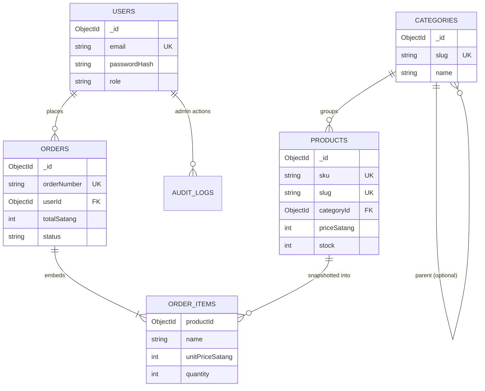

# Database Design — IT Peripheral Store (MongoDB)

Status: Draft v1 (M1-001). Satisfies REQ-B02, B03, B09, B12. Business rules referenced as BR-xx are in [SYSTEM_REQUIREMENTS.md](../requirements/SYSTEM_REQUIREMENTS.md#6-business-rules--orders-and-inventory).

## 1. Conventions

| Topic | Rule |
|---|---|
| Database | `itps_<env>` e.g. `itps_dev`, `itps_test`, `itps_prod` |
| Collection names | lower camelCase plural |
| IDs | `_id: ObjectId` |
| Money | `Int32`/`Int64` **satang** (THB×100). Field suffix `Satang`. Never `Double`/`Decimal128` in v1. |
| Timestamps | `createdAt`, `updatedAt` (`Date`, UTC) via Mongoose `timestamps: true` |
| Strings | Trimmed; length limits enforced by Zod and by `$jsonSchema` |
| Validation | Two layers: Zod at API boundary (primary), MongoDB `$jsonSchema` validator `validationLevel: strict` (safety net). Mongoose `strict: true` drops unknown fields. |
| Deletes | Products and categories use `isActive` soft delete when referenced (BR-10) |

## 2. Entity relationships



Supporting collections (not part of the four core ones): `sessions` (managed by `connect-mongo`, TTL) and `auditLogs` (admin actions, REQ-E08).

## 3. Embedding vs referencing

| Relationship | Decision | Reason |
|---|---|---|
| Order → items | **Embed** (`items[]`) | Always read with the order, bounded size (≤ 20, BR-04), must be immutable snapshot (BR-03) |
| Order → shipping address | **Embed** | Snapshot at order time; user may change address later |
| Order → user | **Reference** `userId` + embed `customer.email/name` snapshot | Users change; order lists for admin need name without `$lookup` |
| Product → category | **Reference** `categoryId` + denormalised `categorySlug` | Category rename/edit must propagate; slug copy enables filter without join. Service updates `categorySlug` on products when a category slug changes (rare, admin-only). |
| Product → images | **Embed** `images[]` (URL + alt) | Small, owned by product |
| Product → specs | **Embed** `specs[]` key/value | Varies by peripheral type; avoids per-type collections |
| User → orders | **Not embedded**; query `orders` by `userId` | Unbounded growth |
| User → addresses | Embed up to 5 `addresses[]` | Small, owned by user (engineering, optional for v1) |

## 4. Collections

### 4.1 `users`

**Purpose:** customer and admin accounts, login identity.

| Field | Type | Req | Validation |
|---|---|:-:|---|
| `_id` | ObjectId | ✓ | |
| `email` | string | ✓ | lowercase, trimmed, RFC-ish email, ≤ 254; **unique** |
| `passwordHash` | string | ✓ | Argon2id (or bcrypt cost ≥ 12) encoded hash. Never plaintext; `select: false` |
| `name` | string | ✓ | 1–100 chars |
| `role` | string | ✓ | enum `customer` \| `admin`; default `customer`; **not settable via public API** |
| `phone` | string | | ≤ 20, digits/+/-/space |
| `addresses` | array<Address> | | max 5 |
| `isActive` | bool | ✓ | default `true`; inactive users cannot log in |
| `failedLoginCount` | int | ✓ | default 0 |
| `lockedUntil` | Date | | set after repeated failures |
| `lastLoginAt` | Date | | |
| `createdAt`/`updatedAt` | Date | ✓ | |

`Address` = `{ recipient: string(1–100), line1: string(1–200), line2?: string(≤200), district: string, province: string, postalCode: string(/^\d{5}$/), phone: string }`

Indexes:

| Index | Purpose |
|---|---|
| `{ email: 1 }` unique, collation `{locale:'en', strength:2}` | Login lookup; case-insensitive uniqueness |
| `{ role: 1, createdAt: -1 }` | Admin user list (future) |

```json
{
  "_id": { "$oid": "6740a1f2c1a2b3c4d5e6f701" },
  "email": "customer@example.com",
  "passwordHash": "$argon2id$v=19$m=19456,t=2,p=1$<salt>$<hash>",
  "name": "Example Customer",
  "role": "customer",
  "addresses": [
    { "recipient": "Example Customer", "line1": "99 Example Rd.", "district": "Pathum Wan",
      "province": "Bangkok", "postalCode": "10330", "phone": "0800000000" }
  ],
  "isActive": true,
  "failedLoginCount": 0,
  "createdAt": { "$date": "2026-11-14T06:00:00Z" },
  "updatedAt": { "$date": "2026-11-14T06:00:00Z" }
}
```

### 4.2 `categories`

**Purpose:** product grouping for navigation and filtering (REQ-B04).

| Field | Type | Req | Validation |
|---|---|:-:|---|
| `name` | string | ✓ | 1–60, unique (case-insensitive) |
| `slug` | string | ✓ | `/^[a-z0-9]+(-[a-z0-9]+)*$/`, ≤ 60, **unique** |
| `description` | string | | ≤ 500 |
| `parentId` | ObjectId → categories | | one level of nesting max (service-enforced) |
| `sortOrder` | int | ✓ | default 0 |
| `isActive` | bool | ✓ | default true |

Indexes: `{ slug: 1 }` unique · `{ name: 1 }` unique (collation strength 2) · `{ isActive: 1, sortOrder: 1 }`.

Seed categories (≥ 6): `keyboards`, `mice`, `headsets`, `monitors`, `webcams`, `storage`, `networking`, `accessories`.

```json
{ "_id": { "$oid": "6740a1f2c1a2b3c4d5e6f710" }, "name": "Keyboards", "slug": "keyboards",
  "description": "Mechanical and membrane keyboards", "sortOrder": 1, "isActive": true,
  "createdAt": { "$date": "2026-11-14T06:00:00Z" }, "updatedAt": { "$date": "2026-11-14T06:00:00Z" } }
```

### 4.3 `products`

**Purpose:** catalog items (REQ-B02/B03). Minimum 30 seeded documents.

| Field | Type | Req | Validation |
|---|---|:-:|---|
| `sku` | string | ✓ | `/^[A-Z0-9-]{3,32}$/`, **unique** |
| `slug` | string | ✓ | kebab-case ≤ 120, **unique** |
| `name` | string | ✓ | 2–150 |
| `brand` | string | ✓ | 1–60 |
| `description` | string | ✓ | 10–5000, plain text (rendered escaped) |
| `categoryId` | ObjectId → categories | ✓ | must reference active category (service check) |
| `categorySlug` | string | ✓ | denormalised copy |
| `priceSatang` | int | ✓ | 0 < x ≤ 10,000,000 (≤ ฿100,000) |
| `compareAtPriceSatang` | int | | > `priceSatang` if set |
| `currency` | string | ✓ | const `THB` |
| `stock` | int | ✓ | **≥ 0** (validator `minimum: 0`) |
| `images` | array<{url, alt}> | ✓ | 1–8; `url` https or `/images/` path ≤ 500; `alt` ≤ 150 |
| `specs` | array<{key, value}> | | ≤ 30; key ≤ 50, value ≤ 200 |
| `tags` | array<string> | | ≤ 10, each ≤ 30 |
| `isActive` | bool | ✓ | default true |
| `isFeatured` | bool | ✓ | default false (landing "featured" section) |
| `createdBy`/`updatedBy` | ObjectId → users | | admin who changed it |

Indexes:

| Index | Purpose |
|---|---|
| `{ sku: 1 }` unique | Admin lookup, seed idempotency |
| `{ slug: 1 }` unique | Product page |
| `{ isActive: 1, categorySlug: 1, priceSatang: 1 }` | Category filter + price sort/range |
| `{ isActive: 1, createdAt: -1 }` | "Newest" listing |
| `{ isActive: 1, isFeatured: 1 }` | Landing page featured products |
| Text `{ name: 10, brand: 5, tags: 3, description: 1 }`, `default_language: 'none'` | `?q=` search (REQ-B04). `none` avoids English stemming mangling model numbers. |

Atlas Search is a future option (REQ-F06); the native text index is sufficient for v1 and works locally.

```json
{
  "_id": { "$oid": "6740a1f2c1a2b3c4d5e6f720" },
  "sku": "KB-MECH-TKL-01",
  "slug": "tkl-mechanical-keyboard-red-switch",
  "name": "TKL Mechanical Keyboard (Red Switch)",
  "brand": "GenericBrand",
  "description": "87-key tenkeyless mechanical keyboard with linear red switches and USB-C.",
  "categoryId": { "$oid": "6740a1f2c1a2b3c4d5e6f710" },
  "categorySlug": "keyboards",
  "priceSatang": 189000,
  "currency": "THB",
  "stock": 25,
  "images": [{ "url": "/images/products/kb-mech-tkl-01.webp", "alt": "TKL mechanical keyboard" }],
  "specs": [{ "key": "Switch", "value": "Linear Red" }, { "key": "Connection", "value": "USB-C wired" }],
  "tags": ["mechanical", "tkl"],
  "isActive": true,
  "isFeatured": true,
  "createdAt": { "$date": "2026-11-14T06:00:00Z" },
  "updatedAt": { "$date": "2026-11-14T06:00:00Z" }
}
```

### 4.4 `orders`

**Purpose:** persisted purchases (REQ-B08/B09) with immutable item snapshots (BR-03).

| Field | Type | Req | Validation |
|---|---|:-:|---|
| `orderNumber` | string | ✓ | `ORD-YYYYMMDD-XXXXXX` (base32 random), **unique** |
| `userId` | ObjectId → users | ✓ | |
| `customer` | {email, name} | ✓ | snapshot |
| `items` | array<OrderItem> | ✓ | 1–20 |
| `shippingAddress` | Address | ✓ | snapshot |
| `subtotalSatang` | int | ✓ | = Σ `lineTotalSatang` (server) |
| `shippingFeeSatang` | int | ✓ | ≥ 0 (BR-09) |
| `totalSatang` | int | ✓ | = subtotal + shipping |
| `currency` | string | ✓ | `THB` |
| `status` | string | ✓ | enum `pending`,`confirmed`,`shipped`,`delivered`,`cancelled` |
| `statusHistory` | array<{status, at, by}> | ✓ | append-only |
| `note` | string | | ≤ 500 customer note |
| `idempotencyKey` | string | | client UUID to prevent double submit |

`OrderItem` = `{ productId: ObjectId, sku: string, name: string, imageUrl: string, unitPriceSatang: int>0, quantity: int 1–10, lineTotalSatang: int }`

Indexes:

| Index | Purpose |
|---|---|
| `{ orderNumber: 1 }` unique | Lookup / display |
| `{ userId: 1, createdAt: -1 }` | "My orders" |
| `{ status: 1, createdAt: -1 }` | Admin order queue |
| `{ "items.productId": 1 }` | BR-10 check "product has orders" |
| `{ userId: 1, idempotencyKey: 1 }` unique, partial (`idempotencyKey` exists) | Double-submit protection |

```json
{
  "_id": { "$oid": "6740a1f2c1a2b3c4d5e6f730" },
  "orderNumber": "ORD-20261114-7K2M9Q",
  "userId": { "$oid": "6740a1f2c1a2b3c4d5e6f701" },
  "customer": { "email": "customer@example.com", "name": "Example Customer" },
  "items": [
    { "productId": { "$oid": "6740a1f2c1a2b3c4d5e6f720" }, "sku": "KB-MECH-TKL-01",
      "name": "TKL Mechanical Keyboard (Red Switch)", "imageUrl": "/images/products/kb-mech-tkl-01.webp",
      "unitPriceSatang": 189000, "quantity": 2, "lineTotalSatang": 378000 }
  ],
  "shippingAddress": { "recipient": "Example Customer", "line1": "99 Example Rd.", "district": "Pathum Wan",
    "province": "Bangkok", "postalCode": "10330", "phone": "0800000000" },
  "subtotalSatang": 378000,
  "shippingFeeSatang": 0,
  "totalSatang": 378000,
  "currency": "THB",
  "status": "pending",
  "statusHistory": [{ "status": "pending", "at": { "$date": "2026-11-14T06:10:00Z" }, "by": { "$oid": "6740a1f2c1a2b3c4d5e6f701" } }],
  "createdAt": { "$date": "2026-11-14T06:10:00Z" },
  "updatedAt": { "$date": "2026-11-14T06:10:00Z" }
}
```

### 4.5 Supporting: `sessions`, `auditLogs`

- `sessions`: managed by `connect-mongo`; `{ _id: sid, expires: Date, session: string }`; TTL index on `expires`.
- `auditLogs`: `{ actorId, action ('product.create' …), entity, entityId, changes (diff, no secrets), ip, requestId, createdAt }`; index `{ entity: 1, entityId: 1, createdAt: -1 }`, TTL 365 days (assumption).

## 5. Server-side validator example

Applied by `database/validators/products.json` during `npm run db:migrate`:

```json
{
  "$jsonSchema": {
    "bsonType": "object",
    "required": ["sku","slug","name","brand","description","categoryId","categorySlug","priceSatang","currency","stock","images","isActive"],
    "properties": {
      "priceSatang": { "bsonType": ["int","long"], "minimum": 1, "maximum": 10000000 },
      "stock":       { "bsonType": ["int","long"], "minimum": 0 },
      "currency":    { "enum": ["THB"] },
      "images":      { "bsonType": "array", "minItems": 1, "maxItems": 8 }
    }
  }
}
```

## 6. Integrity rules mapped to mechanisms

| Constraint | Mechanism |
|---|---|
| Consistent money | Integer satang; Zod `z.number().int().positive()`; `$jsonSchema` `bsonType: int/long` |
| Order snapshots | Embedded `items[]` copied from product at checkout; orders never re-join products for display |
| Server-calculated totals | `CreateOrder` schema has **no** price fields (`.strict()` rejects them); `OrderService` computes all money |
| No negative stock | Conditional `updateOne({_id, isActive:true, stock:{$gte:qty}}, {$inc:{stock:-qty}})` inside a transaction + validator `minimum: 0` |
| Unique email | Unique index (case-insensitive collation) + email lowercased before save; duplicate key → `409 EMAIL_TAKEN` |
| No plaintext passwords | Hash in `AuthService` before insert; `passwordHash` `select:false`; never in responses or logs |
| No hardcoded products | Frontend reads `/api/products`; seed script is the only product source; CI lint rule bans product JSON under `apps/web/src` |

## 7. Transactions and Atlas limitations

- **Checkout** (stock decrement for N products + order insert) and **cancel** (status change + stock restore) use multi-document transactions via `session.withTransaction()`; retry on `TransientTransactionError` / `UnknownTransactionCommitResult` is built into `withTransaction`.
- Transactions require a **replica set or sharded cluster**. Atlas clusters (including the free **M0**) are 3-node replica sets, so transactions work. A standalone local `mongod` does **not** support them: local dev must use Atlas, Docker `mongo --replSet rs0` (single-node replica set), or `mongodb-memory-server` in `MongoMemoryReplSet` mode for tests.
- Atlas **M0/Flex limits** to plan for: shared resources and throughput caps, a maximum number of connections (pool sized small: `maxPoolSize: 10`), 512 MB storage on M0, no dedicated backups on M0 (see Deployment §7), and some features (e.g. certain server-side JavaScript, `$where`) unavailable. Check current Atlas docs at setup time because tier limits change.
- Keep transactions short (< 1 s, ≤ 20 product updates). Default transaction lifetime limit is 60 s.
- Write concern `majority`, read concern `snapshot` inside the checkout transaction.
- Fallback if transactions are ever unavailable: decrement one line at a time with the conditional update and compensate (increment back) on failure. Documented, not implemented in v1.

## 8. Seeding and migration

- `npm run db:seed` → idempotent upsert by `sku`/`slug`: ≥ 8 categories, **≥ 30 products** (spread across categories, realistic generic names, no real trademarks needed), one admin account whose email/password come from `SEED_ADMIN_EMAIL` / `SEED_ADMIN_PASSWORD` env vars (never hardcoded).
- `npm run db:migrate` → applies validators (`collMod`) and indexes.
- CI integration test asserts `products.countDocuments({isActive:true}) >= 30` after seed (REQ-B02 traceability).
