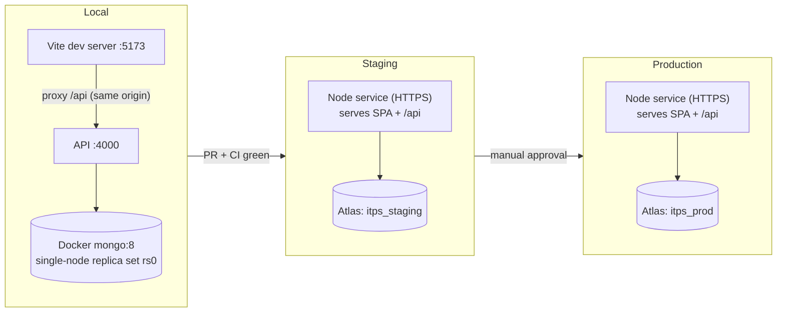
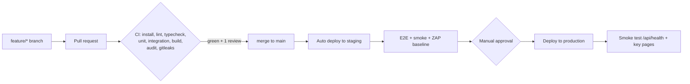

# Deployment Design — IT Peripheral Store

Status: Draft v7 (M1-017). **Design only — nothing is deployed in this task.** Selected topology: **single same-origin Node service** (ADR-001).

## 1. Environments



| | Local | Test / Staging | Production |
|---|---|---|---|
| Purpose | Development | Demo to team/grader, E2E, ZAP scan | Final submission / public |
| Web | Vite dev server, `/api` proxied | `apps/web/dist` served by the API service | Same build artifact as staging |
| API | `npm run dev` (tsx watch) | Node 22 LTS service | Same artifact as staging |
| DB | Docker `mongo:8` single-node replica set (§2) or Atlas dev cluster | Atlas, DB `itps_staging` | Separate Atlas project/cluster, DB `itps_prod` |
| Data | Seed script | Seed script | Seed catalog once; real orders after |
| Cookies | `Secure=false` (http://localhost), `SameSite=Lax` | `Secure=true`, `SameSite=Lax`, `__Host-` | Same as staging |
| Logs | Pretty console | JSON | JSON, retained by host |

CI integration tests use `mongodb-memory-server` in replica-set mode, not Atlas.

## 2. Reproducible local setup (R06)

### 2.1 Prerequisites

| Tool | Version | Windows note |
|---|---|---|
| Git | ≥ 2.40 | Git for Windows; set `core.autocrlf=input` for this repo (`.gitattributes` enforces LF) |
| Node.js | 22 LTS (pinned in `.nvmrc` and `package.json` `engines`) | Install via the nvm-windows or nodejs.org MSI |
| npm | ≥ 10 (bundled) | Use npm workspaces only; no pnpm/yarn |
| Docker Desktop | current, WSL 2 backend | Alternative: an Atlas M0 dev cluster (§2.3) |
| Build tools for `argon2` | Prebuilt binaries cover Node 22 on Windows x64; if install fails, ADR-001 allows the bcrypt fallback | — |

Port 27017 must be free. Stop any locally installed MongoDB Windows service first.

### 2.2 Steps (from a fresh clone)

```bash
git clone https://github.com/JameThaksin/it-peripheral-store.git
cd it-peripheral-store
npm ci                          # installs all workspaces
cp .env.example .env            # Windows PowerShell: Copy-Item .env.example .env ; then fill SESSION_SECRET etc.
npm run db:up                   # docker compose up -d --wait mongo  (starts, initiates rs0, returns only when the primary is writable)
npm run db:migrate              # collections, validators, indexes
npm run db:seed                 # ≥ 30 products, categories, admin from SEED_ADMIN_* vars
npm run dev                     # builds packages/shared, then runs api (:4000) + web (:5173) concurrently
npm run test:integration        # includes the transaction smoke test (checkout + cancel)
```

Workspace build order: `packages/shared` → `apps/api` → `apps/web`, enforced by `npm run build` (`npm run build -w packages/shared && npm run build -w apps/api && npm run build -w apps/web`).

`docker-compose.yml` (to be added in M2) defines the single-node replica set. The port is published on **loopback only** (N01), and the healthcheck succeeds only once the node is a **writable primary**, not merely initiated:

```yaml
services:
  mongo:
    image: mongo:8
    command: ["--replSet", "rs0", "--bind_ip_all"]
    ports: ["127.0.0.1:27017:27017"]   # loopback only; never "27017:27017" (that publishes on all host interfaces)
    volumes: ["mongo-data:/data/db"]
    healthcheck:
      test: ["CMD", "mongosh", "--quiet", "--eval",
             "try { rs.status() } catch (e) { rs.initiate({_id:'rs0',members:[{_id:0,host:'localhost:27017'}]}) }; if (!db.hello().isWritablePrimary) { quit(1) }"]
      interval: 5s
      retries: 30
volumes:
  mongo-data:
```

Local `MONGODB_URI=mongodb://localhost:27017/?replicaSet=rs0`. The member host is `localhost:27017`, so both the host machine and the container resolve it.

Network exposure: `--bind_ip_all` applies **inside** the container (needed for Docker's port forwarding). Exposure to the host network is controlled by the published address `127.0.0.1`, so only processes on the developer's own machine can connect. Verify with `docker compose port mongo 27017` (must print `127.0.0.1:27017`) and AC-N01. The local database has no authentication, which is acceptable only because of this loopback binding and because it holds seed data only. If remote or cross-container access is ever needed, enable MongoDB authentication (`MONGO_INITDB_ROOT_USERNAME`/`PASSWORD` from `.env`, plus a keyfile for the replica set) before changing the binding.

### 2.3 Atlas-only alternative (no Docker)

Create a personal Atlas M0 cluster, add your IP to the access list, create a `readWrite` user for `itps_dev`, and put its `mongodb+srv://` URI in `.env`. Atlas clusters are already replica sets. Skip `npm run db:up`.

### 2.4 Acceptance

AC-R06a, AC-R06b and AC-N01 (SYSTEM_REQUIREMENTS §7). The M2 foundation task must run the steps above on a clean Windows 11 machine and record the actual results in its handoff. Until then this setup is a **design**, not a verified procedure.

## 3. Hosting and topology

**Selected: one Node 22 service per environment** that serves the built SPA (Express `static` + SPA fallback to `index.html`) and the API under `/api` on the same HTTPS origin. Rationale: `SameSite=Lax` session cookies work without third-party-cookie exceptions, no CORS is needed, and there is one deployable artifact. GitHub Pages, or any split static-host + API-host setup, is **not** used, because it forces cross-origin cookies that browsers increasingly block.

| Component | Requirements | Candidate providers (choice still open, any meets the topology) |
|---|---|---|
| App service (SPA + API) | Long-running Node 22 process, env-var secrets, HTTPS termination, health check on `/api/health`, stable egress IP preferred | Render, Railway, Fly.io, Azure App Service, a university VM |
| Database | MongoDB 7+/8 replica set (transactions) | MongoDB Atlas (M0 for coursework; M10+ for real production) |

**Provider selection (open team decision, needed before staging).** Criteria, in order: (1) runs one long-lived Node 22 service with HTTPS on a single origin; (2) supports secret env vars; (3) offers static or published egress IPs so the Atlas access list can stay narrow (SECURITY_MODEL §3.5). A provider without fixed egress IPs forces a wide Atlas access list, which is acceptable for staging only if documented in an ADR with compensating controls (strong per-environment DB user, TLS, no production data); (4) free or student tier. The choice is recorded in ADR-003 when made.

## 4. Environment variables

Names only; values go in `.env` (local) or the host's secret store. `.env.example` must mirror this list.

### 4.1 API (`apps/api`)

| Name | Required | Example (non-secret) | Notes |
|---|:-:|---|---|
| `NODE_ENV` | ✓ | `development` | `development` \| `test` \| `production` |
| `PORT` | ✓ | `4000` | |
| `MAINTENANCE_MODE` | | `off` | `on` → every non-`GET` route returns `503 MAINTENANCE` (checkout and reconcile included). The gate in §7 forces maintenance whenever its record is missing or invalid; this variable can only add maintenance, never remove it |
| `MONGODB_URI` | ✓ | `mongodb://localhost:27017/?replicaSet=rs0` | **Secret** in non-local. API only. Must point to a replica set; the API refuses to start otherwise. |
| `MONGODB_DB_NAME` | ✓ | `itps_dev` | |
| `SESSION_SECRET` | ✓ | — | **Secret**, ≥ 32 random bytes; comma-separated for rotation |
| `SESSION_TTL_HOURS` | | `168` | Absolute lifetime |
| `SESSION_IDLE_MINUTES` | | `120` | Rolling idle timeout |
| `CORS_ORIGINS` | | *(empty)* | Empty = CORS disabled (same-origin topology). Only set if a cross-origin deployment is approved by ADR; never `*` |
| `COOKIE_SECURE` | | `false` | Forced `true` when `NODE_ENV=production` |
| `TRUST_PROXY` | | `1` | Behind host proxy |
| `RATE_LIMIT_WINDOW_MINUTES` | | `15` | |
| `RATE_LIMIT_MAX` | | `300` | |
| `SHIPPING_FEE_SATANG` | | `5000` | BR-09; int 0–100,000 |
| `FREE_SHIPPING_THRESHOLD_SATANG` | | `100000` | BR-09; int 0–1,000,000,000 |
| `SESSION_COOKIE_NAME` | | `itps.sid` | `__Host-itps.sid` in staging/production |
| `SERVE_WEB_DIST` | | `false` | `true` in staging/production: API serves `apps/web/dist` (same-origin) |
| `LOG_LEVEL` | | `info` | |
| `SEED_ADMIN_EMAIL` | seed only | — | Used by seed/CLI, not runtime |
| `SEED_ADMIN_PASSWORD` | seed only | — | **Secret**; seed/CLI only |

### 4.2 Web (`apps/web`)

| Name | Required | Notes |
|---|:-:|---|
| `VITE_API_BASE_URL` | | Default `/api` (same origin). Public value. **Never put secrets in `VITE_*`.** |

Config is parsed with Zod at API startup; a missing or malformed required variable stops the process with a clear message (without printing the value).

## 5. MongoDB Atlas connection management

- One `mongoose.connect()` at startup; verify replica set via `hello` (`setName`) or exit; reuse the pool. `maxPoolSize: 10`, `minPoolSize: 0`, `serverSelectionTimeoutMS: 5000`, `retryWrites: true`, `w: 'majority'`.
- Connection string via `mongodb+srv://` (TLS on by default). Never logged; pino redacts it.
- Graceful shutdown on `SIGTERM`: stop accepting requests, finish in-flight, `mongoose.disconnect()`.
- `/api/health` returns `200 {status:"ok"}` only if `db.admin().ping()` succeeds; no version or host info.
- Atlas network access list: production API egress IPs only. DB users per §3.5 of SECURITY_MODEL.
- M0 limits (connections, throughput, storage, no scheduled backups) are acceptable for coursework; move to a dedicated tier for real traffic.

## 6. HTTPS and CORS

- HTTPS everywhere outside localhost; HTTP → HTTPS redirect at the host; HSTS in production.
- Same-origin topology: CORS middleware is **disabled** (`CORS_ORIGINS` empty). The browser never sends cross-origin credentialed requests.
- A cross-origin deployment would need a new ADR, cookie `SameSite=None; Secure`, an exact-match `CORS_ORIGINS` allowlist with `credentials: true`, and allowed headers `Content-Type, X-CSRF-Token`. The CSRF token stays mandatory.

## 7. Backup and recovery

**What counts as a recovery point (M1-015 B2).** A backup is usable only if it reflects **one consistent moment across all collections**, because `checkoutKeys`, `orders`, `products` and `categories` must agree (DATABASE_DESIGN §7.2, §7.5). An ordinary `mongodump` of a live database does **not** give that: it reads collections one after another at different times, so an order can be in the dump while its registry record or stock decrement isn't, or the other way round. `--oplog` needs a full-instance dump and isn't relied on for Atlas tiers. So a dump is accepted only behind a verified writer barrier (below).

| Atlas tier | Required method | Consistency basis |
|---|---|---|
| Dedicated (M10+), required for real production | **Atlas Cloud Backup** snapshots, plus continuous cloud backup for point-in-time restore; retention ≥ 7 days | Atlas-managed snapshots of the replica set, which Atlas documents as consistent. Confirm in the current Atlas docs at setup and record the result in ADR-003 |
| Flex | Atlas-managed snapshots **if** the tier offers them at setup time and Atlas documents restore from them; otherwise the fallback dump | As above. Verify at setup, because tier features change |
| Free (M0), the coursework tier | **Fallback dump behind a writer barrier** (below), weekly and before each production deploy | No managed backups. Consistency comes from a verified barrier that removes every write privilege for the whole dump |

**Writer inventory (M1-017 B2a).** Every class that can write to the application database, and how the barrier stops it:

| Writer class | Credential / path | Barrier |
|---|---|---|
| API instances | DB user `itps_app_<env>` | API scaled to 0 (platform-confirmed) **and** the user's write role removed |
| Background workers | None in V1. Any future worker must get its own DB user and be added to this table before it ships | Write role removed |
| Seed (`db:seed`) and migrations (`db:migrate`) | DB user `itps_migrate_<env>` (CI/deploy job) | Write role removed; deploy pipeline locked (no deploy job may start during a backup) |
| Maintenance jobs (`db:verify --repair`, `user:disable`, `db:reset`) | `itps_migrate_<env>` or an operator user | Write role removed; the runbook forbids running them during a backup |
| Privileged human operators | Atlas project users (UI, Data Explorer, mongosh) | During the backup, every DB user except the backup user is read-only. Project roles that could create or alter DB users are held only by the backup operator, under a two-person rule |
| Atlas internal TTL monitor | Server-side | Deletes only from `sessions` and `auditLogs`, which are outside the consistency scope and the fingerprint (DATABASE_DESIGN §8) |

**Barrier (fallback dump, M0 and Flex without snapshots).** `npm run ops:backup:barrier`:
1. **Establish.** Lock the deploy pipeline. Scale the API to 0 and confirm through the platform API that 0 instances are running. Through the Atlas Admin API, set every database user except the read-only backup user (`itps_backup_<env>`) to a read-only role.
2. **Verify (the actual proof).** Read back, through the Atlas Admin API, the full list of database users and their roles. It must show **no** user with write privileges on the application database and no user missing from the inventory. Record the Atlas activity-feed position. If anything can't be read or confirmed → **abort**.
3. **Dump** the in-scope collections with the backup user.
4. **Verify it was maintained.** Read the users/roles list again and the activity feed since the recorded position. Any user or role change, new user, pipeline run or platform instance start during the window → **abort and discard the dump**.
5. **Supplementary integrity.** `db:fingerprint` before and after the dump must match, and the value goes into the manifest. A mismatch aborts. A match is **not** taken as proof of quiescence; steps 2 and 4 are.
6. **Release.** Restore the roles, unlock the pipeline, start the API.

If the barrier can't be established in step 1 or 2, or isn't maintained in step 4, there is no backup for that run, and the job fails visibly.

**Restore (fail-closed, M1-017 B2b).**
- **Gate location.** Restore-control metadata lives in the `controlGate` collection. It is excluded from every backup and from the fingerprint, so a restored database **never** contains a gate record.
- **Default closed.** At startup, and every 30 s afterwards, the API reads `controlGate { _id: 'gate' }` in the database it is configured for. It serves checkout and reconcile **only if** the record exists and parses, `status = 'open'`, `targetDb` equals its `MONGODB_DB_NAME`, `clusterId` equals its configured cluster, and `validationId` matches a validation entry in the same document. Anything else (missing, corrupt, a different target, or an unreadable record) → maintenance mode: every non-`GET` route returns `503 MAINTENANCE`. `MAINTENANCE_MODE=off` can't override a closed gate.
- **Procedure.**
  1. Restore into a **new** database name that no running API is configured for.
  2. Run `db:verify --restore --restore-id <id>`. On success it writes the gate record `{ status: 'open', restoreId, backupId, targetDb, clusterId, fingerprint, validationId, validatedAt }` with write concern `majority`. On any failure it writes nothing.
  3. Only then point the API at the database.
- **Crash safety.** A crash anywhere before step 2 completes leaves no gate record, so the database stays closed. A gate record copied from another database fails the `targetDb`/`clusterId` match.
- **Initial deployment.** `db:migrate` creates an `open` gate (`restoreId: 'initial'`) only on an empty database, with no documents in any in-scope collection.

**Limitations of restoring an older backup** (documented, not mitigated in V1):
- Everything after the restore point is lost: orders, stock changes, cancellations, key closures and account disablements.
- The registry guarantee (I2) doesn't survive for keys closed after the restore point. Such a key is unknown again, so a delayed request or a client retry with it could create an order.
- Customers who received `ORDER_FOUND` or `CONFIRMED_NOT_COMMITTED` after the restore point may get a different answer now. Their pending client entries may refer to orders that no longer exist; reconcile then answers truthfully for the restored database.
- Accounts disabled after the restore point are active again. The operator must re-run `user:disable` from the incident notes, which are kept outside the database, before reopening.
- Loss is bounded by the RPO below. Affected customers are told to check "My orders".

- Targets (assumptions for coursework): RPO 7 days on M0, RTO 2 hours. Real production: RPO ≤ 1 h, RTO ≤ 1 h.
- Restore drill once before final submission: restore the latest backup into a staging database through the full procedure above, including validation and the startup gate, and run the smoke tests.
- Backups contain PII and password hashes: encrypt at rest, restrict access to admins of the team.
- The backup job also reports the `checkoutKeys` document count and storage size, so registry growth is visible (DATABASE_DESIGN §4.5).

## 8. Deployment workflow



- `main` is protected: PR + passing CI + 1 review; no direct pushes.
- Migrations (`db:migrate`: collections, indexes incl. TTL, validators) run as a separate step with the migrate DB user before the new API version starts. Migrations must be backward compatible (additive) so rollback is just redeploying the previous build.
- Production deploy is a manual, approved GitHub Actions job (environment protection rules). Not configured in M1.
- Rollback: redeploy previous build artifact; DB changes are additive so no down-migration needed.
