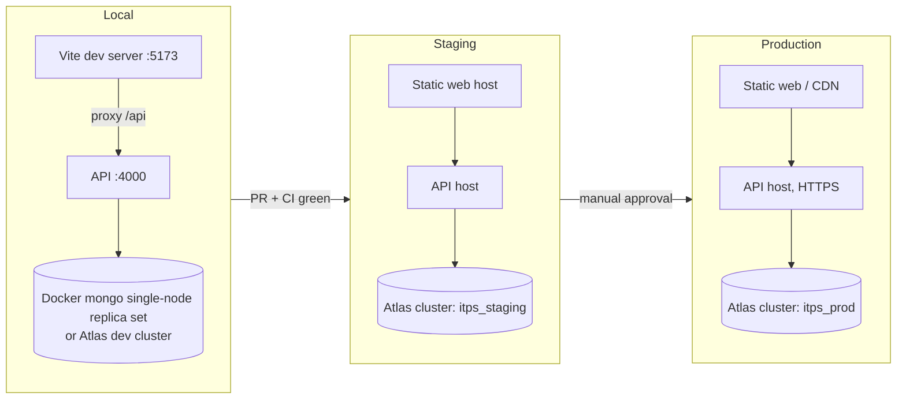
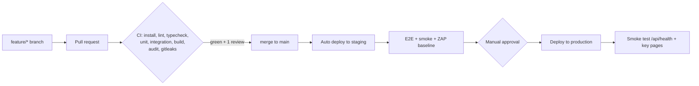

# Deployment Design — IT Peripheral Store

Status: Draft v1 (M1-001). **Design only — nothing is deployed in this task.**

## 1. Environments

| | Local | Test / Staging | Production |
|---|---|---|---|
| Purpose | Development | Demo to team/grader, E2E, ZAP scan | Final submission / public |
| Web | Vite dev server | Built SPA on static host | Built SPA on static host/CDN |
| API | `npm run dev` (tsx watch) | Node 22 LTS container/service | Same image as staging |
| DB | Docker `mongo:8` `--replSet rs0` or Atlas dev | Atlas, DB `itps_staging` | Separate Atlas project/cluster, DB `itps_prod` |
| Data | Seed script | Seed script | Seed catalog once; real orders after |
| Cookies | `Secure=false` (http://localhost) | `Secure=true` | `Secure=true`, `__Host-` prefix |
| Logs | Pretty console | JSON | JSON, retained by host |

CI integration tests use `mongodb-memory-server` (replica set mode), not Atlas.

## 2. Environment variables

Names only; values in `.env` (local) or the host's secret store. `.env.example` must mirror this list.

### API (`apps/api`)

| Name | Required | Example (non-secret) | Notes |
|---|:-:|---|---|
| `NODE_ENV` | ✓ | `development` | `development` \| `test` \| `production` |
| `PORT` | ✓ | `4000` | |
| `MONGODB_URI` | ✓ | `mongodb://localhost:27017/?replicaSet=rs0` | **Secret** in non-local. API only. |
| `MONGODB_DB_NAME` | ✓ | `itps_dev` | |
| `SESSION_SECRET` | ✓ | — | **Secret**, ≥ 32 random bytes; comma-separated for rotation |
| `SESSION_TTL_HOURS` | | `168` | Absolute lifetime |
| `SESSION_IDLE_MINUTES` | | `120` | Rolling idle timeout |
| `CORS_ORIGINS` | ✓ | `http://localhost:5173` | Comma-separated allowlist; never `*` |
| `COOKIE_SECURE` | | `false` | Forced `true` when `NODE_ENV=production` |
| `TRUST_PROXY` | | `1` | Behind host proxy |
| `RATE_LIMIT_WINDOW_MINUTES` | | `15` | |
| `RATE_LIMIT_MAX` | | `300` | |
| `SHIPPING_FEE_SATANG` | | `5000` | BR-09 |
| `FREE_SHIPPING_THRESHOLD_SATANG` | | `100000` | BR-09 |
| `LOG_LEVEL` | | `info` | |
| `SEED_ADMIN_EMAIL` | seed only | — | Used by seed/CLI, not runtime |
| `SEED_ADMIN_PASSWORD` | seed only | — | **Secret**; seed/CLI only |

### Web (`apps/web`)

| Name | Required | Notes |
|---|:-:|---|
| `VITE_API_BASE_URL` | | Default `/api` (same origin). Public value. **Never put secrets in `VITE_*`.** |

Config is parsed with Zod at API startup; a missing or malformed required variable stops the process with a clear message (without printing the value).

## 3. Hosting requirements

| Component | Requirements | Candidate options (decide in M-next) |
|---|---|---|
| Frontend | Static file hosting, HTTPS, SPA fallback to `index.html`, custom domain optional | GitHub Pages*, Netlify, Vercel, Cloudflare Pages, or served by the API |
| Backend | Long-running Node 22 process, env-var secrets, HTTPS termination, stable egress IP preferred, health check | Render, Railway, Fly.io, Azure App Service, a university VM |
| Database | MongoDB 7+/8 replica set (transactions) | MongoDB Atlas (M0 for coursework; M10+ for real production) |

\* GitHub Pages cannot proxy `/api`, which forces cross-origin cookies. **Recommended:** serve the built SPA from the same host as the API (Express `static` + SPA fallback) or use a host with rewrites (`/api/* → API`) so the app is same-origin. This keeps `SameSite=Lax` cookies and minimal CORS.

## 4. MongoDB Atlas connection management

- One `mongoose.connect()` at startup; reuse the pool. `maxPoolSize: 10`, `minPoolSize: 0`, `serverSelectionTimeoutMS: 5000`, `retryWrites: true`, `w: 'majority'`.
- Connection string via `mongodb+srv://` (TLS on by default). Never logged; pino redacts it.
- Graceful shutdown on `SIGTERM`: stop accepting requests, finish in-flight, `mongoose.disconnect()`.
- `/api/health` returns `200 {status:"ok"}` only if `db.admin().ping()` succeeds; no version or host info.
- Atlas network access list: production API egress IPs only. DB users per §3.5 of SECURITY_MODEL.
- M0 limits (connections, throughput, storage, no scheduled backups) are acceptable for coursework; move to a dedicated tier for real traffic.

## 5. HTTPS and CORS

- HTTPS everywhere outside localhost; HTTP → HTTPS redirect at the host; HSTS in production.
- CORS (`cors` package): `origin` from `CORS_ORIGINS` allowlist, `credentials: true`, methods `GET,POST,PATCH,DELETE`, allowed headers `Content-Type, X-CSRF-Token`. Same-origin deployment makes CORS a no-op.
- If cross-origin is unavoidable: cookie `SameSite=None; Secure`, CSRF token remains mandatory, origin allowlist is exact-match.

## 6. Deployment workflow

- `main` is protected: PR + passing CI + 1 review; no direct pushes.
- Migrations (`db:migrate`: indexes + validators) run as a separate step with the migrate DB user before the new API version starts. Migrations must be backward compatible (additive) so rollback is just redeploying the previous build.
- Production deploy is a manual, approved GitHub Actions job (environment protection rules). Not configured in M1.
- Rollback: redeploy previous build artifact; DB changes are additive so no down-migration needed.

## 7. Backup and recovery

| Tier | Approach |
|---|---|
| Atlas M0 (coursework) | No managed backups. Scheduled `mongodump` (GitHub Action, weekly + before each production deploy) to an encrypted artifact store the team controls; seed script can rebuild catalog. |
| Atlas M10+ (real production) | Atlas Cloud Backup with point-in-time restore; retention ≥ 7 days. |

- Targets (assumptions for coursework): RPO 7 days on M0, RTO 2 hours. Real production: RPO ≤ 1 h, RTO ≤ 1 h.
- Restore drill once before final submission: restore latest dump into a staging DB and run smoke tests.
- Backups contain PII and password hashes: encrypt at rest, restrict access to admins of the team.
