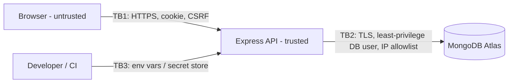

# Security Model — IT Peripheral Store

Status: Draft v4 (M1-007). No real secrets appear in this or any document; values shown are placeholders.

## 1. Assets and trust boundaries

| Asset | Why it matters |
|---|---|
| User credentials and sessions | Account takeover, admin takeover |
| Admin capabilities | Catalog defacement, price changes, order tampering |
| Customer PII (name, email, phone, address) | Privacy (Thai PDPA applies to real users) |
| Product prices and stock | Financial integrity of orders |
| MongoDB credentials | Full data compromise |

Everything from the browser — body, query, params, headers, cookies, cart contents, prices — is untrusted.

## 2. Threat model and controls

| # | Threat | Example | Controls | Verified by |
|---|---|---|---|---|
| T1 | **Broken access control** | Customer calls `/api/admin/products`; customer reads another user's order by guessing `orderNumber` | `requireRole('admin')` on the admin router (not per-route opt-in); `/api/orders/*` filters by `userId` for **every** role, all-order access only on `/api/admin/orders/*` (API_CONTRACTS §4); `404` for non-owned; role never from client; frontend guards are UX only | Integration tests: guest→401, customer→403 on every admin route; AC-F04 matrix on both order routes |
| T2 | **Authentication attacks** | Credential stuffing, brute force, session fixation | Argon2id hashing; rate limit login (10/15 min per IP+email) and register; account lock after 5 failures for 15 min; generic error message; session ID regenerated on login and privilege change; absolute session lifetime 7 days, idle 2 h | Tests for lockout, regenerate, generic error |
| T3 | **NoSQL injection** | `{"email":{"$ne":null}}` on login; `?category[$gt]=` | Zod parses to primitives (strings/numbers only) before queries; `express-mongo-sanitize`-style rejection of keys starting with `$` or containing `.`; Mongoose `sanitizeFilter: true`; never use `$where`/`$function`; text search via `$text` with string arg | Integration tests with operator payloads on login, list filters, admin PATCH |
| T4 | **XSS** | Admin pastes `<script>` in product description; malicious image URL `javascript:` | React escapes by default; **ban `dangerouslySetInnerHTML`** (ESLint rule); descriptions are plain text; image URL schema allows only `https:` or `/images/`; Helmet CSP: `default-src 'self'; img-src 'self' https: data:; script-src 'self'; object-src 'none'; frame-ancestors 'none'` | Lint rule; unit test URL schema; CSP header test |
| T5 | **CSRF** | Malicious site posts to `/api/orders` using victim's cookie | `SameSite=Lax` cookie + synchronizer token bound to the session and rotated on session regeneration (§3.1); checked on all non-GET including login/register (prevents login CSRF); timing-safe compare; GET routes never change state; same-origin topology so no CORS needed | AC-R04 lifecycle test; write without/with stale token → 403 |
| T6 | **Sensitive data exposure** | Password hash in API response; MongoDB URI in frontend bundle; stack trace in error | `passwordHash` `select:false` + response DTO mapping (allowlist of fields); MongoDB URI only in API env; no `VITE_` prefix on secrets (only `VITE_` vars reach the bundle); error handler hides stack in non-local; pino redaction; HTTPS + HSTS | Tests: `/auth/me` has no hash; CI greps built `dist/` for `mongodb+srv`; secret scan |
| T7 | **Missing rate limiting / abuse** | Scraping, order spam, password spraying | `express-rate-limit` with MongoDB store: global 300 req/15 min/IP; auth limits above; orders 20/h/user; body size 100 kb | Test: N+1 request → 429 |
| T8 | **Mass assignment** | Register with `"role":"admin"`; PATCH product with `createdBy`; PATCH `/users/me` with `role` | Zod `.strict()` on **every** object schema, nested included (body, query, params); unknown keys rejected, never stripped; Mongoose `strict: 'throw'`; services build documents from explicit fields only; never `Model.create(req.body)` | AC-F03a/b: top-level and nested extra fields → 400, no write |
| T9 | **Order price manipulation** | Client sends `"priceSatang":1` or edits `localStorage` cart | Order schema contains no money fields; server loads current price from DB, computes all totals in bounded int32 satang with safe-integer checks (DATABASE_DESIGN §1.1); quantity bounds applied **after** merging duplicate lines (BR-04); cart quote endpoint is informational only | Test: price fields → 400; total matches DB price; AC-F05; AC-R03 |
| T10 | **Inventory race conditions** | Two customers buy the last unit; stale admin stock value overwrites sales; double submit; double cancel; delete during checkout | All write paths in DATABASE_DESIGN §7: conditional `$inc` in transactions; every stock mutation increments `inventoryRevision`; admin stock relative or `expectedRevision`-preconditioned; idempotency records with fingerprint; conditional status transitions restore stock once; soft delete only; `$jsonSchema minimum: 0` | 10 parallel orders for stock 3 → exactly 3 succeed, stock = 0; AC-F01a–d, AC-F02a–e, AC-G01a/b, AC-G02a/b, AC-G03a/b, AC-G04, AC-R01, AC-R02a–e, AC-R05a/c |

Additional: local development database exposure (unauthenticated MongoDB published on all interfaces) is prevented by loopback-only port publishing (DEPLOYMENT_DESIGN §2.2, AC-N01); clickjacking (`frame-ancestors 'none'`), dependency vulnerabilities (`npm audit --audit-level=high` in CI, Dependabot), open redirect (post-login redirect accepts only relative paths).

## 3. Control details

### 3.1 Sessions and cookies

- `express-session` + `connect-mongo` store (`sessions` collection, TTL).
- Cookie `itps.sid`: `HttpOnly`, `Secure` (all non-local envs), `SameSite=Lax`, `Path=/`, no `Domain` attribute (host-only). `__Host-` prefix in production when same-origin.
- `SESSION_SECRET` ≥ 32 random bytes; supports an array for rotation.
- `app.set('trust proxy', 1)` behind the hosting proxy so `Secure` cookies and rate-limit IPs work.
- Session stores only `{ csrfToken }` (anonymous) or `{ userId, role, csrfToken, createdAt }` (authenticated). Role is re-read from DB on each request so demotion/deactivation takes effect immediately.
- `saveUninitialized: false`: a session is created only by `GET /api/auth/csrf`, login or register, never by browsing.

**CSRF token lifecycle (R04)**

| Event | Session | CSRF token |
|---|---|---|
| `GET /api/auth/csrf`, no session | Create anonymous session (idle 2 h) | New random 32-byte token, returned |
| `GET /api/auth/csrf`, session exists | Unchanged | Existing token returned |
| Register / login success | `req.session.regenerate()` (new ID, old ID destroyed) | New token generated, returned in response body |
| Login failure | Unchanged | Unchanged |
| Logout | `req.session.destroy()`, cookie cleared | Gone; client must call `/auth/csrf` before next write |
| Session expiry (idle 2 h / absolute 7 d) | Removed by TTL | Next write → `403 CSRF_INVALID` (anonymous) or `401` (auth route); client re-fetches |

Comparison uses `crypto.timingSafeEqual`. Tokens are never put in cookies readable by JS, URLs or logs. The selected topology is same-origin (DEPLOYMENT_DESIGN §3), so `SameSite=Lax` applies. If a cross-origin deployment is ever chosen, it needs an ADR, `SameSite=None; Secure`, and an exact-match CORS allowlist.

### 3.2 Password hashing

- Argon2id (`argon2` package) with OWASP baseline params (m=19 MiB, t=2, p=1). Fallback: bcrypt cost 12 if native build is a problem on a team member's machine (documented in ADR-001).
- Passwords 10–128 chars; check against a bundled common-password list.
- Rehash on login if parameters change.

### 3.3 Server-side authorization

- Routers: `publicRouter`, `authRouter` (requires session), `adminRouter` (requires `role=admin`, mounted at `/api/admin`). Adding a route to `adminRouter` makes it admin-only by construction.
- Admin accounts: created only by `npm run db:seed` / `npm run admin:create` CLI reading env vars. No API path can set `role`.

### 3.4 Input validation

- Shared Zod schemas used by both the web forms (UX) and the API (enforcement). API validation is authoritative.
- `validate({ body, query, params })` middleware; parsed output replaces the raw input.

### 3.5 Least-privilege database access

| Atlas DB user | Roles | Used by |
|---|---|---|
| `itps_app_<env>` | `readWrite` on `itps_<env>` only | API runtime |
| `itps_migrate_<env>` | `readWrite` + `dbAdmin` on `itps_<env>` | `db:migrate`, `db:seed` (CI/deploy job only) |
| Personal accounts | Atlas project roles, MFA required | Team members |

- Separate Atlas **projects or clusters** for dev/test and production; production credentials are never on laptops.
- Atlas network access: production allows only the API host egress IPs (or private endpoint if available on the tier); dev may allow team IPs. `0.0.0.0/0` is not allowed for production.
- TLS is enforced by Atlas (`mongodb+srv://`).

### 3.6 Secrets management

- Local: `.env` (git-ignored); `.env.example` lists names only.
- CI: GitHub Actions secrets; tests use ephemeral `mongodb-memory-server`, so CI needs no Atlas secret.
- Hosting: provider secret store / environment variables.
- Secret scanning: GitHub secret scanning + `gitleaks` step in CI. If a secret is committed: rotate immediately, then purge history.
- Frontend: only `VITE_API_BASE_URL` (non-secret). Anything prefixed `VITE_` is public.

### 3.7 Audit logging

- `auditLogs` record every admin write (product/category CRUD, order status change), login success/failure for admins, and account lockouts.
- Fields: actor, action, entity, entityId, field-level diff (no passwords/tokens), IP, requestId, timestamp.
- Readable by admins only; not editable via API.

### 3.8 HTTP hardening

`helmet()` with CSP above, HSTS (`max-age=15552000; includeSubDomains`) in production, `X-Content-Type-Options: nosniff`, `Referrer-Policy: strict-origin-when-cross-origin`; `x-powered-by` disabled; `express.json({ limit: '100kb' })`.

## 4. Security testing

| Activity | When |
|---|---|
| Integration tests for T1–T10 (listed above) | Every PR (CI) |
| `npm audit --audit-level=high`, Dependabot | Every PR / weekly |
| `gitleaks` secret scan | Every PR |
| Bundle check for `mongodb` strings in `apps/web/dist` | Every PR |
| ESLint security rules (`no-dangerously-set-inner-html`, `eslint-plugin-security`) | Every PR |
| OWASP ZAP baseline scan against staging | Before each release |
| Manual checklist review (this document) | Milestone end / Codex audit |

## 5. Residual risks

- Offset pagination and text search are not hardened against heavy scraping beyond rate limits (acceptable for coursework).
- No email verification or password reset in v1 (REQ-F04); admins reset passwords via CLI.
- Free-tier hosting/Atlas may share IP ranges, weakening IP allowlisting; mitigated by strong DB credentials and TLS.
