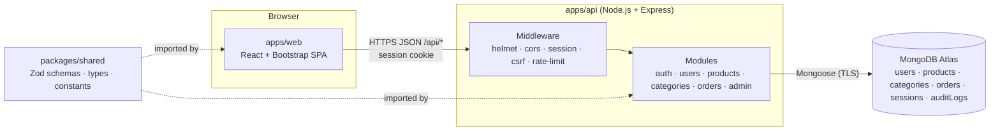
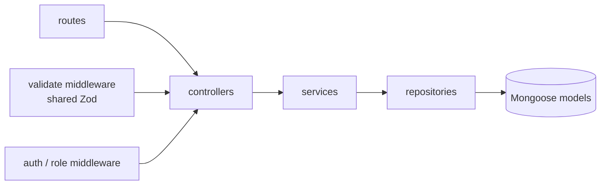

# System Architecture — IT Peripheral Store

Status: Draft v5 (M1-009). Related: [Requirements](../requirements/SYSTEM_REQUIREMENTS.md) · [Database](DATABASE_DESIGN.md) · [API](API_CONTRACTS.md) · [Security](SECURITY_MODEL.md) · [Deployment](DEPLOYMENT_DESIGN.md) · [ADR-001](../decisions/ADR-001-TECH_STACK.md) · [ADR-002](../decisions/ADR-002-DATA_CONSISTENCY.md)

## 1. Overview

A **modular monolith**: one React SPA and one Express API process, sharing validation schemas through a workspace package. MongoDB Atlas is reachable only from the API.



Key properties:

- The browser talks only to `/api/*`. No MongoDB driver, URI or credentials exist in `apps/web` (REQ-B10, NFR-03).
- **Same-origin is the selected topology** (ADR-001): in staging/production one Node service serves the built SPA and `/api`, so cookies stay `SameSite=Lax` and CORS is not needed. Locally, the Vite dev server proxies `/api`, which is also same-origin from the browser's view.
- No microservices, message queues or caches in v1. One process scales vertically; it can be run as 2+ stateless instances because sessions live in MongoDB.

## 2. Monorepo layout

Single npm workspace root (`package.json` → `"workspaces": ["apps/*", "packages/*"]`).

```
it-peripheral-store/
├── apps/
│   ├── web/                 # React (Vite) + Bootstrap 5 + React Router
│   └── api/                 # Express app
├── packages/
│   └── shared/              # Zod schemas, TS types, enums, money helpers
├── database/
│   ├── indexes/             # index definitions (also applied by Mongoose syncIndexes)
│   ├── validators/          # $jsonSchema validators per collection
│   └── seed/                # ≥30 products, categories, admin bootstrap
├── tests/
│   ├── integration/         # API + in-memory/ephemeral MongoDB
│   └── e2e/                 # Playwright: browse, checkout, admin CRUD
├── docker-compose.yml       # local MongoDB single-node replica set (DEPLOYMENT_DESIGN §2)
├── docs/
├── .env.example
└── .github/workflows/ci.yml
```

## 3. Frontend (`apps/web`)

| Concern | Choice |
|---|---|
| Build | Vite |
| Routing | React Router: `/`, `/about`, `/products`, `/products/:slug`, `/cart`, `/checkout`, `/login`, `/register`, `/orders`, `/admin/*` |
| UI | Bootstrap 5 (CSS + `react-bootstrap` components) |
| Server data | TanStack Query (cache, loading/error states) over a thin `fetch` wrapper that sends `credentials: 'include'` and the CSRF header |
| Cart | `localStorage` key `cart:v1` → `[{productId, quantity}]`. Prices always re-fetched; never trusted. |
| Auth state | `GET /api/auth/me` on load. Admin routes guarded in UI for UX only; real enforcement is in the API. |
| Static content | Hero, features, team and social links are static content in `src/content/`. Products are never static. |

## 4. Backend (`apps/api`)

### 4.1 Layering



| Layer | Responsibility | Must not |
|---|---|---|
| Route | Path, HTTP method, middleware chain (`requireAuth`, `requireRole('admin')`, `validate(schema)`) | Contain logic |
| Controller | Map HTTP ↔ service call; set status codes | Touch Mongoose |
| Service | Business rules (pricing, stock, status transitions), transactions | Read `req`/`res` |
| Repository | Queries, projections, pagination; returns plain objects | Contain business rules |
| Model | Mongoose schema, indexes, hooks (password hashing lives in auth service, not hooks) | — |

Repositories are kept thin; a module may skip a repository for a trivial read if it adds nothing, but services never build queries from raw request objects.

### 4.2 Module map

```
apps/api/src/
├── app.ts            # express app factory (used by tests)
├── server.ts         # listen + graceful shutdown
├── config/           # env parsing with Zod; fails fast on missing vars
├── db/               # mongoose connect, transaction helper
├── middleware/       # error handler, auth, roles, csrf, rateLimit, requestId, logger
├── modules/
│   ├── auth/         # register, login, logout, me
│   ├── users/        # profile (self)
│   ├── products/     # public catalog
│   ├── categories/   # public categories
│   ├── orders/       # customer checkout + own orders
│   └── admin/        # admin products, categories, orders, audit log
└── lib/              # money, slug, order number, logger
```

Each module has `*.routes.ts`, `*.controller.ts`, `*.service.ts`, `*.repository.ts`, `*.model.ts` (where it owns a collection). `admin` reuses services from `products`, `categories` and `orders` instead of duplicating logic.

### 4.3 Request lifecycle

```mermaid
sequenceDiagram
  participant B as Browser
  participant E as Express
  participant S as OrderService
  participant DB as MongoDB
  B->>E: POST /api/orders {items, shippingAddress, idempotencyKey} + cookie + X-CSRF-Token
  E->>E: helmet, rate-limit, session, csrf, requireAuth, validate(CreateOrder, strict)
  E->>S: createOrder(userId, dto)
  S->>S: normalize lines (merge duplicates, then check qty 1–10), fingerprint
  S->>DB: startSession + withTransaction
  S->>DB: find idempotencyKeys {userId, key, expiresAt > now}; else orders {userId, idempotencyKey} and key age (retired → 409/422)
  alt record exists
    S-->>E: same fingerprint → replay order (200), else 422
  else new key
    S->>DB: insert idempotencyKeys {userId, key, fingerprint, orderId}
    S->>DB: find active products by ids
    S->>S: compute prices (int satang, bounded) and snapshot lines
    loop each line
      S->>DB: updateOne({_id, isActive: true, stock ≥ qty}, {$inc: {stock: -qty, inventoryRevision: 1}})
    end
    S->>DB: insert order
    S-->>E: order (201)
  end
  E-->>B: response
```

If any conditional stock update matches 0 documents, the service throws `OUT_OF_STOCK` or `PRODUCT_UNAVAILABLE` and the transaction aborts (no partial decrement, no idempotency record). Concurrent requests with the same key collide on the unique `idempotencyKeys` index. `withTransaction` retries only transient errors (`WriteConflict` while the winner is uncommitted). A duplicate-key error after the winner commits, an unresolved commit result, or an exhausted retry is handled by the service **outside the aborted transaction**. An unresolved commit is treated as **unknown**, never as failed: the service reconciles by re-reading the key record, then replays, rejects with `422`, or returns `503 CHECKOUT_RETRY` (DATABASE_DESIGN §7.2). All write paths that compete with checkout are listed in DATABASE_DESIGN §7.

## 5. Cross-cutting concerns

| Concern | Approach |
|---|---|
| Validation | Zod schemas in `packages/shared`, **all object schemas `.strict()` including nested objects and query/params**; `validate()` middleware parses `body`/`query`/`params`, **rejects unknown keys with `400 VALIDATION_ERROR`** (never strips), and replaces the input with the parsed output. Mongoose models use `strict: 'throw'` as a backstop. (ADR-002 D3) |
| Errors | Throw `AppError(code, status, details?)`; central handler returns `{error:{code,message,details?,requestId}}`. Stack traces never sent to client. |
| Logging | `pino` JSON logs with `requestId`; redact `password`, `cookie`, `authorization`, `MONGODB_URI` |
| Config | `config/env.ts` parses `process.env` with Zod at startup |
| Money | Integer satang, BSON `int`, bounds and safe-arithmetic rules in DATABASE_DESIGN §1.1; formatting only in UI (`Intl.NumberFormat('th-TH',{style:'currency',currency:'THB'})`) |
| IDs | MongoDB ObjectId in API; products also addressable by unique `slug` |
| Time | Stored as UTC `Date`; `createdAt`/`updatedAt` via Mongoose timestamps |

## 6. Testing strategy

| Level | Tool | Scope |
|---|---|---|
| Unit | Vitest | shared schemas, money/pricing, order status transitions, services with mocked repos |
| Integration | Vitest + Supertest + `mongodb-memory-server` (replica set mode, for transactions) | Every route: auth, authorization (customer vs admin vs guest), strict validation, checkout stock rules, and the concurrency acceptance criteria AC-F01…AC-R05 in SYSTEM_REQUIREMENTS §7 (run with `Promise.all` against a real replica set) |
| E2E | Playwright | Browse → search → add to cart → register → checkout; admin login → create/edit/deactivate product; responsive matrix AC-F07 (360–1440 px) |
| Security | Integration cases + `npm audit` + secret scan in CI | IDOR, NoSQL operator injection, mass assignment, price tampering, CSRF missing token |

## 7. Assumptions and open decisions

| # | Item | Status |
|---|---|---|
| AS-1 | Currency THB only, integer satang | Assumed |
| AS-2 | Product images are URLs (seed uses local `/images/...` served by web or a public CDN) | Assumed; upload is REQ-F05 |
| AS-3 | Language: TypeScript across web, api, shared | Baseline confirmed by project owner (M1-003); formal team sign-off pending (ADR-001) |
| OD-1 | Shipping fee values | Open, config-driven |
| OD-2 | Whether course graders need Thai UI text | Open |
| OD-3 | Exact hosting provider | Open. Topology fixed: single same-origin Node service (DEPLOYMENT_DESIGN §3) |
