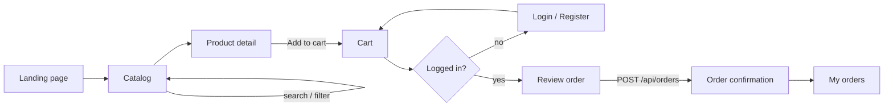
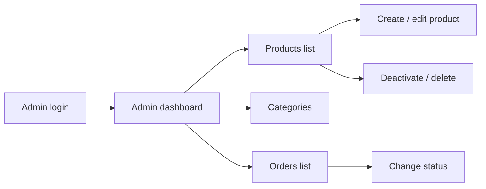

# System Requirements — IT Peripheral Store

Status: Draft v2 (M1-003, remediates Codex M1-002 audit) · Owner: team · Last updated: 2026-11-15

## 0. Sources and labels

The assignment PDFs were **not available** in the local workspace. Requirements below come from the M1-001 task brief. When the PDFs are found, re-check every `REQ-*` row against them (see handoff `M1-001.md`).

Every requirement has one label:

| Label | Meaning |
|---|---|
| **[A]** Required by assignment | Comes from Project A or Project B. Must not be removed or weakened. |
| **[E]** Engineering recommendation | Our decision for security, quality or maintainability. Can be changed with an ADR. |
| **[F]** Future enhancement | Out of scope for the course submission. |

Payment processing is **not** a requirement. Checkout creates an order with status `pending`; no card data is collected (see BR-07).

## 1. Functional requirements

### 1.1 Project A — Startup landing page

| ID | Requirement | Label | Implemented by |
|---|---|---|---|
| REQ-A01 | Responsive frontend built with Bootstrap | [A] | `apps/web`, Bootstrap 5 grid |
| REQ-A02 | Navbar | [A] | `<SiteNavbar>` on every page |
| REQ-A03 | Hero section | [A] | Home page `<Hero>` |
| REQ-A04 | Features section with at least 3 features | [A] | Home page `<Features>` (static content) |
| REQ-A05 | Separate About Team page | [A] | Route `/about` |
| REQ-A06 | Social links | [A] | Footer `<SocialLinks>` |
| REQ-A07 | At least one additional section | [A] | Home page "Featured products" (live from API) + "Contact/FAQ" |
| REQ-A08 | Resume link for each team member | [A] | `/about`, data in `apps/web/src/content/team.ts` |

Team members and resume links (from the brief; no roles or other personal data are added):

| Name | Resume |
|---|---|
| Sirapat Chuaysong | https://nussirapat.github.io/My_Resume/ |
| CHONTIDAPORN BOONBANJOB | https://slowlifejg-star.github.io/Punch_Resume/ |
| NATTAWU TSAEDIAW | https://nussirapat.github.io/Resume_Nattawut/ |
| THAKSIN SAARDAIAM | https://jamethaksin.github.io/resume/ |

> Team content is static marketing content and may live in the frontend. **Products may not** (REQ-B10).

### 1.2 Project B — Online store

| ID | Requirement | Label | Implemented by |
|---|---|---|---|
| REQ-B01 | Online store for IT peripherals | [A] | Whole system |
| REQ-B02 | At least 30 products stored in MongoDB | [A] | `database/seed` inserts ≥ 30 products; CI check counts them |
| REQ-B03 | Product details: name, description, images, price, category | [A] | `products` collection, `GET /api/products/:slug` |
| REQ-B04 | Product search **or** category filtering | [A] | Both: `?q=` text search and `?category=` filter |
| REQ-B05 | Customer and Admin roles | [A] | `users.role ∈ {customer, admin}` |
| REQ-B06 | Admin authentication | [A] | Session login; admin routes require `role=admin` |
| REQ-B07 | Admin product CRUD | [A] | `/api/admin/products` |
| REQ-B08 | Shopping cart or purchase | [A] | Client cart + `POST /api/orders` checkout |
| REQ-B09 | Orders persisted in MongoDB | [A] | `orders` collection |
| REQ-B10 | Products never hardcoded in frontend | [A]/[E] | Frontend reads products only from the API |
| REQ-B11 | Responsive UI | [A] | Bootstrap breakpoints; acceptance AC-F07 (360–1440 px) |
| REQ-B12 | Database architecture documentation | [A] | `docs/architecture/DATABASE_DESIGN.md` |

### 1.3 Engineering and future

| ID | Requirement | Label |
|---|---|---|
| REQ-E01 | Customer self-registration and login | [E] |
| REQ-E02 | Customer views own order history | [E] |
| REQ-E03 | Admin manages categories | [E] |
| REQ-E04 | Admin views all orders and changes status | [E] |
| REQ-E05 | Admin "delete" of products and categories always deactivates (soft delete); no hard delete through the API (ADR-002 D5) | [E] |
| REQ-E06 | Stock shown on product page; out-of-stock cannot be ordered | [E] |
| REQ-E07 | Pagination on product and order lists | [E] |
| REQ-E08 | Audit log of admin actions | [E] |
| REQ-F01 | Real payment gateway | [F] |
| REQ-F02 | Server-side persistent cart across devices | [F] |
| REQ-F03 | Product reviews and ratings | [F] |
| REQ-F04 | Email notifications, password reset by email | [F] |
| REQ-F05 | Image upload to object storage (initially image URLs) | [F] |
| REQ-F06 | Analytics dashboard / aggregation reports ("big data" extension) | [F] |
| REQ-F07 | Nested category hierarchy (v1 categories are flat) | [F] |

## 2. Non-functional requirements

| ID | Requirement | Label |
|---|---|---|
| NFR-01 | Works from 360 px to desktop with no horizontal scroll; verified at 360, 375, 576, 768, 992, 1200, 1440 px (AC-F07) | [A] |
| NFR-02 | All secrets in environment variables; none in git | [E] |
| NFR-03 | Browser never connects to MongoDB or sees its connection string | [E] |
| NFR-04 | Passwords hashed (Argon2id or bcrypt cost ≥ 12) | [E] |
| NFR-05 | Product list API p95 < 300 ms locally with 30–1,000 products | [E] |
| NFR-06 | All input validated server-side with shared **strict** Zod schemas; unknown fields rejected, never stripped (ADR-002 D3) | [E] |
| NFR-07 | Unit + integration tests in CI; E2E for checkout and admin CRUD | [E] |
| NFR-08 | WCAG 2.1 AA basics: alt text, labels, keyboard nav, contrast | [E] |
| NFR-09 | Reproducible local setup on Windows/macOS/Linux per DEPLOYMENT_DESIGN §2; one `npm run dev` after setup | [E] |
| NFR-10 | Structured JSON logs without secrets or passwords | [E] |

## 3. Roles and permissions

| Capability | Guest | Customer | Admin |
|---|:-:|:-:|:-:|
| View landing, about, products, categories | ✓ | ✓ | ✓ |
| Search / filter products | ✓ | ✓ | ✓ |
| Keep a cart (browser) | ✓ | ✓ | ✓ |
| Register / log in | ✓ | – | – |
| Place order | – | ✓ | ✓¹ |
| View own orders | – | ✓ | ✓ |
| Product / category CRUD | – | – | ✓ |
| View all orders, change status | – | – | ✓ |
| Manage users' roles | – | – | ✓² |

¹ Allowed but not needed. ² Admins are created by seed script or CLI only; there is no public "make admin" endpoint. Role changes via API are [F].

## 4. Customer journey

1. Guest browses landing page and catalog (products loaded from API).
2. Adds items to cart; cart is stored in `localStorage` as `{productId, quantity}` only — **never prices**.
3. At checkout the customer must log in.
4. Client sends items and shipping address. Server re-reads products, checks stock, computes totals, decrements stock and saves the order.
5. Customer sees confirmation with the server-computed total, and the order in "My orders".

## 5. Admin workflow

Admin logs in through the same `/login` page; the UI shows admin navigation only when `role=admin`, and every admin API checks the role on the server.

## 6. Business rules — orders and inventory

| ID | Rule |
|---|---|
| BR-01 | All money is stored as **integer satang** (THB × 100), BSON `int`, within the bounds of DATABASE_DESIGN §1.1. No floats. Currency fixed to `THB` in v1. |
| BR-02 | The server computes `unitPrice`, `lineTotal`, `subtotal`, `shippingFee`, `total`. Any price sent by the client is ignored (and rejected by schema). |
| BR-03 | Order lines store a **snapshot** of product name, SKU, image and unit price at purchase time. Later product edits do not change past orders. |
| BR-04 | Cart lines are **normalized first** (duplicate `productId` lines summed), **then validated**: merged quantity per product is an integer 1–10 and there are at most 20 distinct products. Violations return `400 VALIDATION_ERROR` with no stock change. Quote and checkout use the same rule. |
| BR-05 | Stock is decremented atomically with `stock >= qty` as a condition; stock can never go negative. If any line fails, the whole order fails and no stock changes (transaction). |
| BR-06 | Only `isActive: true` products can be ordered. |
| BR-07 | No payment is captured. New orders start as `pending`. Admin moves them through `pending → confirmed → shipped → delivered`; admin may cancel from `pending` or `confirmed`; customer may cancel own order only from `pending`. Each transition is a conditional write on the current status (ADR-002 D6). |
| BR-08 | Cancelling an order restores its stock in the same transaction, and **only** the transaction that actually changed the status restores stock, so stock is restored at most once. |
| BR-09 | Shipping fee: flat rate from config (`SHIPPING_FEE_SATANG`, default 5000 = ฿50), free when subtotal ≥ `FREE_SHIPPING_THRESHOLD_SATANG`. Values are assumptions, adjustable. |
| BR-10 | Products are never hard-deleted through the API; delete = deactivate. Orders therefore never reference a missing product. |
| BR-11 | `/api/orders/*` returns only the caller's own orders (admins included); all-order access is only via `/api/admin/orders/*`. |
| BR-12 | Order numbers are human-readable (`ORD-YYYYMMDD-XXXXXX`) and unique. |
| BR-13 | Admin stock changes are relative (`stockAdjust`) or preconditioned (`stockSet` + `expectedStock`); a stale absolute value is rejected with `409 STOCK_CONFLICT` and never overwrites sales. |
| BR-14 | Each checkout carries a client idempotency key (UUID v4). Within 24 h the same key with the same payload returns the original order; with a different payload it is rejected (`422`). After 24 h the key may be used again. Stock is decremented at most once per accepted order. |
| BR-15 | Order total ≤ 1,000,000,000 satang (฿10 M); larger orders are rejected with `422 ORDER_LIMIT_EXCEEDED`. |
| BR-16 | A product can be assigned only to an active category; a category can be deactivated only when it has no active products. |

## 7. Acceptance criteria for M1-002 audit findings

Each criterion is an automated test unless marked *manual*. Test level: **I** = integration (Supertest + replica-set MongoDB), **E** = E2E (Playwright).

| AC | Finding | Criterion | Level |
|---|---|---|---|
| AC-F01a | F01 | Stock 10. Interleave: admin reads 10 → checkout buys 3 (stock 7) → admin sends `stockSet: 15, expectedStock: 10`. Result `409 STOCK_CONFLICT`, stock stays 7. | I |
| AC-F01b | F01 | Stock 7; concurrently checkout buys 2 and admin sends `stockAdjust: +5`. Final stock = 10 (both changes kept). | I |
| AC-F01c | F01 | `stockAdjust: -20` on stock 7 → `409 STOCK_CONFLICT`, stock unchanged. PATCH with plain `stock` field → `400 VALIDATION_ERROR`. | I |
| AC-F02a | F02 | 5 parallel identical checkouts with one key → exactly one order exists, stock decremented once; all 5 responses carry the same `orderNumber` (one `201`, the rest `200`). | I |
| AC-F02b | F02 | Same key, different items → `422 IDEMPOTENCY_KEY_REUSED`, no order, no stock change. | I |
| AC-F02c | F02 | Same key after the record's `expiresAt` (clock advanced in test) → new order created (`201`). | I |
| AC-F03a | F03 | For every write endpoint, a top-level unknown field (e.g. `role`, `priceSatang`) → `400 VALIDATION_ERROR` with `details[].path`, and no DB write. | I |
| AC-F03b | F03 | Unknown nested field (e.g. `shippingAddress.isAdmin`, `items[0].unitPriceSatang`) and unknown query param (e.g. `?foo=1`) → `400 VALIDATION_ERROR`. | I |
| AC-F04 | F04 | `GET /api/orders/:n`: guest 401, owner 200, other customer 404, admin (not owner) 404. `GET /api/admin/orders/:n`: guest 401, customer 403, admin 200. | I |
| AC-F05 | F05 | Two lines of 6 for the same product → `400 VALIDATION_ERROR` (merged qty 12 > 10) on both `/cart/quote` and `/orders`; no stock change. Two lines of 4 → one merged line of 8. | I |
| AC-F06 | F06 | `DELETE /api/admin/products/:id`: active product (with or without orders) → `200 {isActive:false, deletedAt}`; repeat → same `200`; unknown id → `404`. The product document still exists. | I |
| AC-R01 | R01 | Parallel checkout and deactivation of the same product (20 runs): every run ends either with a committed order and an inactive product, or with `409 PRODUCT_UNAVAILABLE` and no order. No order ever references a missing product. | I |
| AC-R02 | R02 | Pending order with 2 units: parallel customer cancel + admin cancel + admin confirm → exactly one succeeds; stock restored ≤ once; `statusHistory` has one entry after `pending`. | I |
| AC-R03 | R03 | Boundary writes through Mongoose: `priceSatang` 1 and 10,000,000 accepted, 0 / 10,000,001 / 1.5 rejected; stored BSON type is `int` (`$type: "int"`). Order exceeding total cap → `422 ORDER_LIMIT_EXCEEDED`. | I |
| AC-R04 | R04 | Flow: `GET /auth/csrf` → `POST /auth/login` with token → response has new `csrfToken` → write with old token `403 CSRF_INVALID`, with new token succeeds → logout → write with that token `403`. Login without token → `403`. | I |
| AC-R05a | R05 | Parallel "deactivate category" and "create product in that category": exactly one succeeds (`409 CATEGORY_HAS_ACTIVE_PRODUCTS` or `409 CATEGORY_UNAVAILABLE`); `activeProductCount` equals the actual count afterwards. | I |
| AC-R05b | R05 | Renaming a category slug requires no product update, and `?category=<newSlug>` returns its products. | I |
| AC-R06a | R06 | On a clean Windows 11 machine, following DEPLOYMENT_DESIGN §2 from a fresh clone, the developer reaches a running app, and `npm run test:integration` passes its transaction smoke test. | manual + I |
| AC-R06b | R06 | Staging smoke test over HTTPS on the chosen same-origin topology: login, add to cart, checkout, logout. | E |
| AC-F07 | F07 | Landing, About, catalog, product, cart, checkout and admin product list at 360, 375, 576, 768, 992, 1200 and 1440 px: `document.documentElement.scrollWidth <= window.innerWidth`, the navbar is usable, and no content is clipped. | E |
