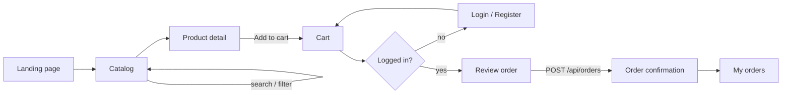
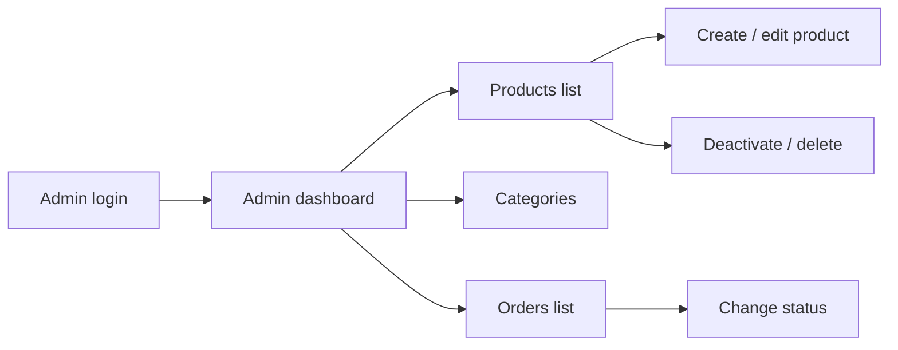

# System Requirements — IT Peripheral Store

Status: Draft v9 (M1-017, remediates Codex M1-002 through M1-016 audits) · Owner: team · Last updated: 2026-11-15

## 0. Sources and labels

The assignment PDFs were **not available** in the local workspace. Requirements below come from the M1-001 task brief. When the PDFs are found, re-check every `REQ-*` row against them (see handoff `M1-001.md`).

Every requirement has one label:

| Label | Meaning |
|---|---|
| **[A]** Required by assignment | Comes from Project A or Project B. Must not be removed or weakened. |
| **[E]** Engineering recommendation | Our decision for security, quality or maintainability. Can be changed with an ADR. |
| **[F]** Future enhancement | Out of scope for the course submission. |

Payment processing is **not** a requirement. Checkout creates an order with status `pending`; no card data is collected (see BR-07).

## 1. Functional requirements

### 1.1 Project A — Startup landing page

| ID | Requirement | Label | Implemented by |
|---|---|---|---|
| REQ-A01 | Responsive frontend built with Bootstrap | [A] | `apps/web`, Bootstrap 5 grid |
| REQ-A02 | Navbar | [A] | `<SiteNavbar>` on every page |
| REQ-A03 | Hero section | [A] | Home page `<Hero>` |
| REQ-A04 | Features section with at least 3 features | [A] | Home page `<Features>` (static content) |
| REQ-A05 | Separate About Team page | [A] | Route `/about` |
| REQ-A06 | Social links | [A] | Footer `<SocialLinks>` |
| REQ-A07 | At least one additional section | [A] | Home page "Featured products" (live from API) + "Contact/FAQ" |
| REQ-A08 | Resume link for each team member | [A] | `/about`, data in `apps/web/src/content/team.ts` |

Team members and resume links (from the brief; no roles or other personal data are added):

| Name | Resume |
|---|---|
| Sirapat Chuaysong | https://nussirapat.github.io/My_Resume/ |
| CHONTIDAPORN BOONBANJOB | https://slowlifejg-star.github.io/Punch_Resume/ |
| NATTAWU TSAEDIAW | https://nussirapat.github.io/Resume_Nattawut/ |
| THAKSIN SAARDAIAM | https://jamethaksin.github.io/resume/ |

> Team content is static marketing content and may live in the frontend. **Products may not** (REQ-B10).

### 1.2 Project B — Online store

| ID | Requirement | Label | Implemented by |
|---|---|---|---|
| REQ-B01 | Online store for IT peripherals | [A] | Whole system |
| REQ-B02 | At least 30 products stored in MongoDB | [A] | `database/seed` inserts ≥ 30 products; CI check counts them |
| REQ-B03 | Product details: name, description, images, price, category | [A] | `products` collection, `GET /api/products/:slug` |
| REQ-B04 | Product search **or** category filtering | [A] | Both: `?q=` text search and `?category=` filter |
| REQ-B05 | Customer and Admin roles | [A] | `users.role ∈ {customer, admin}` |
| REQ-B06 | Admin authentication | [A] | Session login; admin routes require `role=admin` |
| REQ-B07 | Admin product CRUD | [A] | `/api/admin/products` |
| REQ-B08 | Shopping cart or purchase | [A] | Client cart + `POST /api/orders` checkout |
| REQ-B09 | Orders persisted in MongoDB | [A] | `orders` collection |
| REQ-B10 | Products never hardcoded in frontend | [A]/[E] | Frontend reads products only from the API |
| REQ-B11 | Responsive UI | [A] | Bootstrap breakpoints; acceptance AC-F07 (360–1440 px) |
| REQ-B12 | Database architecture documentation | [A] | `docs/architecture/DATABASE_DESIGN.md` |

### 1.3 Engineering and future

| ID | Requirement | Label |
|---|---|---|
| REQ-E01 | Customer self-registration and login | [E] |
| REQ-E02 | Customer views own order history | [E] |
| REQ-E03 | Admin manages categories | [E] |
| REQ-E04 | Admin views all orders and changes status | [E] |
| REQ-E05 | Admin "delete" of products and categories always deactivates (soft delete); no hard delete through the API (ADR-002 D5) | [E] |
| REQ-E06 | Stock shown on product page; out-of-stock cannot be ordered | [E] |
| REQ-E07 | Pagination on product and order lists | [E] |
| REQ-E08 | Audit log of admin actions | [E] |
| REQ-F01 | Real payment gateway | [F] |
| REQ-F02 | Server-side persistent cart across devices | [F] |
| REQ-F03 | Product reviews and ratings | [F] |
| REQ-F04 | Email notifications, password reset by email | [F] |
| REQ-F05 | Image upload to object storage (initially image URLs) | [F] |
| REQ-F06 | Analytics dashboard / aggregation reports ("big data" extension) | [F] |
| REQ-F07 | Nested category hierarchy (v1 categories are flat) | [F] |

## 2. Non-functional requirements

| ID | Requirement | Label |
|---|---|---|
| NFR-01 | Works from 360 px to desktop with no horizontal scroll; verified at 360, 375, 576, 768, 992, 1200, 1440 px (AC-F07) | [A] |
| NFR-02 | All secrets in environment variables; none in git | [E] |
| NFR-03 | Browser never connects to MongoDB or sees its connection string | [E] |
| NFR-04 | Passwords hashed (Argon2id or bcrypt cost ≥ 12) | [E] |
| NFR-05 | Product list API p95 < 300 ms locally with 30–1,000 products | [E] |
| NFR-06 | All input validated server-side with shared **strict** Zod schemas; unknown fields rejected, never stripped (ADR-002 D3) | [E] |
| NFR-07 | Unit + integration tests in CI; E2E for checkout and admin CRUD | [E] |
| NFR-08 | WCAG 2.1 AA basics: alt text, labels, keyboard nav, contrast | [E] |
| NFR-09 | Reproducible local setup on Windows/macOS/Linux per DEPLOYMENT_DESIGN §2; one `npm run dev` after setup | [E] |
| NFR-10 | Structured JSON logs without secrets or passwords | [E] |

## 3. Roles and permissions

| Capability | Guest | Customer | Admin |
|---|:-:|:-:|:-:|
| View landing, about, products, categories | ✓ | ✓ | ✓ |
| Search / filter products | ✓ | ✓ | ✓ |
| Keep a cart (browser) | ✓ | ✓ | ✓ |
| Register / log in | ✓ | – | – |
| Place order | – | ✓ | ✓¹ |
| View own orders | – | ✓ | ✓ |
| Product / category CRUD | – | – | ✓ |
| View all orders, change status | – | – | ✓ |
| Manage users' roles | – | – | ✓² |

¹ Allowed but not needed. ² Admins are created by seed script or CLI only; there is no public "make admin" endpoint. Role changes via API are [F].

## 4. Customer journey

1. Guest browses landing page and catalog (products loaded from API).
2. Adds items to cart; cart is stored in `localStorage` as `{productId, quantity}` only — **never prices**.
3. At checkout the customer must log in.
4. Client sends items and shipping address. Server re-reads products, checks stock, computes totals, decrements stock and saves the order.
5. Customer sees confirmation with the server-computed total, and the order in "My orders".

## 5. Admin workflow

Admin logs in through the same `/login` page; the UI shows admin navigation only when `role=admin`, and every admin API checks the role on the server.

## 6. Business rules — orders and inventory

| ID | Rule |
|---|---|
| BR-01 | All money is stored as **integer satang** (THB × 100), BSON `int`, within the bounds of DATABASE_DESIGN §1.1. No floats. Currency fixed to `THB` in v1. |
| BR-02 | The server computes `unitPrice`, `lineTotal`, `subtotal`, `shippingFee`, `total`. Any price sent by the client is ignored (and rejected by schema). |
| BR-03 | Order lines store a **snapshot** of product name, SKU, image and unit price at purchase time. Later product edits do not change past orders. |
| BR-04 | Cart lines are **normalized first** (duplicate `productId` lines summed), **then validated**: merged quantity per product is an integer 1–10 and there are at most 20 distinct products. Violations return `400 VALIDATION_ERROR` with no stock change. Quote and checkout use the same rule. |
| BR-05 | Stock is decremented atomically with `stock >= qty` as a condition; stock can never go negative. If any line fails, the whole order fails and no stock changes (transaction). |
| BR-06 | Only `isActive: true` products can be ordered. |
| BR-07 | No payment is captured. New orders start as `pending`. Admin moves them through `pending → confirmed → shipped → delivered`; admin may cancel from `pending` or `confirmed`; customer may cancel own order only from `pending`. Each transition is a conditional write on the current status (ADR-002 D6). |
| BR-08 | Cancelling an order restores its stock in the same transaction, and **only** the transaction that actually changed the status restores stock, so stock is restored at most once. Restoration is not limited by the admin stock cap. Only the int32 hard stock limit can block it, and then the cancellation fails atomically (`409 INVENTORY_LIMIT`, order and stock unchanged, no unit discarded) until an admin lowers stock (DATABASE_DESIGN §7.4). |
| BR-09 | Shipping fee: flat rate from config (`SHIPPING_FEE_SATANG`, default 5000 = ฿50), free when subtotal ≥ `FREE_SHIPPING_THRESHOLD_SATANG`. Values are assumptions, adjustable. |
| BR-10 | Products are never hard-deleted through the API; delete = deactivate. Orders therefore never reference a missing product. |
| BR-11 | `/api/orders/*` returns only the caller's own orders (admins included); all-order access is only via `/api/admin/orders/*`. |
| BR-12 | Order numbers are human-readable (`ORD-YYYYMMDD-XXXXXX`) and unique. |
| BR-13 | Every stock mutation increments the product's `inventoryRevision`. Admin stock changes are relative (`stockAdjust`) or absolute with the observed revision (`stockSet` + `expectedRevision`); an absolute correction made after **any** intervening stock change is rejected with `409 STOCK_CONFLICT`, even if the stock number happens to match. Admins cannot raise stock above 1,000,000. |
| BR-14 | Each checkout carries a client idempotency key: any UUID, which the server treats as opaque and never reads a timestamp from. **At most one order is ever created per user and key.** Keys are recorded in a durable, insert-only per-user registry (`checkoutKeys`) that is kept for the account's lifetime with no TTL. A used or closed key can therefore never create an order, however late a request arrives. Separately, the same key and payload return the original order (`200`) until `replayUntil` = server time recorded inside the creating transaction (before its commit) + 24 h; a different payload in that window is rejected (`422`). After that, or once closed, the key returns `409 IDEMPOTENCY_KEY_CLOSED`. Every checkout response states the key's outcome: `ORDER_FOUND`; `CONFIRMED_NOT_COMMITTED`, only when the key is durably closed **and** a later majority read of orders finds no order (never from an empty read, and never from the closed marker alone); or `UNKNOWN` (`503`, or `500` for unexpected errors). Failed reads, unacknowledged writes, persistent conflicts (bounded retries) and unresolved commits always give `UNKNOWN`. A business error is returned only after the key has been closed. While the outcome is unknown, clients retry with the same key (automatically for at most 24 h) or call the owner-only `POST /api/orders/reconcile`. A new key requires a definitive outcome for the previous key **and** an explicit user action. V1 never deletes accounts or registry records; disablement (BR-18) leaves them untouched (DATABASE_DESIGN §4.5, §7.2). Stock is decremented at most once per accepted order. |
| BR-15 | Order total ≤ 1,000,000,000 satang (฿10 M); larger orders are rejected with `422 ORDER_LIMIT_EXCEEDED`. |
| BR-16 | Every active product belongs to an active category. A category can be deactivated only via DELETE and only when it has no active products; category PATCH cannot change `isActive`. Inactive products may reference inactive categories but cannot be reactivated until their category is active. A product update that changes category and activation together is applied as one atomic transition from the stored before-state (DATABASE_DESIGN §7.5). |
| BR-17 | Seeding is insert-only and repeatable: rerunning it never changes existing products (stock, `inventoryRevision`, category, activation), categories (activation, counters) or users. `inventoryRevision` is a 64-bit counter that is never reset. |
| BR-18 | **Accounts can be disabled, not deleted (V1).** Disablement (`user:disable` maintenance command) is the only supported account action. It takes effect at the majority-acknowledged commit of a transaction that writes the user document. Every checkout and reconcile request takes effect at the commit of a fence transaction that writes the same document, conditional on `isActive: true`; that applies to new checkouts, existing-key replays, `409` answers and reconcile alike. A request whose fence commits first completes normally, even if its response arrives after the disablement. Any request whose fence hasn't committed gets `403 ACCOUNT_DISABLED` and writes and reveals nothing, including one that was authenticated earlier and paused. This relies on a transaction conflict, not on any delay or on `requireAuth`'s check alone. Read-only order endpoints rely on `requireAuth` only. Disablement never deletes or changes `checkoutKeys`, orders or other user data. Permanent erasure is out of scope and needs a separately reviewed protocol. |
| BR-19 | **Backups are consistent recovery points; restores fail closed.** Tier-dependent: Atlas Cloud Backup snapshots on dedicated tiers. Elsewhere, a dump only behind a verified writer barrier: every writer class (API, workers, seed, migrations, maintenance jobs, operators) loses write privilege, confirmed through the Atlas Admin API before and after the dump; the backup aborts if the barrier can't be established or maintained. Fingerprints are a supplementary integrity check with fixed scope, canonical encoding and ordering, and never proof of quiescence. A live `mongodump` is not accepted. After a restore the API stays in maintenance (`503 MAINTENANCE` for checkout and reconcile) unless a `controlGate` record, written only by a passing `db:verify --restore`, matches this restore and target. A missing, corrupt or mismatched record keeps it closed. The limitations of restoring older data are documented (DEPLOYMENT_DESIGN §7). |

## 7. Acceptance criteria for audit findings (M1-002 to M1-016)

Each criterion is an automated test unless marked *manual*. Test level: **I** = integration (Supertest + replica-set MongoDB), **E** = E2E (Playwright), **O** = operational drill against a staging database.

| AC | Finding | Criterion | Level |
|---|---|---|---|
| AC-F01a | F01, N02 | Admin reads (stock 10, rev r) → checkout buys 3 (7, r+1) → `stockAdjust +3` (10, r+2) → admin sends `stockSet: 15, expectedRevision: r`. Result `409 STOCK_CONFLICT` with `currentRevision: r+2`, although stock equals 10 again; stock stays 10. | I |
| AC-F01d | F01, N02 | Every stock-changing operation (checkout, cancellation, `stockAdjust` ±, `stockSet`) increases `inventoryRevision` by exactly 1 per affected product; non-stock edits (price, name) leave it unchanged. | I |
| AC-F01b | F01 | Stock 7; concurrently checkout buys 2 and admin sends `stockAdjust: +5`. Final stock = 10 (both changes kept), revision +2. | I |
| AC-F01c | F01 | `stockAdjust: -20` on stock 7 → `409`; `stockAdjust` taking stock above 1,000,000 → `409`; stock and revision unchanged. PATCH with plain `stock`, or `stockSet` without `expectedRevision` → `400 VALIDATION_ERROR`. | I |
| AC-F02a | F02 | 5 parallel identical checkouts with one key → exactly one order exists, stock decremented once; all 5 responses carry the same `orderNumber` (one `201`, the rest `200`). | I |
| AC-F02b | F02 | Same key, different items → `422 IDEMPOTENCY_KEY_REUSED`, no order, no stock change. | I |
| AC-F02c | F02, R1, M1-010 F3 | Same key and payload after `replayUntil` (server clock advanced 25 h) → `409 IDEMPOTENCY_KEY_CLOSED` with outcome `ORDER_FOUND` and the original `orderNumber`; no new order, no stock change. | I |
| AC-F02d | F02, N03, M1-010 F1, M1-012 N3 | Forced duplicate-key path: B's transaction runs while A's is open, then A commits. B's registry insert fails with `E11000` or `WriteConflict`, and either is accepted. B ends with A's order (`200`, same fingerprint), `422` (different fingerprint) or `503`/`UNKNOWN`; one order, one decrement. Forced winner abort (`OUT_OF_STOCK` injected into A after its registry insert): any interleaving is accepted. Asserted: ≤ 1 order, and no `CONFIRMED_NOT_COMMITTED` answer for a key that has an order. | I |
| AC-F02e | F02, N03 | Injected `E11000` on an unrelated index → `500`, no order. Conflict retry budget exhausted → `503 CHECKOUT_RETRY`, and a follow-up request with the same key succeeds exactly once. | I |
| AC-G01a | F02, G01 | Fault injection: commit really applied, driver reports `UnknownTransactionCommitResult`, and the key record is hidden from majority reads for 1 s → reconciliation finds it → `201` with that order; exactly one order. Hidden for longer than the 3 s window → `503 CHECKOUT_RETRY` (**not** a business error); a retry with the same key → `200` replay of the same order; stock decremented once. | I |
| AC-G01b | F02, G01 | Uncertain commit, then another customer buys the remaining stock before the client retries with the same key: the retry returns the original order (`200`), never `409 OUT_OF_STOCK`. Uncertain commit that really failed (injected abort after commit sent) → reconcile → `503` (`UNKNOWN`); retry with the same key → `201`, exactly one order. In no run does a client receive `CONFIRMED_NOT_COMMITTED` for a key whose order committed. | I |
| AC-F03a | F03 | For every write endpoint, a top-level unknown field (e.g. `role`, `priceSatang`) → `400 VALIDATION_ERROR` with `details[].path`, and no DB write. | I |
| AC-F03b | F03 | Unknown nested field (e.g. `shippingAddress.isAdmin`, `items[0].unitPriceSatang`) and unknown query param (e.g. `?foo=1`) → `400 VALIDATION_ERROR`. | I |
| AC-F04 | F04 | `GET /api/orders/:n`: guest 401, owner 200, other customer 404, admin (not owner) 404. `GET /api/admin/orders/:n`: guest 401, customer 403, admin 200. | I |
| AC-F05 | F05 | Two lines of 6 for the same product → `400 VALIDATION_ERROR` (merged qty 12 > 10) on both `/cart/quote` and `/orders`; no stock change. Two lines of 4 → one merged line of 8. | I |
| AC-F06 | F06 | `DELETE /api/admin/products/:id`: active product (with or without orders) → `200 {isActive:false, deletedAt}`; repeat → same `200`; unknown id → `404`. The product document still exists. | I |
| AC-R01 | R01 | Parallel checkout and deactivation of the same product (20 runs): every run ends either with a committed order and an inactive product, or with `409 PRODUCT_UNAVAILABLE` and no order. No order ever references a missing product. | I |
| AC-R02a | R02, N05 | Pending order (2 units): parallel customer cancel + admin cancel → exactly one `200`, the other `409 INVALID_STATUS_TRANSITION`; stock restored exactly once (+2, revision +1); history `pending → cancelled`. | I |
| AC-R02b | R02, N05 | Pending order: parallel admin confirm + admin cancel (repeat 20×). Each run must match one serial ordering: (i) confirm then cancel → both `200`, history `pending → confirmed → cancelled`; or (ii) cancel then confirm → cancel `200`, confirm `409`, history `pending → cancelled`. In both, final status `cancelled` and stock restored exactly once. | I |
| AC-R02c | R02, N05 | Pending order: parallel customer cancel + admin confirm. Allowed: (i) cancel `200`, confirm `409`, stock restored once; or (ii) confirm `200`, customer cancel `409` (customers cancel only from `pending`), stock not restored. Never two restorations. | I |
| AC-R02d | R02, N04 | Stock 10 → order of 4 (stock 6) → admin `stockAdjust` up to the cap (1,000,000) → cancel the order → `200`, stock 1,000,004, no unit lost; a following admin `stockAdjust +1` → `409` (above cap), `stockAdjust -4` → `200`. | I |
| AC-R02e | R02, G04 | Isolated test DB: set a product's stock to 2,147,483,645 directly, cancel an order containing 4 units → `409 INVENTORY_LIMIT` with `details`; order status, `statusHistory`, stock and revision of **every** product in the order are unchanged. After `stockAdjust -4`, the same cancellation → `200`, stock restored exactly once. | I |
| AC-M10-F1a | M1-010 F1, M1-012 N3 | **Delayed commit vs fence.** Hold a checkout transaction after its registry insert (test hook), then call `POST /api/orders/reconcile` for the same key. The reconcile may wait, fail with a conflict or time out; no behavior is required. (i) Release and commit; (ii) inject an abort. Repeat 20× each. Accepted: reconcile `ORDER_FOUND`, `CONFIRMED_NOT_COMMITTED` or `UNKNOWN`, provided it is never `CONFIRMED_NOT_COMMITTED` when an order for the key exists afterwards, and never `ORDER_FOUND` when none does. | I |
| AC-M10-F1b | M1-010 F1 | **Fence before a delayed request.** Reconcile a key that was never sent → `CONFIRMED_NOT_COMMITTED`. Then deliver the original checkout request (held back by a test proxy) immediately, and again with the server clock advanced 25 h → both `409 IDEMPOTENCY_KEY_CLOSED`, `CONFIRMED_NOT_COMMITTED`; no order, no stock change. | I |
| AC-M10-F1c | M1-010 F1, F3 | **No age-based answers.** A commit that is applied but hidden from majority reads (fault injection), retried after the server clock passes `replayUntil` → `503 CHECKOUT_RETRY` with `UNKNOWN`, never `CONFIRMED_NOT_COMMITTED`. Once visible, the retry → `409 IDEMPOTENCY_KEY_CLOSED`, `ORDER_FOUND`. A never-seen key (UUID v4; UUID v7 dated 30 days ago; UUID v7 dated 1 day ahead) → normal `201`. | I |
| AC-M10-F1d | M1-010 F1 | **Fence not acknowledged.** Inject a write-concern timeout, then a primary step-down, on the closed-record insert. Reconcile → `503 CHECKOUT_RETRY`, `UNKNOWN`. A checkout that hit `OUT_OF_STOCK` → `503`, `UNKNOWN` (not the business error). A later reconcile returns an outcome that matches the database. | I |
| AC-M10-F1e | M1-010 F1 | **Business errors close the key.** An `OUT_OF_STOCK` response carries `CONFIRMED_NOT_COMMITTED`, and a closed registry record exists. The same key after a restock → `409 IDEMPOTENCY_KEY_CLOSED`, `CONFIRMED_NOT_COMMITTED`. Race: a same-key request B commits while A's attempt fails with `OUT_OF_STOCK` → A returns B's order (`200` replay), not the error; one order. | I |
| AC-M10-F2a | M1-010 F2 | **Three reconcile outcomes.** A committed key → `200 { outcome: ORDER_FOUND, order }`. A never-seen key → `200 CONFIRMED_NOT_COMMITTED`, and a closed registry record now exists. A committed record not yet majority-visible (fault injection) → `503`, `UNKNOWN`. Calling reconcile 3 more times returns the same outcome each time. | I |
| AC-M10-F2b | M1-010 F2 | **No non-authoritative lookup.** `GET /api/orders?idempotencyKey=…` → `400 VALIDATION_ERROR`. A unit test of `resolveKey`, covering every branch, shows `CONFIRMED_NOT_COMMITTED` only for (closed record and no order); missing records give `ABSENT`, which is never returned to a client. | I |
| AC-M10-F2c | M1-010 F2 | **Owner-only.** User B reconciles user A's committed key → `200 CONFIRMED_NOT_COMMITTED` for B's own namespace, with no data from A's order. A's record and order are unchanged; A's reconcile still returns `ORDER_FOUND`, and A's same-key replay still works. Guest → `401`; missing or invalid CSRF → `403`; neither writes anything. An admin can reconcile only their own keys. | I |
| AC-M10-F2d | M1-010 F2 | **Session expiry (client).** With an `UNKNOWN` pending checkout, the session expires → reconcile returns `401` → the app keeps the entry and asks the user to sign in. After the same user signs in, reconcile runs before "Place order" is enabled. A different user signing in on the same browser neither sees nor sends the entry. | E |
| AC-M10-F2e | M1-010 F2 | **No new key while unknown (client).** While the outcome is `UNKNOWN`, "Place order" is disabled and the app offers only automatic same-key retries, "Check again" and "Stop and check" (reconcile). A new key is generated only after `ORDER_FOUND` or `CONFIRMED_NOT_COMMITTED` and a new user click. After `ORDER_FOUND` the app shows the existing order and doesn't offer to buy again automatically. | E |
| AC-M10-F3a | M1-010 F3 | **Server-time window start.** With a fake server clock, `createdAt` equals server time at the registry insert and `replayUntil = createdAt + 24 h`. A UUID v7 key dated 2 days ago or 1 day ahead gets exactly the same window. No commit timestamp is stored or returned. | I |
| AC-M10-F3b | M1-010 F3 | **Expiry boundary.** Same key and payload at `replayUntil − 1 s` → `200` replay; at `replayUntil` and at `replayUntil + 1 s` → `409 IDEMPOTENCY_KEY_CLOSED`, `ORDER_FOUND`. None creates an order or changes stock. | I |
| AC-M10-F3c | M1-010 F3 | **Delayed commit and the window.** Delay the commit 800 ms after the registry insert (inside the 1 s budget). Replay still answers `200` at `replayUntil − 1 s` and `409` at `replayUntil`, so the window is measured from step 2 and lasts ≥ 24 h − 1 s after the commit, as documented. | I |
| AC-M10-F3d | M1-010 F3, M1-012 N2 | **Window separate from reuse prevention.** At `replayUntil + 1 s` the record is still present and unchanged; same key → `409`, `ORDER_FOUND`; reconcile → `ORDER_FOUND`; no second order. | I |
| AC-M10-F3e | M1-010 F3 | **Concurrency after expiry, and client retention.** 10 concurrent same-key requests after `replayUntil` → all `409 IDEMPOTENCY_KEY_CLOSED`, `ORDER_FOUND`; order count and stock unchanged. Client unit test: a resolved key is deleted from storage and never sent again, and automatic retries stop 24 h after `firstSentAt`. | I |
| AC-M12-N1a | M1-012 N1 | **Closed marker plus a historical order.** Fixture: an order for `(U, K)` and a `closed` registry record, with no committed record (simulating restored or inconsistent data). Checkout with K → `409 IDEMPOTENCY_KEY_CLOSED`, `ORDER_FOUND`; reconcile → `ORDER_FOUND`; an integrity alert is logged. Never `CONFIRMED_NOT_COMMITTED`. | I |
| AC-M12-N1b | M1-012 N1 | **Read failures.** Fail or time out (fault injection) the majority `orders` read, and separately the registry read, in: reconcile; checkout step 0 on a closed key; the post-fence read after a business error; and commit-unknown polling. Each → `503`/`UNKNOWN`. None returns `CONFIRMED_NOT_COMMITTED` or a business error. | I |
| AC-M12-N1c | M1-012 N1 | **Every definitive answer reads orders.** A unit test with a spy on the repository: every code path that returns `CONFIRMED_NOT_COMMITTED` or `409 IDEMPOTENCY_KEY_CLOSED` performed the registry read and then the `orders` read, both with read concern `majority` in one causally consistent session, after the closure was acknowledged. | I |
| AC-M12-N2a | M1-012 N2 | **No TTL, no cleanup.** After `db:migrate`, `checkoutKeys` has only `_id` and the unique `{userId, key}` index (asserted in CI). `db:verify` exits non-zero if a TTL index is added. With the server clock advanced 400 days, a closed key → `409 IDEMPOTENCY_KEY_CLOSED`, `CONFIRMED_NOT_COMMITTED`, and a committed key → `409`, `ORDER_FOUND`. | I |
| AC-M12-N2b | M1-012 N2 | **Insert-only registry.** With the database profiler on during the whole integration suite, operations on `checkoutKeys` are only `insert` and `find`; there is no `update`, `delete` or `findAndModify` anywhere (V1 has no erasure path). | I |
| AC-M12-N2c | M1-012 N2 | **Delayed requests can't revive a key.** Reconcile closes K. The original checkout request, held by a test proxy, is delivered at +1 min, +25 h and +400 days (fake clock) → each `409 IDEMPOTENCY_KEY_CLOSED`, `CONFIRMED_NOT_COMMITTED`; no order, no stock change; the registry document is unchanged. | I |
| AC-M12-N2d | M1-012 N2, M1-014 B1 | **Disablement keeps the registry.** After `user:disable`, the user's `checkoutKeys` documents are byte-identical (fingerprint), and the unique entries stay taken: inserting a `closed` or `committed` record for an existing key directly in the test database fails with `E11000`. | I |
| AC-M12-N3a | M1-012 N3 | **Schedule-independent race.** 200 runs of a concurrent checkout(K) and reconcile(K) for the same user, with random delays and random injected faults (`WriteConflict`, `wtimeout`, primary step-down, lost `abortTransaction`). Any winner and any `UNKNOWN` is accepted. After each run, and again 70 s later: ≤ 1 order for `(U, K)`; if any response said `CONFIRMED_NOT_COMMITTED`, no order for K exists; if an order exists, every definitive response said `ORDER_FOUND`. | I |
| AC-M12-N3b | M1-012 N3 | **Bounded retries.** With a `WriteConflict` injected on every attempt, checkout returns `503`/`UNKNOWN` within 10 s after ≤ 3 attempts, and reconcile returns `503`/`UNKNOWN` within 5 s after ≤ 3 inserts. No business error and no `CONFIRMED_NOT_COMMITTED`. | I |
| AC-M12-N3c | M1-012 N3 | **Unknown commit.** Inject `UnknownTransactionCommitResult` with the commit (a) applied and (b) not applied. The response is `201`/`200` or `503`/`UNKNOWN`, never `CONFIRMED_NOT_COMMITTED` and never a business error. A later reconcile → `ORDER_FOUND` for (a) and `CONFIRMED_NOT_COMMITTED` for (b). | I |
| AC-M12-N3d | M1-012 N3 | **Abandoned transaction.** The body throws after the registry insert and `abortTransaction` is lost, so the transaction stays open until the server aborts it. Checkout → `503`/`UNKNOWN`. A reconcile during that period returns `UNKNOWN` or `CONFIRMED_NOT_COMMITTED`, whichever the database allows, never `ORDER_FOUND` without an order. After 70 s reconcile → `CONFIRMED_NOT_COMMITTED`, and the order count is 0. | I |
| AC-M14-B1a | M1-014 B1 | **Checkout paused after authentication.** A test hook holds `POST /api/orders` after `requireAuth` and before the transaction. Run `user:disable` for that user; it commits. Release → `403 ACCOUNT_DISABLED`; no order, no registry record, no stock change; the user's `accountFence` advanced only by the disablement. | I |
| AC-M14-B1b | M1-014 B1 | **Reconcile paused after authentication.** Same as B1a for `POST /api/orders/reconcile` with a never-seen key → `403 ACCOUNT_DISABLED`; no `closed` record written. With an existing committed key → still `403`, and the registry and order are unchanged. | I |
| AC-M14-B1c | M1-014 B1 | **Concurrent disablement and checkout, schedule-independent.** 100 runs of checkout and `user:disable` started together, with random delays and injected `WriteConflict`s; waiting is not required. Accepted: (checkout `201`, order exists, then the account is disabled) **or** (checkout `403 ACCOUNT_DISABLED` or `503`/`UNKNOWN`, and no order). Asserted: no order or registry record has a commit later than the disablement's commit (checked via the `accountFence` order and the oplog in the test replica set); after a `503`, a later reconcile → `403` and the order count is unchanged. | I |
| AC-M14-B1d | M1-014 B1 | **Disablement never deletes data.** Before and after `user:disable`, `db:fingerprint` of `checkoutKeys` and `orders` for the user is identical. A same-key replay request with the old session → `401`. A static check finds no delete path for `users`, `checkoutKeys` or `orders` in application or maintenance code (V1). | I |
| AC-M14-B2a | M1-014 B2, M1-016 B2a | **Backup during active checkout (barrier method, M0).** While a load generator places checkouts, run `ops:backup:barrier`. Asserted: the dump starts only after the Atlas Admin API read-back shows no user with write privileges and 0 API instances; every checkout that received `201` before the barrier is in the dump with its registry record; restoring the dump passes `db:verify --restore`. | O |
| AC-M14-B2b | M1-014 B2 | **Backup during active checkout (managed snapshot, M10+ or Flex if selected).** Take an Atlas snapshot during the same load, restore it to a staging cluster, and run `db:verify --restore` → pass. *Manual staging drill, run when that tier is adopted.* | O |
| AC-M14-B2c | M1-014 B2, M1-016 B2b | **Restore validation failure keeps checkout unavailable.** Restore a backup, then delete one `committed` registry record (or alter one stock value) in the restored database. `db:verify --restore` exits non-zero and writes no gate record. Starting the API against it, with `MAINTENANCE_MODE=off`, serves `503 MAINTENANCE` for `POST /api/orders` and `POST /api/orders/reconcile`, while `GET /api/products` works. After repairing the database and re-validating it, the gate is written and checkout reopens within 30 s. | I |
| AC-M14-B2d | M1-014 B2, M1-016 B2a | **No dump without a barrier.** The job refuses to run `mongodump` unless steps 1–2 are recorded in the same run. Simulate an Atlas Admin API read failure in step 2 → abort, no manifest. | I |
| AC-M16-B1a | M1-016 B1a | **Existing-key checkout paused before disablement.** Key K already has an order. A request with K is authenticated, then held before its `authorizedResolve` transaction; `user:disable` commits; release → `403 ACCOUNT_DISABLED`, with no order data in the body. Variant: held **after** its fence committed and before the response → `200` replay delivered after the disablement (completed before disablement). Both: orders and `checkoutKeys` unchanged. | I |
| AC-M16-B1b | M1-016 B1a | **Reconcile paused before disablement.** Same as B1a for reconcile, with an existing committed key and with a never-seen key: held before the fence → `403`, no closed record, no data. Held after the fence commit → its normal outcome. A unit test confirms that every checkout and reconcile code path that returns key or order data goes through a committed fence transaction. | I |
| AC-M16-B2a | M1-016 B2a | **Every writer class during a backup.** With the barrier established, attempt a write as each class: API user, `itps_migrate` (seed, migrate, `db:verify --repair`, `user:disable`), an operator user, and a new DB user created mid-backup. Each write fails with an authorization error, or (for the new user and any role change) step 4 detects it and the dump is discarded. No dump is kept whose barrier wasn't confirmed both before and after. | O |
| AC-M16-B2b | M1-016 B2b | **Crash after restore, before validation.** Kill the restore after `mongorestore` and before `db:verify --restore` finishes. The restored database has no `controlGate` record; an API pointed at it serves `503 MAINTENANCE` for checkout and reconcile. Variants: a corrupt gate document, a gate with another `targetDb` or `clusterId`, and a gate copied from another database → all closed. | I |
| AC-M16-B2c | M1-016 B2c | **Fingerprint stable across control metadata.** Fingerprint the restored database, write a gate record, fingerprint again → identical (`controlGate`, `sessions` and `auditLogs` are out of scope). Backup and restore fingerprints are equal for a valid restore. | I |
| AC-M16-B2d | M1-016 B2c | **Tampered restore.** Change one field in one document, change only a value's BSON type (`int` → `long`), reorder keys inside one document, or drop one index. Every case except the key reorder (canonical encoding sorts keys) changes the fingerprint, and validation fails with the differing collection named. A manifest from a different script version → validation fails. | I |
| AC-R2a | R2 | Create an active product in an active category → `201`, category `activeProductCount` +1, `inventoryRevision` `"0"`. Create an inactive product in an inactive category → `201`, no counter change. Create into a non-existent category (active or inactive product) → `409 CATEGORY_UNAVAILABLE` and no product document exists. Create an active product in an inactive category → `409`, no document. | I |
| AC-R2b | R2 | 10 concurrent creates with the same SKU (active) → exactly one `201`, nine `409 SKU_TAKEN`; one document; counter +1 exactly once. Same with an existing SKU via seed → skipped, product and counter unchanged. | I |
| AC-R2c | R2 | Race an active product create against `DELETE` of its category (20×): either (product created, DELETE `409 CATEGORY_HAS_ACTIVE_PRODUCTS`) or (category inactive, create `409 CATEGORY_UNAVAILABLE`, no product document). Race an inactive create against the DELETE: both may succeed. `db:verify` clean after every run. | I |
| AC-G04 | G04, N02 | Isolated test DB: `inventoryRevision` stored as BSON `long` (`$type: "long"`) after create, checkout, cancel, adjust and set. Set the revision to 2,147,483,647 (int32 max): checkout and cancellation succeed and the revision becomes 2,147,483,648 (still `long`). The API returns it as the string `"2147483648"`, and `stockSet` with that string succeeds. The seed never resets it (AC-G02a). | I |
| AC-R03 | R03 | Boundary writes through Mongoose: `priceSatang` 1 and 10,000,000 accepted, 0 / 10,000,001 / 1.5 rejected; stored BSON type is `int` (`$type: "int"`). Order exceeding total cap → `422 ORDER_LIMIT_EXCEEDED`. | I |
| AC-R04 | R04 | Flow: `GET /auth/csrf` → `POST /auth/login` with token → response has new `csrfToken` → write with old token `403 CSRF_INVALID`, with new token succeeds → logout → write with that token `403`. Login without token → `403`. | I |
| AC-R05a | R05, N06 | Category with 0 active products. Race `DELETE /admin/categories/:id` (repeat 20× each) against each of: create active product in it, reactivate an inactive product in it, move an active product into it. Exactly one of each pair succeeds (`409 CATEGORY_HAS_ACTIVE_PRODUCTS` or `409 CATEGORY_UNAVAILABLE`), and `db:verify` reports no drift and no active product in an inactive category. | I |
| AC-R05c | R05, N06 | `PATCH /admin/categories/:id` with `isActive: false` (or `true`) → `400 VALIDATION_ERROR`, no change. `POST /reactivate` on an inactive category → `200`; its products remain inactive; reactivating one of them then succeeds. Creating an inactive product in an inactive category → `201`; reactivating it while the category is inactive → `409 CATEGORY_UNAVAILABLE`. | I |
| AC-R05b | R05 | Renaming a category slug requires no product update, and `?category=<newSlug>` returns its products. | I |
| AC-G03a | R05, G03 | Single PATCH requests with both `categoryId` and `isActive`, one per row of the DATABASE_DESIGN §7.5 transition table (inactive→active moved, active→inactive moved, active→active moved, same-category variants). After each: counts match the table and `db:verify` is clean. Moving and activating into an inactive category → `409 CATEGORY_UNAVAILABLE`, no change. | I |
| AC-G03b | R05, G03 | Race `PATCH {categoryId: B, isActive: true}` on an inactive product against `DELETE /admin/categories/B` (20×): each run ends with either the product active in B and B active (DELETE `409`), or B inactive and the product unchanged (PATCH `409`). Race two PATCHes on the same product: the result equals one serial order, and counts are exact. | I |
| AC-G02a | F01, N02, G02 | Run seed → perform checkout, cancellation, `stockAdjust`, `stockSet`, a product move, a deactivation and a category deactivation → snapshot every product (stock, `inventoryRevision`, `categoryId`, `isActive`), every category (`isActive`, `activeProductCount`) and the admin user → rerun seed → snapshots identical, `db:verify` clean. A `stockSet` with a revision read before the rerun still behaves exactly as without the rerun. | I |
| AC-G02b | G02, R05 | Run seed against an empty DB while concurrently creating, moving and activating products through the API, and run two seeds in parallel → exactly one copy of each seed product, `db:verify` clean. `db:reset` refuses when `NODE_ENV=production` or the DB name lacks `_dev`/`_test`. | I |
| AC-R06a | R06 | On a clean Windows 11 machine, following DEPLOYMENT_DESIGN §2 from a fresh clone: `npm run db:up` returns only after the healthcheck reports a writable primary; migrations and seed succeed; the app starts; `npm run test:integration` passes its transaction smoke test. | manual + I |
| AC-N01 | N01, R06 | `docker compose port mongo 27017` prints `127.0.0.1:27017`; a connection attempt to port 27017 from another machine on the same network fails, while the local smoke test passes. | manual |
| AC-R06b | R06 | Staging smoke test over HTTPS on the chosen same-origin topology: login, add to cart, checkout, logout. | E |
| AC-F07 | F07 | Landing, About, catalog, product, cart, checkout and admin product list at 360, 375, 576, 768, 992, 1200 and 1440 px: `document.documentElement.scrollWidth <= window.innerWidth`, the navbar is usable, and no content is clipped. | E |
