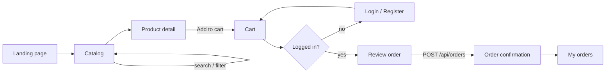
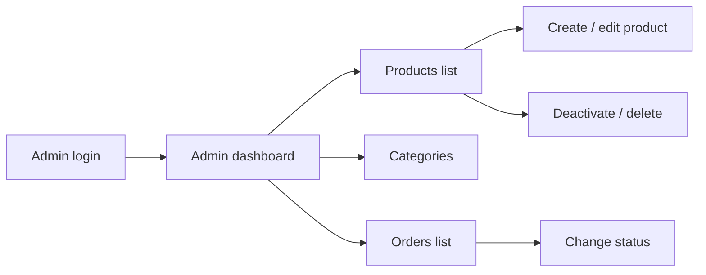

# System Requirements — IT Peripheral Store

Status: Draft v1 (M1-001) · Owner: team · Last updated: 2026-11-14

## 0. Sources and labels

The assignment PDFs were **not available** in the local workspace. Requirements below come from the M1-001 task brief. When the PDFs are found, re-check every `REQ-*` row against them (see handoff `M1-001.md`).

Every requirement has one label:

| Label | Meaning |
|---|---|
| **[A]** Required by assignment | Comes from Project A or Project B. Must not be removed or weakened. |
| **[E]** Engineering recommendation | Our decision for security, quality or maintainability. Can be changed with an ADR. |
| **[F]** Future enhancement | Out of scope for the course submission. |

Payment processing is **not** a requirement. Checkout creates an order with status `pending`; no card data is collected (see BR-07).

## 1. Functional requirements

### 1.1 Project A — Startup landing page

| ID | Requirement | Label | Implemented by |
|---|---|---|---|
| REQ-A01 | Responsive frontend built with Bootstrap | [A] | `apps/web`, Bootstrap 5 grid |
| REQ-A02 | Navbar | [A] | `<SiteNavbar>` on every page |
| REQ-A03 | Hero section | [A] | Home page `<Hero>` |
| REQ-A04 | Features section with at least 3 features | [A] | Home page `<Features>` (static content) |
| REQ-A05 | Separate About Team page | [A] | Route `/about` |
| REQ-A06 | Social links | [A] | Footer `<SocialLinks>` |
| REQ-A07 | At least one additional section | [A] | Home page "Featured products" (live from API) + "Contact/FAQ" |
| REQ-A08 | Resume link for each team member | [A] | `/about`, data in `apps/web/src/content/team.ts` |

Team members and resume links (from the brief; no roles or other personal data are added):

| Name | Resume |
|---|---|
| Sirapat Chuaysong | https://nussirapat.github.io/My_Resume/ |
| CHONTIDAPORN BOONBANJOB | https://slowlifejg-star.github.io/Punch_Resume/ |
| NATTAWU TSAEDIAW | https://nussirapat.github.io/Resume_Nattawut/ |
| THAKSIN SAARDAIAM | https://jamethaksin.github.io/resume/ |

> Team content is static marketing content and may live in the frontend. **Products may not** (REQ-B10).

### 1.2 Project B — Online store

| ID | Requirement | Label | Implemented by |
|---|---|---|---|
| REQ-B01 | Online store for IT peripherals | [A] | Whole system |
| REQ-B02 | At least 30 products stored in MongoDB | [A] | `database/seed` inserts ≥ 30 products; CI check counts them |
| REQ-B03 | Product details: name, description, images, price, category | [A] | `products` collection, `GET /api/products/:slug` |
| REQ-B04 | Product search **or** category filtering | [A] | Both: `?q=` text search and `?category=` filter |
| REQ-B05 | Customer and Admin roles | [A] | `users.role ∈ {customer, admin}` |
| REQ-B06 | Admin authentication | [A] | Session login; admin routes require `role=admin` |
| REQ-B07 | Admin product CRUD | [A] | `/api/admin/products` |
| REQ-B08 | Shopping cart or purchase | [A] | Client cart + `POST /api/orders` checkout |
| REQ-B09 | Orders persisted in MongoDB | [A] | `orders` collection |
| REQ-B10 | Products never hardcoded in frontend | [A]/[E] | Frontend reads products only from the API |
| REQ-B11 | Responsive UI | [A] | Bootstrap breakpoints, tested at 375 px and 1440 px |
| REQ-B12 | Database architecture documentation | [A] | `docs/architecture/DATABASE_DESIGN.md` |

### 1.3 Engineering and future

| ID | Requirement | Label |
|---|---|---|
| REQ-E01 | Customer self-registration and login | [E] |
| REQ-E02 | Customer views own order history | [E] |
| REQ-E03 | Admin manages categories | [E] |
| REQ-E04 | Admin views all orders and changes status | [E] |
| REQ-E05 | Admin deactivates (soft-deletes) products instead of hard delete when ordered before | [E] |
| REQ-E06 | Stock shown on product page; out-of-stock cannot be ordered | [E] |
| REQ-E07 | Pagination on product and order lists | [E] |
| REQ-E08 | Audit log of admin actions | [E] |
| REQ-F01 | Real payment gateway | [F] |
| REQ-F02 | Server-side persistent cart across devices | [F] |
| REQ-F03 | Product reviews and ratings | [F] |
| REQ-F04 | Email notifications, password reset by email | [F] |
| REQ-F05 | Image upload to object storage (initially image URLs) | [F] |
| REQ-F06 | Analytics dashboard / aggregation reports ("big data" extension) | [F] |

## 2. Non-functional requirements

| ID | Requirement | Label |
|---|---|---|
| NFR-01 | Works on mobile (≥ 360 px) and desktop; no horizontal scroll | [A] |
| NFR-02 | All secrets in environment variables; none in git | [E] |
| NFR-03 | Browser never connects to MongoDB or sees its connection string | [E] |
| NFR-04 | Passwords hashed (Argon2id or bcrypt cost ≥ 12) | [E] |
| NFR-05 | Product list API p95 < 300 ms locally with 30–1,000 products | [E] |
| NFR-06 | All input validated server-side with shared Zod schemas | [E] |
| NFR-07 | Unit + integration tests in CI; E2E for checkout and admin CRUD | [E] |
| NFR-08 | WCAG 2.1 AA basics: alt text, labels, keyboard nav, contrast | [E] |
| NFR-09 | Runs locally with one command after `.env` setup | [E] |
| NFR-10 | Structured JSON logs without secrets or passwords | [E] |

## 3. Roles and permissions

| Capability | Guest | Customer | Admin |
|---|:-:|:-:|:-:|
| View landing, about, products, categories | ✓ | ✓ | ✓ |
| Search / filter products | ✓ | ✓ | ✓ |
| Keep a cart (browser) | ✓ | ✓ | ✓ |
| Register / log in | ✓ | – | – |
| Place order | – | ✓ | ✓¹ |
| View own orders | – | ✓ | ✓ |
| Product / category CRUD | – | – | ✓ |
| View all orders, change status | – | – | ✓ |
| Manage users' roles | – | – | ✓² |

¹ Allowed but not needed. ² Admins are created by seed script or CLI only; there is no public "make admin" endpoint. Role changes via API are [F].

## 4. Customer journey

1. Guest browses landing page and catalog (products loaded from API).
2. Adds items to cart; cart is stored in `localStorage` as `{productId, quantity}` only — **never prices**.
3. At checkout the customer must log in.
4. Client sends items and shipping address. Server re-reads products, checks stock, computes totals, decrements stock and saves the order.
5. Customer sees confirmation with the server-computed total, and the order in "My orders".

## 5. Admin workflow

Admin logs in through the same `/login` page; the UI shows admin navigation only when `role=admin`, and every admin API checks the role on the server.

## 6. Business rules — orders and inventory

| ID | Rule |
|---|---|
| BR-01 | All money is stored as **integer satang** (THB × 100). No floats. Currency fixed to `THB` in v1. |
| BR-02 | The server computes `unitPrice`, `lineTotal`, `subtotal`, `shippingFee`, `total`. Any price sent by the client is ignored (and rejected by schema). |
| BR-03 | Order lines store a **snapshot** of product name, SKU, image and unit price at purchase time. Later product edits do not change past orders. |
| BR-04 | Quantity per line: integer 1–10. Max 20 lines per order. Duplicate product lines are merged. |
| BR-05 | Stock is decremented atomically with `stock >= qty` as a condition; stock can never go negative. If any line fails, the whole order fails and no stock changes (transaction). |
| BR-06 | Only `isActive: true` products can be ordered. |
| BR-07 | No payment is captured. New orders start as `pending`. Admin moves them through `pending → confirmed → shipped → delivered`; `pending|confirmed → cancelled`. |
| BR-08 | Cancelling an order restores its stock in the same transaction. |
| BR-09 | Shipping fee: flat rate from config (`SHIPPING_FEE_SATANG`, default 5000 = ฿50), free when subtotal ≥ `FREE_SHIPPING_THRESHOLD_SATANG`. Values are assumptions, adjustable. |
| BR-10 | A product that appears in any order cannot be hard-deleted; it is deactivated instead. |
| BR-11 | Customers can only read their own orders; admins can read all. |
| BR-12 | Order numbers are human-readable (`ORD-YYYYMMDD-XXXXXX`) and unique. |
