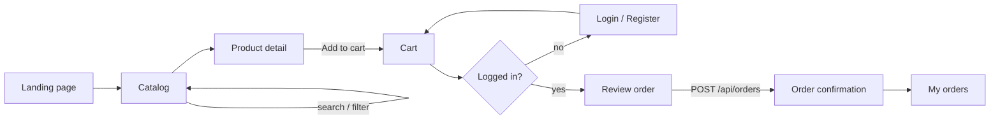
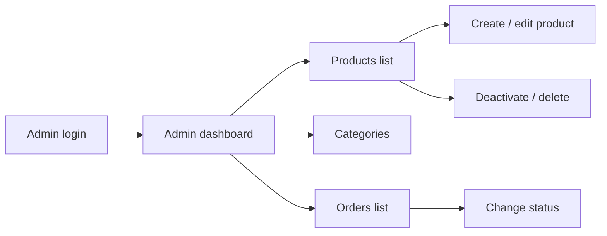

# System Requirements — IT Peripheral Store

Status: Draft v5 (M1-009, remediates Codex M1-002, M1-004, M1-006 and M1-008 audits) · Owner: team · Last updated: 2026-11-15

## 0. Sources and labels

The assignment PDFs were **not available** in the local workspace. Requirements below come from the M1-001 task brief. When the PDFs are found, re-check every `REQ-*` row against them (see handoff `M1-001.md`).

Every requirement has one label:

| Label | Meaning |
|---|---|
| **[A]** Required by assignment | Comes from Project A or Project B. Must not be removed or weakened. |
| **[E]** Engineering recommendation | Our decision for security, quality or maintainability. Can be changed with an ADR. |
| **[F]** Future enhancement | Out of scope for the course submission. |

Payment processing is **not** a requirement. Checkout creates an order with status `pending`; no card data is collected (see BR-07).

## 1. Functional requirements

### 1.1 Project A — Startup landing page

| ID | Requirement | Label | Implemented by |
|---|---|---|---|
| REQ-A01 | Responsive frontend built with Bootstrap | [A] | `apps/web`, Bootstrap 5 grid |
| REQ-A02 | Navbar | [A] | `<SiteNavbar>` on every page |
| REQ-A03 | Hero section | [A] | Home page `<Hero>` |
| REQ-A04 | Features section with at least 3 features | [A] | Home page `<Features>` (static content) |
| REQ-A05 | Separate About Team page | [A] | Route `/about` |
| REQ-A06 | Social links | [A] | Footer `<SocialLinks>` |
| REQ-A07 | At least one additional section | [A] | Home page "Featured products" (live from API) + "Contact/FAQ" |
| REQ-A08 | Resume link for each team member | [A] | `/about`, data in `apps/web/src/content/team.ts` |

Team members and resume links (from the brief; no roles or other personal data are added):

| Name | Resume |
|---|---|
| Sirapat Chuaysong | https://nussirapat.github.io/My_Resume/ |
| CHONTIDAPORN BOONBANJOB | https://slowlifejg-star.github.io/Punch_Resume/ |
| NATTAWU TSAEDIAW | https://nussirapat.github.io/Resume_Nattawut/ |
| THAKSIN SAARDAIAM | https://jamethaksin.github.io/resume/ |

> Team content is static marketing content and may live in the frontend. **Products may not** (REQ-B10).

### 1.2 Project B — Online store

| ID | Requirement | Label | Implemented by |
|---|---|---|---|
| REQ-B01 | Online store for IT peripherals | [A] | Whole system |
| REQ-B02 | At least 30 products stored in MongoDB | [A] | `database/seed` inserts ≥ 30 products; CI check counts them |
| REQ-B03 | Product details: name, description, images, price, category | [A] | `products` collection, `GET /api/products/:slug` |
| REQ-B04 | Product search **or** category filtering | [A] | Both: `?q=` text search and `?category=` filter |
| REQ-B05 | Customer and Admin roles | [A] | `users.role ∈ {customer, admin}` |
| REQ-B06 | Admin authentication | [A] | Session login; admin routes require `role=admin` |
| REQ-B07 | Admin product CRUD | [A] | `/api/admin/products` |
| REQ-B08 | Shopping cart or purchase | [A] | Client cart + `POST /api/orders` checkout |
| REQ-B09 | Orders persisted in MongoDB | [A] | `orders` collection |
| REQ-B10 | Products never hardcoded in frontend | [A]/[E] | Frontend reads products only from the API |
| REQ-B11 | Responsive UI | [A] | Bootstrap breakpoints; acceptance AC-F07 (360–1440 px) |
| REQ-B12 | Database architecture documentation | [A] | `docs/architecture/DATABASE_DESIGN.md` |

### 1.3 Engineering and future

| ID | Requirement | Label |
|---|---|---|
| REQ-E01 | Customer self-registration and login | [E] |
| REQ-E02 | Customer views own order history | [E] |
| REQ-E03 | Admin manages categories | [E] |
| REQ-E04 | Admin views all orders and changes status | [E] |
| REQ-E05 | Admin "delete" of products and categories always deactivates (soft delete); no hard delete through the API (ADR-002 D5) | [E] |
| REQ-E06 | Stock shown on product page; out-of-stock cannot be ordered | [E] |
| REQ-E07 | Pagination on product and order lists | [E] |
| REQ-E08 | Audit log of admin actions | [E] |
| REQ-F01 | Real payment gateway | [F] |
| REQ-F02 | Server-side persistent cart across devices | [F] |
| REQ-F03 | Product reviews and ratings | [F] |
| REQ-F04 | Email notifications, password reset by email | [F] |
| REQ-F05 | Image upload to object storage (initially image URLs) | [F] |
| REQ-F06 | Analytics dashboard / aggregation reports ("big data" extension) | [F] |
| REQ-F07 | Nested category hierarchy (v1 categories are flat) | [F] |

## 2. Non-functional requirements

| ID | Requirement | Label |
|---|---|---|
| NFR-01 | Works from 360 px to desktop with no horizontal scroll; verified at 360, 375, 576, 768, 992, 1200, 1440 px (AC-F07) | [A] |
| NFR-02 | All secrets in environment variables; none in git | [E] |
| NFR-03 | Browser never connects to MongoDB or sees its connection string | [E] |
| NFR-04 | Passwords hashed (Argon2id or bcrypt cost ≥ 12) | [E] |
| NFR-05 | Product list API p95 < 300 ms locally with 30–1,000 products | [E] |
| NFR-06 | All input validated server-side with shared **strict** Zod schemas; unknown fields rejected, never stripped (ADR-002 D3) | [E] |
| NFR-07 | Unit + integration tests in CI; E2E for checkout and admin CRUD | [E] |
| NFR-08 | WCAG 2.1 AA basics: alt text, labels, keyboard nav, contrast | [E] |
| NFR-09 | Reproducible local setup on Windows/macOS/Linux per DEPLOYMENT_DESIGN §2; one `npm run dev` after setup | [E] |
| NFR-10 | Structured JSON logs without secrets or passwords | [E] |

## 3. Roles and permissions

| Capability | Guest | Customer | Admin |
|---|:-:|:-:|:-:|
| View landing, about, products, categories | ✓ | ✓ | ✓ |
| Search / filter products | ✓ | ✓ | ✓ |
| Keep a cart (browser) | ✓ | ✓ | ✓ |
| Register / log in | ✓ | – | – |
| Place order | – | ✓ | ✓¹ |
| View own orders | – | ✓ | ✓ |
| Product / category CRUD | – | – | ✓ |
| View all orders, change status | – | – | ✓ |
| Manage users' roles | – | – | ✓² |

¹ Allowed but not needed. ² Admins are created by seed script or CLI only; there is no public "make admin" endpoint. Role changes via API are [F].

## 4. Customer journey

1. Guest browses landing page and catalog (products loaded from API).
2. Adds items to cart; cart is stored in `localStorage` as `{productId, quantity}` only — **never prices**.
3. At checkout the customer must log in.
4. Client sends items and shipping address. Server re-reads products, checks stock, computes totals, decrements stock and saves the order.
5. Customer sees confirmation with the server-computed total, and the order in "My orders".

## 5. Admin workflow

Admin logs in through the same `/login` page; the UI shows admin navigation only when `role=admin`, and every admin API checks the role on the server.

## 6. Business rules — orders and inventory

| ID | Rule |
|---|---|
| BR-01 | All money is stored as **integer satang** (THB × 100), BSON `int`, within the bounds of DATABASE_DESIGN §1.1. No floats. Currency fixed to `THB` in v1. |
| BR-02 | The server computes `unitPrice`, `lineTotal`, `subtotal`, `shippingFee`, `total`. Any price sent by the client is ignored (and rejected by schema). |
| BR-03 | Order lines store a **snapshot** of product name, SKU, image and unit price at purchase time. Later product edits do not change past orders. |
| BR-04 | Cart lines are **normalized first** (duplicate `productId` lines summed), **then validated**: merged quantity per product is an integer 1–10 and there are at most 20 distinct products. Violations return `400 VALIDATION_ERROR` with no stock change. Quote and checkout use the same rule. |
| BR-05 | Stock is decremented atomically with `stock >= qty` as a condition; stock can never go negative. If any line fails, the whole order fails and no stock changes (transaction). |
| BR-06 | Only `isActive: true` products can be ordered. |
| BR-07 | No payment is captured. New orders start as `pending`. Admin moves them through `pending → confirmed → shipped → delivered`; admin may cancel from `pending` or `confirmed`; customer may cancel own order only from `pending`. Each transition is a conditional write on the current status (ADR-002 D6). |
| BR-08 | Cancelling an order restores its stock in the same transaction, and **only** the transaction that actually changed the status restores stock, so stock is restored at most once. Restoration is not limited by the admin stock cap. Only the int32 hard stock limit can block it, and then the cancellation fails atomically (`409 INVENTORY_LIMIT`, order and stock unchanged, no unit discarded) until an admin lowers stock (DATABASE_DESIGN §7.4). |
| BR-09 | Shipping fee: flat rate from config (`SHIPPING_FEE_SATANG`, default 5000 = ฿50), free when subtotal ≥ `FREE_SHIPPING_THRESHOLD_SATANG`. Values are assumptions, adjustable. |
| BR-10 | Products are never hard-deleted through the API; delete = deactivate. Orders therefore never reference a missing product. |
| BR-11 | `/api/orders/*` returns only the caller's own orders (admins included); all-order access is only via `/api/admin/orders/*`. |
| BR-12 | Order numbers are human-readable (`ORD-YYYYMMDD-XXXXXX`) and unique. |
| BR-13 | Every stock mutation increments the product's `inventoryRevision`. Admin stock changes are relative (`stockAdjust`) or absolute with the observed revision (`stockSet` + `expectedRevision`); an absolute correction made after **any** intervening stock change is rejected with `409 STOCK_CONFLICT`, even if the stock number happens to match. Admins cannot raise stock above 1,000,000. |
| BR-14 | Each checkout carries a client idempotency key (UUID v7). For 24 h after the commit, the same key with the same payload returns the original order, and a different payload is rejected (`422`). A key can create an order only within 24 h of its issue time and never more than once. After its replay window, it returns `409 IDEMPOTENCY_KEY_EXPIRED` with the original order number (or `422` if none exists) and **never** creates a new order. A client with an unresolved checkout older than 23 h must reconcile via its order list and ask the user before placing a new order. Stock is decremented at most once per accepted order. If the commit outcome is uncertain, the server never reports a definitive failure: it reconciles by re-reading the key record, and if the outcome is still unknown it returns `503 CHECKOUT_RETRY` ("outcome unknown"). Retrying with the same key is safe. A business error is returned only when the attempt is known not to have committed (DATABASE_DESIGN §7.2). |
| BR-15 | Order total ≤ 1,000,000,000 satang (฿10 M); larger orders are rejected with `422 ORDER_LIMIT_EXCEEDED`. |
| BR-16 | Every active product belongs to an active category. A category can be deactivated only via DELETE and only when it has no active products; category PATCH cannot change `isActive`. Inactive products may reference inactive categories but cannot be reactivated until their category is active. A product update that changes category and activation together is applied as one atomic transition from the stored before-state (DATABASE_DESIGN §7.5). |
| BR-17 | Seeding is insert-only and repeatable: rerunning it never changes existing products (stock, `inventoryRevision`, category, activation), categories (activation, counters) or users. `inventoryRevision` is a 64-bit counter that is never reset. |

## 7. Acceptance criteria for audit findings (M1-002, M1-004)

Each criterion is an automated test unless marked *manual*. Test level: **I** = integration (Supertest + replica-set MongoDB), **E** = E2E (Playwright).

| AC | Finding | Criterion | Level |
|---|---|---|---|
| AC-F01a | F01, N02 | Admin reads (stock 10, rev r) → checkout buys 3 (7, r+1) → `stockAdjust +3` (10, r+2) → admin sends `stockSet: 15, expectedRevision: r`. Result `409 STOCK_CONFLICT` with `currentRevision: r+2`, although stock equals 10 again; stock stays 10. | I |
| AC-F01d | F01, N02 | Every stock-changing operation (checkout, cancellation, `stockAdjust` ±, `stockSet`) increases `inventoryRevision` by exactly 1 per affected product; non-stock edits (price, name) leave it unchanged. | I |
| AC-F01b | F01 | Stock 7; concurrently checkout buys 2 and admin sends `stockAdjust: +5`. Final stock = 10 (both changes kept), revision +2. | I |
| AC-F01c | F01 | `stockAdjust: -20` on stock 7 → `409`; `stockAdjust` taking stock above 1,000,000 → `409`; stock and revision unchanged. PATCH with plain `stock`, or `stockSet` without `expectedRevision` → `400 VALIDATION_ERROR`. | I |
| AC-F02a | F02 | 5 parallel identical checkouts with one key → exactly one order exists, stock decremented once; all 5 responses carry the same `orderNumber` (one `201`, the rest `200`). | I |
| AC-F02b | F02 | Same key, different items → `422 IDEMPOTENCY_KEY_REUSED`, no order, no stock change. | I |
| AC-F02c | F02, R1 | Same key after the record's `expiresAt` (clock advanced 25 h) → `409 IDEMPOTENCY_KEY_EXPIRED` with the original `orderNumber`; no new order, no stock change. (Replaces the earlier "new order after expiry" criterion.) | I |
| AC-F02d | F02, N03 | Forced duplicate-key path: request B's transaction is held until A commits, then B's insert raises `E11000` → B returns A's order (`200`, same fingerprint) or `422` (different fingerprint); one order, one decrement. Forced winner abort: A aborts (`OUT_OF_STOCK` injected after its key insert) → B completes with `201`. | I |
| AC-F02e | F02, N03 | Injected `E11000` on an unrelated index → `500`, no order. Conflict retry budget exhausted → `503 CHECKOUT_RETRY`, and a follow-up request with the same key succeeds exactly once. | I |
| AC-G01a | F02, G01 | Fault injection: commit really applied, driver reports `UnknownTransactionCommitResult`, and the key record is hidden from majority reads for 1 s → reconciliation finds it → `201` with that order; exactly one order. Hidden for longer than the 3 s window → `503 CHECKOUT_RETRY` (**not** a business error); a retry with the same key → `200` replay of the same order; stock decremented once. | I |
| AC-G01b | F02, G01 | Uncertain commit, then another customer buys the remaining stock before the client retries with the same key: the retry returns the original order (`200`), never `409 OUT_OF_STOCK`. Uncertain commit that really failed (injected abort after commit sent) → reconcile → `503`; retry with the same key → `201`, exactly one order. In no run does a client receive a definitive no-order result (`409`/`422`) for an order that committed. | I |
| AC-F03a | F03 | For every write endpoint, a top-level unknown field (e.g. `role`, `priceSatang`) → `400 VALIDATION_ERROR` with `details[].path`, and no DB write. | I |
| AC-F03b | F03 | Unknown nested field (e.g. `shippingAddress.isAdmin`, `items[0].unitPriceSatang`) and unknown query param (e.g. `?foo=1`) → `400 VALIDATION_ERROR`. | I |
| AC-F04 | F04 | `GET /api/orders/:n`: guest 401, owner 200, other customer 404, admin (not owner) 404. `GET /api/admin/orders/:n`: guest 401, customer 403, admin 200. | I |
| AC-F05 | F05 | Two lines of 6 for the same product → `400 VALIDATION_ERROR` (merged qty 12 > 10) on both `/cart/quote` and `/orders`; no stock change. Two lines of 4 → one merged line of 8. | I |
| AC-F06 | F06 | `DELETE /api/admin/products/:id`: active product (with or without orders) → `200 {isActive:false, deletedAt}`; repeat → same `200`; unknown id → `404`. The product document still exists. | I |
| AC-R01 | R01 | Parallel checkout and deactivation of the same product (20 runs): every run ends either with a committed order and an inactive product, or with `409 PRODUCT_UNAVAILABLE` and no order. No order ever references a missing product. | I |
| AC-R02a | R02, N05 | Pending order (2 units): parallel customer cancel + admin cancel → exactly one `200`, the other `409 INVALID_STATUS_TRANSITION`; stock restored exactly once (+2, revision +1); history `pending → cancelled`. | I |
| AC-R02b | R02, N05 | Pending order: parallel admin confirm + admin cancel (repeat 20×). Each run must match one serial ordering: (i) confirm then cancel → both `200`, history `pending → confirmed → cancelled`; or (ii) cancel then confirm → cancel `200`, confirm `409`, history `pending → cancelled`. In both, final status `cancelled` and stock restored exactly once. | I |
| AC-R02c | R02, N05 | Pending order: parallel customer cancel + admin confirm. Allowed: (i) cancel `200`, confirm `409`, stock restored once; or (ii) confirm `200`, customer cancel `409` (customers cancel only from `pending`), stock not restored. Never two restorations. | I |
| AC-R02d | R02, N04 | Stock 10 → order of 4 (stock 6) → admin `stockAdjust` up to the cap (1,000,000) → cancel the order → `200`, stock 1,000,004, no unit lost; a following admin `stockAdjust +1` → `409` (above cap), `stockAdjust -4` → `200`. | I |
| AC-R02e | R02, G04 | Isolated test DB: set a product's stock to 2,147,483,645 directly, cancel an order containing 4 units → `409 INVENTORY_LIMIT` with `details`; order status, `statusHistory`, stock and revision of **every** product in the order are unchanged. After `stockAdjust -4`, the same cancellation → `200`, stock restored exactly once. | I |
| AC-R1a | R1 | Checkout commits, but the client's response is lost (uncertain outcome) and the client stays offline. Advance the clock 25 h, so the key record has expired (TTL removed it, or it remains with `expiresAt` in the past; both cases tested). The client retries with the same key → `409 IDEMPOTENCY_KEY_EXPIRED` with the original `orderNumber`; order count for the user unchanged; stock unchanged. `GET /api/orders?idempotencyKey=<key>` returns that order. | I |
| AC-R1b | R1 | Replay boundary: same key and payload at commit + 23 h 59 m → `200` replay; at commit + 24 h 1 m → `409 IDEMPOTENCY_KEY_EXPIRED`. Neither creates an order. | I |
| AC-R1c | R1 | Uncertain outcome where the commit really failed; the client retries after 25 h with the same key → `422 IDEMPOTENCY_KEY_EXPIRED`, no order created. A key whose UUID v7 timestamp is 10 min in the future → `400`. | I |
| AC-R1d | R1 | Client: with a pending checkout older than 23 h, the web app doesn't resend. It calls `GET /api/orders?idempotencyKey=`; if an order exists it shows the confirmation, otherwise it shows the review message, and a new order needs a user click and uses a new key. | E |
| AC-R1e | R1 | Two concurrent requests with the same expired key (record removed, order exists): both return `409 IDEMPOTENCY_KEY_EXPIRED`; the unique `orders {userId, idempotencyKey}` index prevents any second order. | I |
| AC-R2a | R2 | Create an active product in an active category → `201`, category `activeProductCount` +1, `inventoryRevision` `"0"`. Create an inactive product in an inactive category → `201`, no counter change. Create into a non-existent category (active or inactive product) → `409 CATEGORY_UNAVAILABLE` and no product document exists. Create an active product in an inactive category → `409`, no document. | I |
| AC-R2b | R2 | 10 concurrent creates with the same SKU (active) → exactly one `201`, nine `409 SKU_TAKEN`; one document; counter +1 exactly once. Same with an existing SKU via seed → skipped, product and counter unchanged. | I |
| AC-R2c | R2 | Race an active product create against `DELETE` of its category (20×): either (product created, DELETE `409 CATEGORY_HAS_ACTIVE_PRODUCTS`) or (category inactive, create `409 CATEGORY_UNAVAILABLE`, no product document). Race an inactive create against the DELETE: both may succeed. `db:verify` clean after every run. | I |
| AC-G04 | G04, N02 | Isolated test DB: `inventoryRevision` stored as BSON `long` (`$type: "long"`) after create, checkout, cancel, adjust and set. Set the revision to 2,147,483,647 (int32 max): checkout and cancellation succeed and the revision becomes 2,147,483,648 (still `long`). The API returns it as the string `"2147483648"`, and `stockSet` with that string succeeds. The seed never resets it (AC-G02a). | I |
| AC-R03 | R03 | Boundary writes through Mongoose: `priceSatang` 1 and 10,000,000 accepted, 0 / 10,000,001 / 1.5 rejected; stored BSON type is `int` (`$type: "int"`). Order exceeding total cap → `422 ORDER_LIMIT_EXCEEDED`. | I |
| AC-R04 | R04 | Flow: `GET /auth/csrf` → `POST /auth/login` with token → response has new `csrfToken` → write with old token `403 CSRF_INVALID`, with new token succeeds → logout → write with that token `403`. Login without token → `403`. | I |
| AC-R05a | R05, N06 | Category with 0 active products. Race `DELETE /admin/categories/:id` (repeat 20× each) against each of: create active product in it, reactivate an inactive product in it, move an active product into it. Exactly one of each pair succeeds (`409 CATEGORY_HAS_ACTIVE_PRODUCTS` or `409 CATEGORY_UNAVAILABLE`), and `db:verify` reports no drift and no active product in an inactive category. | I |
| AC-R05c | R05, N06 | `PATCH /admin/categories/:id` with `isActive: false` (or `true`) → `400 VALIDATION_ERROR`, no change. `POST /reactivate` on an inactive category → `200`; its products remain inactive; reactivating one of them then succeeds. Creating an inactive product in an inactive category → `201`; reactivating it while the category is inactive → `409 CATEGORY_UNAVAILABLE`. | I |
| AC-R05b | R05 | Renaming a category slug requires no product update, and `?category=<newSlug>` returns its products. | I |
| AC-G03a | R05, G03 | Single PATCH requests with both `categoryId` and `isActive`, one per row of the DATABASE_DESIGN §7.5 transition table (inactive→active moved, active→inactive moved, active→active moved, same-category variants). After each: counts match the table and `db:verify` is clean. Moving and activating into an inactive category → `409 CATEGORY_UNAVAILABLE`, no change. | I |
| AC-G03b | R05, G03 | Race `PATCH {categoryId: B, isActive: true}` on an inactive product against `DELETE /admin/categories/B` (20×): each run ends with either the product active in B and B active (DELETE `409`), or B inactive and the product unchanged (PATCH `409`). Race two PATCHes on the same product: the result equals one serial order, and counts are exact. | I |
| AC-G02a | F01, N02, G02 | Run seed → perform checkout, cancellation, `stockAdjust`, `stockSet`, a product move, a deactivation and a category deactivation → snapshot every product (stock, `inventoryRevision`, `categoryId`, `isActive`), every category (`isActive`, `activeProductCount`) and the admin user → rerun seed → snapshots identical, `db:verify` clean. A `stockSet` with a revision read before the rerun still behaves exactly as without the rerun. | I |
| AC-G02b | G02, R05 | Run seed against an empty DB while concurrently creating, moving and activating products through the API, and run two seeds in parallel → exactly one copy of each seed product, `db:verify` clean. `db:reset` refuses when `NODE_ENV=production` or the DB name lacks `_dev`/`_test`. | I |
| AC-R06a | R06 | On a clean Windows 11 machine, following DEPLOYMENT_DESIGN §2 from a fresh clone: `npm run db:up` returns only after the healthcheck reports a writable primary; migrations and seed succeed; the app starts; `npm run test:integration` passes its transaction smoke test. | manual + I |
| AC-N01 | N01, R06 | `docker compose port mongo 27017` prints `127.0.0.1:27017`; a connection attempt to port 27017 from another machine on the same network fails, while the local smoke test passes. | manual |
| AC-R06b | R06 | Staging smoke test over HTTPS on the chosen same-origin topology: login, add to cart, checkout, logout. | E |
| AC-F07 | F07 | Landing, About, catalog, product, cart, checkout and admin product list at 360, 375, 576, 768, 992, 1200 and 1440 px: `document.documentElement.scrollWidth <= window.innerWidth`, the navbar is usable, and no content is clipped. | E |
